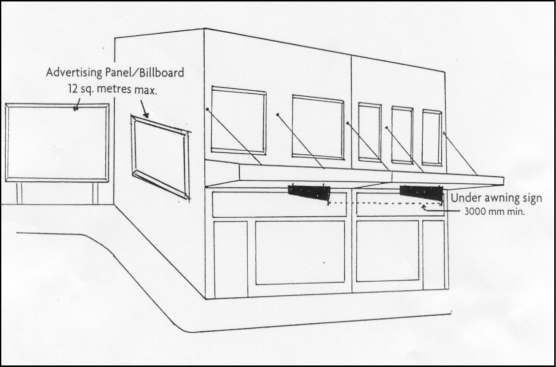
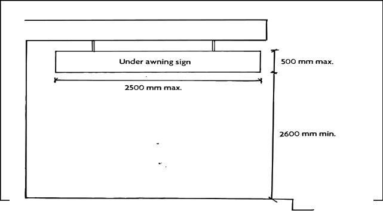
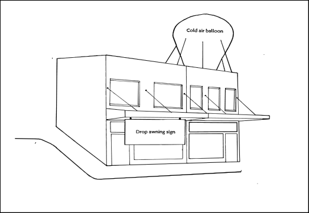
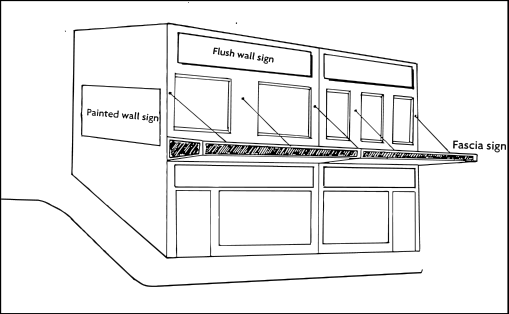
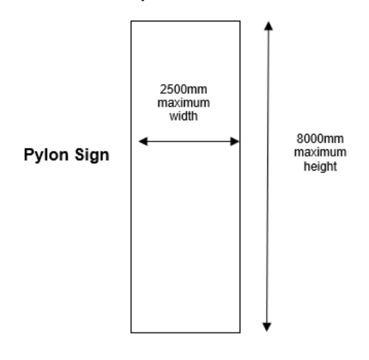
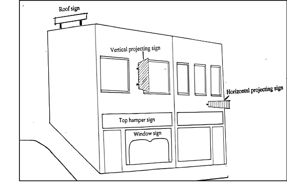
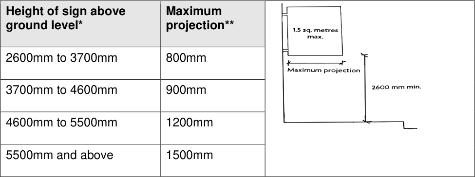
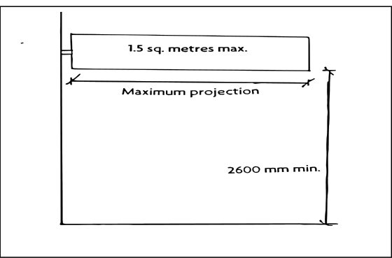

### 1.0 Types of Signs and Specifications

'A' frame signs: These signs are usually small mobile signs used to advertise businesses. They must not be placed on or near public land, especially footpaths.

Advertising panel/billboard:

This is a non-illuminated structure, such as a bulletin board or a sign, which advertises products sold on the premises.  Must comply with the following:

(a) maximum size 12 square metres

(b) only one per building facade

(c) does not extend above or laterally from the wall it is attached to

### Appendix C – Advice for Designing Advertising Signs

(d) does not cover any windows or architectural features.

> [Picture on page 4: a picture, saved as a picture (images/appendix-c-advice-for-designing-advertising-signs-page-4-1.gif, 150 dpi).]

Awning sign: Attached to the underside of awning (other than the fascia or return end).  Above awning signs are prohibited in Fairfield City.

Under awning signs however must:

(a) be not more than 2500mm in length and 500mm in depth

(b) be at least 2600mm above the ground

(c) not project beyond the awning

(d) be securely fixed by metal supports

(e) not be closer than 3000mm to any other under awning sign.

> [Picture on page 4: a picture, saved as a picture (images/appendix-c-advice-for-designing-advertising-signs-page-4-10.gif, 150 dpi).]

### Appendix C – Advice for Designing Advertising Signs

Cold air balloons: These are signs made of materials that enable them to be inflated by means of cold air. Consent is required for the erection of these signs and this will usually have a time limit attached to it.

Drop awning sign: Sign displayed on a roll down shade blind attached to the underside of an awning. (See diagram below)

> [Picture on page 5: a picture, saved as a picture (images/appendix-c-advice-for-designing-advertising-signs-page-5-1.gif, 150 dpi).]

Fascia sign: Attached to the fascia or return end of an awning. Fascia signs will not:

(a) project above or below the fascia or return end  on which it is attached.

(b) extend out more than 300mm out from the fascia or return end of the

> [Picture on page 5: a picture, saved as a picture (images/appendix-c-advice-for-designing-advertising-signs-page-5-5.gif, 150 dpi).]

awning.

Fin sign: Erected above or on the canopy of the building. Fin signs are prohibited in Fairfield City.

### Appendix C – Advice for Designing Advertising Signs

Flashing sign: Illuminated at frequent intervals by an internal source of artificial light. This sign could be included in other types of signs, for example a flashing under awning sign. These will only be considered in the Cabramatta Town Centre, however, consideration must be given to any detrimental effects they could have on surrounding residents, business or traffic.

Floodlit sign: Any part of the advertisement may be illuminated by an external source of artificial light.

Floodlit signs will comply with the following:

(a) maximum size is 12 square metres

(b) only one per building facade

(c) must not extend beyond or above the wall it is attached to

(d) not to cover any windows or architectural features.

Flush wall sign: Attached to the wall of a building, including painted wall other than above the doorway or display window.

Flush wall signs will:

(a) not project more than 300mm from the wall to which they are attached

(b) not cover more than 20% of the area of the wall and only one per building facade for each company of the premises

(c) not project above or beyond the wall to which they are attached.

Mobile advertising: These are signs that are attached to trucks or trailers that are usually parked beside major roads. These signs are not permitted in Fairfield City.

Moving sign: Signs that have moving parts with power supplied from an outside source, for example, a moving flush wall sign. These signs will only be considered in the Cabramatta Town Centre.

Painted wall sign:  Advertisement painted directly onto the facade of a building. Painted wall signs will not cover more than 20% of the area of the wall and only one per building facade for each separate business occupying the premises.

Pole sign: Signs that are erected on a pole independent of any other building or structure.

These must comply with the following:

(a) maximum height of 8000mm

(b) minimum height above ground level must be at least 2600mm

(c) maximum sign area of 4.5 square metres

(d) pole signs along the same street should have the same setback and spacing where possible

(e) pole signs should not obscure traffic signals or distract drivers in an unsafe way.

### Appendix C – Advice for Designing Advertising Signs

> [Picture on page 7: a picture, saved as a picture (images/appendix-c-advice-for-designing-advertising-signs-page-7-1.gif, 150 dpi).]

Pylon sign: Signs that are erected on a pylon independent of any other building or structure.

These must comply with the following:

(a) maximum height of 8000mm

(b) maximum width of 2500mm

(c) pylon signs along the same street should have the same setback and spacing where possible

(d) pylon signs should not obscure traffic signals or distract drivers in an unsafe way.

Roof sign: Erected on or above the roof of a building. These signs are not permitted in Fairfield City. (See diagram below)

> [Picture on page 7: a picture, saved as a picture (images/appendix-c-advice-for-designing-advertising-signs-page-7-13.gif, 150 dpi).]

### Appendix C – Advice for Designing Advertising Signs

#### Projecting wall sign:

Vertical:

Attached to the wall of a building, projecting more than 300mm. A vertical projecting wall sign is one where the height of the sign is larger than its width.

The vertical wall sign will:

(a)       only be permitted where there is no awning

(b) not project above the wall to which it is attached

(c) be at least 2600mm above ground

(d) not have an area of more than 1.5 square metres

(e) be securely fixed to the building.

The maximum height of the sign will be determined as follows:

> [Picture on page 8: a picture, saved as a picture (images/appendix-c-advice-for-designing-advertising-signs-page-8-12.gif, 150 dpi).]

| Height of sign above | Maximum |
|---|---|
| ground level* | projection** |
| 2600mm to 3700mm | 800mm |
| 3700mm to 4600mm | 900mm |
| 4600mm to 5500mm | 1200mm |
| 5500mm and above | 1500mm |

\* Measured to the underside of the sign

\** Measured vertically from the supporting wall to the outside face of the sign

#### Projecting wall sign

Horizontal:

### Appendix C – Advice for Designing Advertising Signs

Attached to the wall of a building, projecting more than 300mm. A horizontal projecting wall sign is one where the height of the sign is less than its width.

The horizontal wall sign will only be permitted where there is no awning:

(a) not project above the wall to which it is attached project beyond the point within 600mm of the kerb line

(b) be at least 2600mm above ground

(c) not have an area of more than 1.5 square metres

(d) be securely fixed to the building

The maximum height of the sign will be determined as follows:

| Height of sign above ground level* | Maximum height** |
|---|---|
| 2600mm to 3700mm | 500mm |
| 3700mm to 6100mm | 1200mm |
| 6100mmm and above | 1500mm |

\*  Measured to the underside of the sign

\** Measured vertically from the underside of the sign to the top side of the sign

#### Horizontal Projecting Wall Sign

> [Picture on page 9: a picture, saved as a picture (images/appendix-c-advice-for-designing-advertising-signs-page-9-7.gif, 150 dpi).]

Top hamper sign: Attached above a doorway or a display window. These signs will not extend beyond any building line or below the level of the door and/or window above which it is attached.

### Appendix C – Advice for Designing Advertising Signs

Window sign: Any advertisement located or displayed on or in the window of a building. This sign should not cover more than 25% of the window area.
