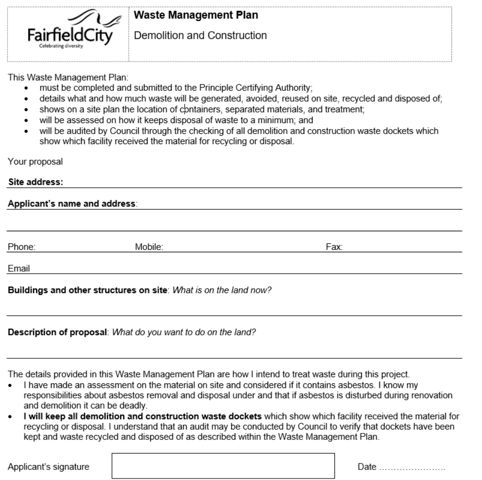
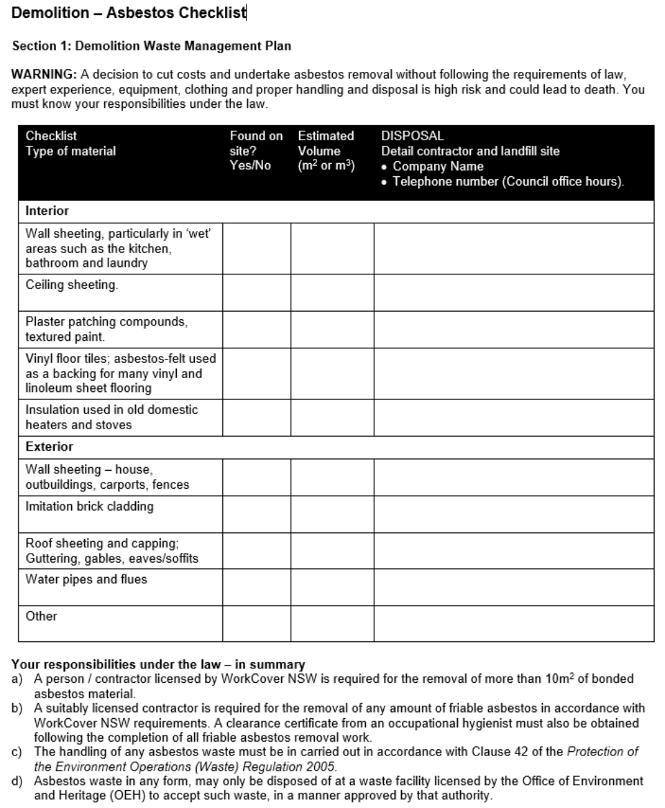
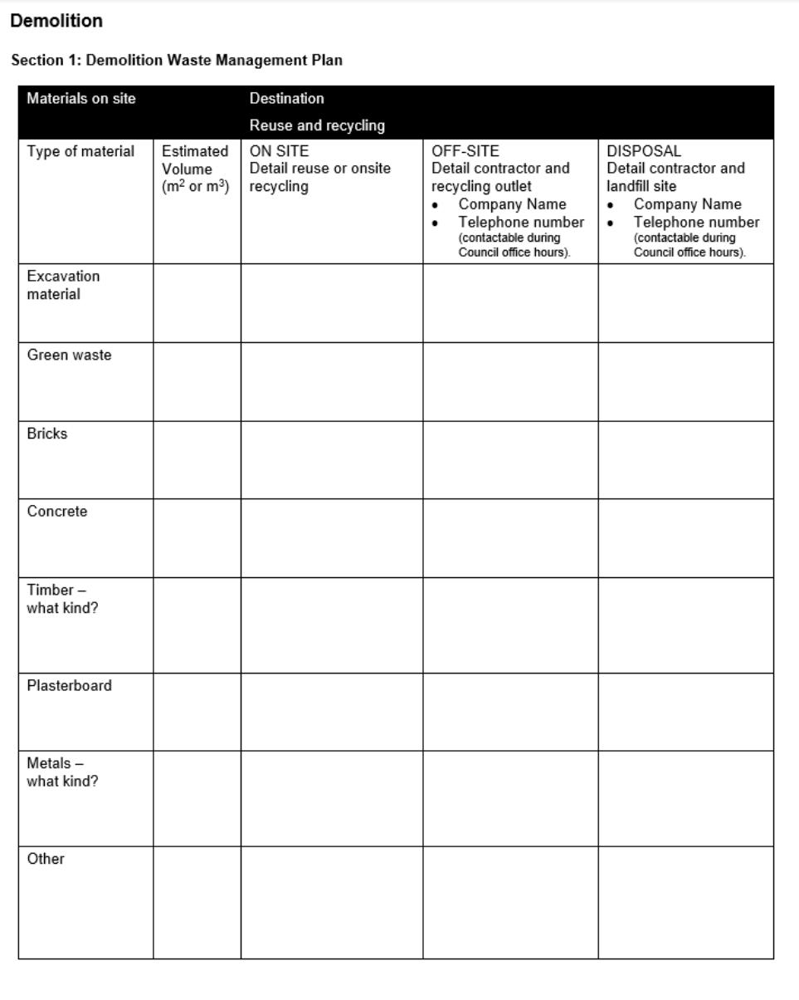
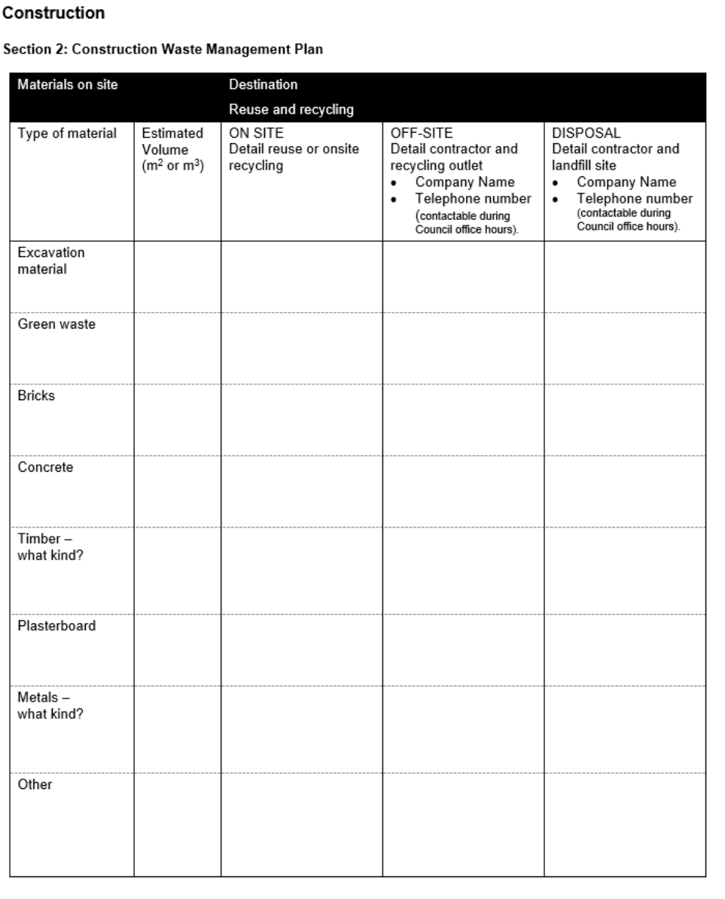
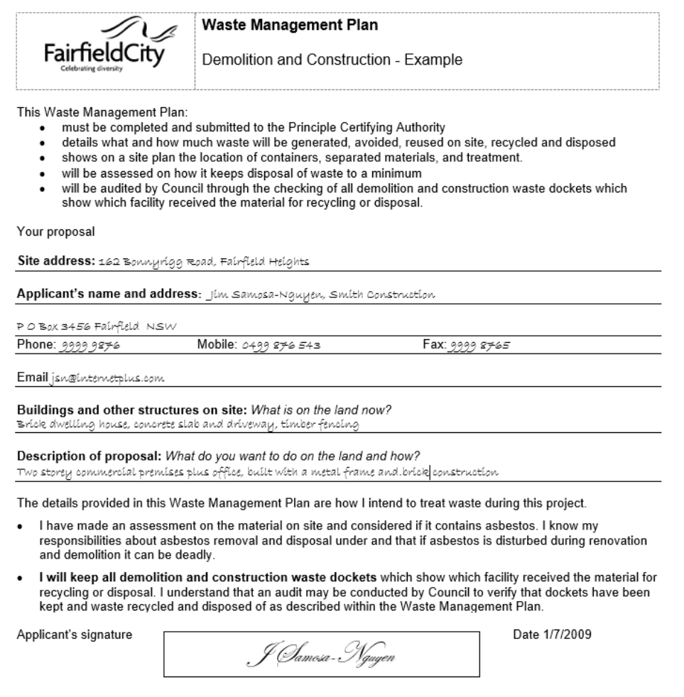
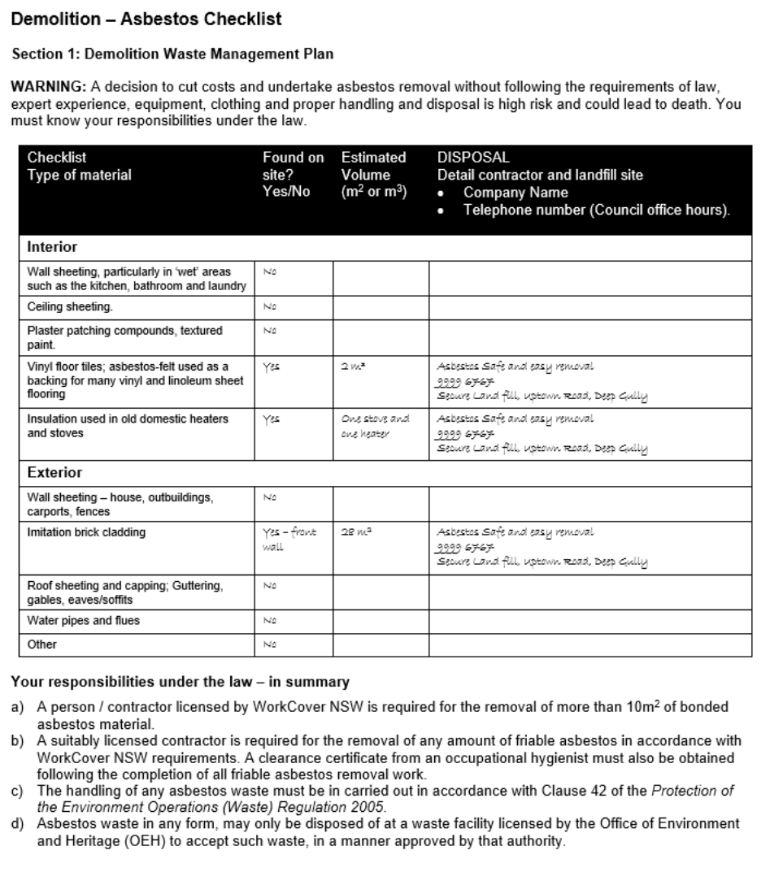
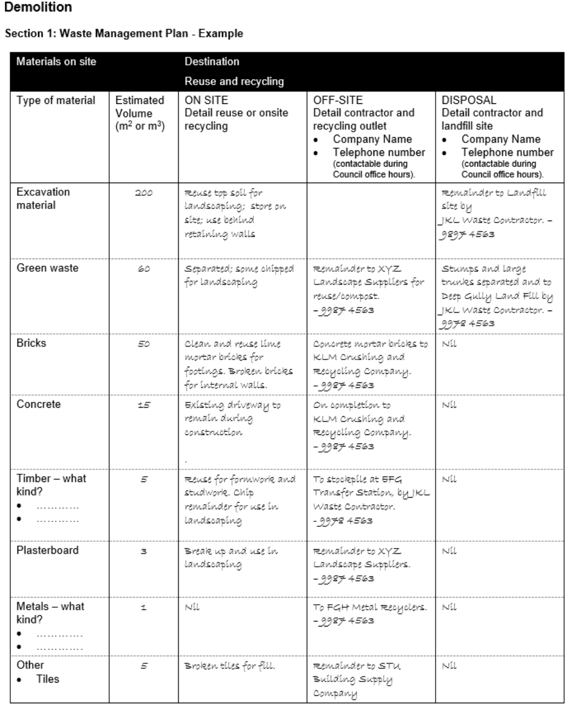
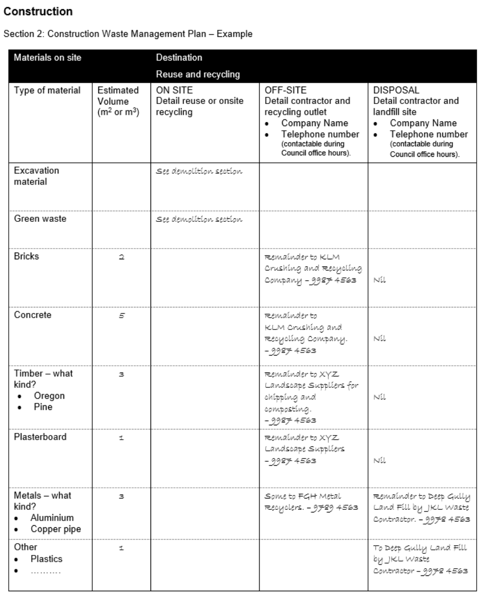

## 6. Removal and Disposal of Asbestos Material

#### Older development in Fairfield City

In its residential areas in the east of the City, Fairfield has many fibro houses built before and after the WWII period, with significant development after the war. Bonded materials containing asbestos (commonly like ‘fibro’) are the most common asbestos materials in these types of domestic houses. Asbestos has been identified as a deadly substance when disturbed in activities such as demolition and renovation. Many of those houses are being altered or demolished.

#### Your responsibilities under the law – in summary

a) A person / contractor licensed by WorkCover NSW is required for the removal of more than 10sqm of bonded asbestos material.

b) A suitably licensed contractor is required for the removal of any amount of friable asbestos in accordance with WorkCover NSW requirements. A clearance certificate from an occupational hygienist must also be obtained following the completion of all friable asbestos removal work.

### Appendix E – Waste not Policy to Manage Demolition Construction Waste

c) The handling of any asbestos waste must be in carried out in accordance with Clause 42 of the Protection of the Environment Operations (Waste) Regulation 2005.

d) Asbestos waste in any form, may only be disposed of at a waste facility licensed by the Office of Environment and Heritage (OEH) to accept such waste, in a manner approved by that authority.

WARNING: A decision to cut costs and undertake asbestos removal without following the requirements of law, expert experience, equipment, clothing and proper handling and disposal is high risk and could lead to death.

#### Where you will find asbestos in the home and other buildings

Inside the house, bonded materials containing asbestos were often used for wall sheeting, particularly in ‘wet’ areas such as the kitchen, bathroom and laundry (e.g. the glazed patterned panels around showers and baths that are held in with screws). They were also used as ceiling sheeting. Asbestos might also be found bonded in plaster patching compounds, textured paint and vinyl floor tiles.

Loosely bound materials containing asbestos might be found in a few older forms of insulation used in domestic heaters and stoves. Asbestos-felt was used as a backing for many vinyl and linoleum sheet floorings and does not pose a health risk while it remains undisturbed. However, these materials become loose when the floor covering is damaged or removed.

Outside the house, externally bonded materials containing asbestos were commonly used for roof sheeting and capping, guttering, gables, eaves/soffits, water pipes and flues, wall sheeting, flexible building boards and imitation brick cladding. They have also been used for fencing and building car ports and sheds.

Asbestos has also been sprayed in buildings for acoustic (noise-proofing) and decorative purposes since the 1940's. The demolition of buildings with asbestos insulation or lagging has the potential for the release of massive amounts of asbestos fibre unless stringent precautions are taken.

#### The deadly dangers of asbestos

Disturbed asbestos releases tiny asbestos fibres into the air. When asbestos fibres are breathed in, they may get trapped in the lungs and remain there for a long time. Over time, these fibres can accumulate and cause scarring and inflammation, which can affect breathing and lead to serious health problems. Asbestos has been classified as a known human carcinogen (a substance that causes cancer). Studies have shown that exposure to asbestos may increase the risk of lung cancer and mesothelioma (a relatively rare cancer of the thin membranes that line the chest and abdomen). Although rare, mesothelioma is the most common form of cancer associated with asbestos exposure.

#### The safe removal and disposal of asbestos

Removal of asbestos eliminates the hazard forever provided it is done with professional, accredited companies to handle and remove asbestos related materials from building sites.

### Appendix E – Waste not Policy to Manage Demolition Construction Waste

Before any work commencing, a risk assessment should be carried out. A safe work procedure should then be devised that minimises the release of dust and fibres and avoids exposure. Work involving friable (crumbles easily) asbestos is considered to present the greatest risk of exposure to air-borne fibres. Bonded asbestos (fibro) is unlikely to release airborne fibres unless it is damaged or disturbed.  Your contractor should tell you what they plan to do complete the job and minimise any risk.

Specific safety precautions for work involving asbestos are:

1\. Wearing protective clothing and an approved respirator

2\. Using non-powered hand tools as these generate less dust

3\. Wetting down material to reduce the release of dust or using vacuum attachments fitted with High Efficiency Particulate Air (HEPA) filters.

4\. Working in well-ventilated areas if possible.

5\. Using drop sheets to collect debris.

6\. Disposing of smaller asbestos pieces and collected dust in plastic bags labelled "asbestos waste". Your contractor, at a minimum, should be practicing these precautions. Work should stop if these practices are not being followed.

#### Removal of asbestos

Removal of friable asbestos-containing material, or bonded asbestos that is damaged or more than 10sqm in area, must be carried out by licensed operators in accordance with relevant State legislation. A permit must also be obtained from WorkCover before commencing any work. All asbestos removal companies must be registered under relevant State legislation.

The following safety measures are required:

1\. For external work, close all windows and doors on the building.

2\. Use warning signs and barriers when removing asbestos cement materials.

3\. If practical, seal asbestos-cement sheets with PVA paint or wet with water.

4\. Wear coveralls and an approved respirator (see personal protective equipment below).

5\. Wet clean gutters and collect material for waste disposal.

6\. Remove asbestos sheets with minimal breakage and lower asbestos sheets to the ground; do not drop them.

7\. Stack removed asbestos sheets on polythene sheeting, wrap and seal for disposal.

8\. Do not leave asbestos sheets on site where they may break or be crushed.

9\. Do not skid or drag asbestos sheets over other sheets - this can release asbestos fibres.

10\. Clean asbestos-cement residues with an approved vacuum cleaner.

11\. Keep waste containing asbestos wet or wrapped in polythene and remove from site as soon as practical.

12\. Place used disposable coveralls, masks and filters with other asbestos waste in bags for removal. 13. Your contractor, at a minimum, should be practicing these precautions. Work should stop if these practices are not being followed.

### Appendix E – Waste not Policy to Manage Demolition Construction Waste

#### Waste Handling and Disposal

Contact the Office of Environment and Heritage for waste disposal requirements and approved waste facilities. All waste containing asbestos must be:

1\. Kept damp (prevent excess runoff water).

2\. Collected, labelled and sealed using plastic or leak-proof containers.

3\. Stored at a secure site in labelled, lined bins or a leak-proof container.

4\. Removed from the site as soon as practicable and/or collected and stored in a manner approved by the EPA or an appropriate disposal authority.

5\. Transported in a covered leak-proof vehicle or a manner approved by the OEH

6\. Disposed of in a manner and at a site approved by OEH or an appropriate disposal authority.

7\. Vehicles must be cleaned before leaving the landfill site.

Your contractor, at a minimum, should be practicing these precautions. Work should stop if these practices are not being followed.

#### Useful References

NSW WorkCover Authority (Publications Order Line 131 050 – www.workcover.nsw.gov.au)

Working with Asbestos: Guide PDF Format-1242 Kb - Publication Number - 5484

Asbestos Demotion Application Forms - Publication Number - 772, 808, 773, 809, 5397, 5398

Forms for asbestos and/or demolition work, include guides Notification and Permit Forms for Asbestos and Demolition - Publication Number - 940, 941, 942, 943

Use these forms to notify WorkCover of demolition and/or bonded asbestos work, or to lodge an application for a permit to remove friable asbestos or undertake certain demolition work.

### Appendix E – Waste not Policy to Manage Demolition Construction Waste

### Appendix E – Waste not Policy to Manage Demolition Construction Waste

> [Picture on page 11: a picture, saved as a picture (images/appendix-e-waste-not-policy-to-manage-demolition-and-constru-page-11-2.gif, 150 dpi).]

### Appendix E – Waste not Policy to Manage Demolition Construction Waste

> [Picture on page 12: a picture, saved as a picture (images/appendix-e-waste-not-policy-to-manage-demolition-and-constru-page-12-2.gif, 150 dpi).]

### Appendix E – Waste not Policy to Manage Demolition Construction Waste

> [Picture on page 13: a picture, saved as a picture (images/appendix-e-waste-not-policy-to-manage-demolition-and-constru-page-13-2.gif, 150 dpi).]

### Appendix E – Waste not Policy to Manage Demolition Construction Waste

> [Picture on page 14: a picture, saved as a picture (images/appendix-e-waste-not-policy-to-manage-demolition-and-constru-page-14-2.gif, 150 dpi).]

### Appendix E – Waste not Policy to Manage Demolition Construction Waste

> [Picture on page 15: a picture, saved as a picture (images/appendix-e-waste-not-policy-to-manage-demolition-and-constru-page-15-2.gif, 150 dpi).]

### Appendix E – Waste not Policy to Manage Demolition Construction Waste

> [Picture on page 16: a picture, saved as a picture (images/appendix-e-waste-not-policy-to-manage-demolition-and-constru-page-16-2.gif, 150 dpi).]

### Appendix E – Waste not Policy to Manage Demolition Construction Waste

> [Picture on page 17: a picture, saved as a picture (images/appendix-e-waste-not-policy-to-manage-demolition-and-constru-page-17-2.gif, 150 dpi).]

### Appendix E – Waste not Policy to Manage Demolition Construction Waste

> [Picture on page 18: a picture, saved as a picture (images/appendix-e-waste-not-policy-to-manage-demolition-and-constru-page-18-2.gif, 150 dpi).]
