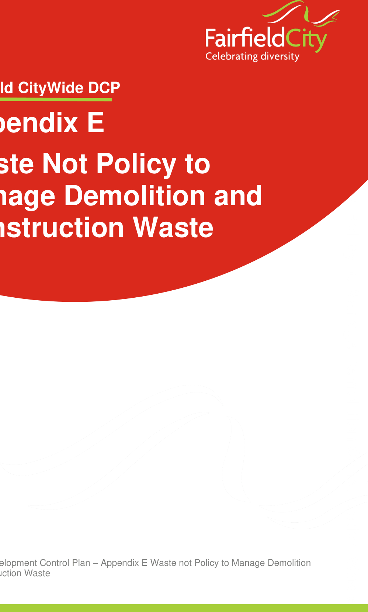

# Fairfield City Wide Development Control Plan 2024 - Appendix E Waste Not Policy to Manage Demolition and Construction Waste

> This chapter is split into 7 section file(s), one per numbered heading, in the order they appear in the PDF.

Source PDF: [fairfield-city-wide-dcp-2024-amendment-no.2 - Appendix E Waste Not Policy to Manage Demolition and Construction Waste.pdf](https://planfortomorrow.sharepoint.com/sites/Planfortomorrow/Shared%20Documents/00%20NSW-Planning-Resources/dcp/fairfield-city-wide-development-control-plan-2024/appendix-e-waste-not-policy-to-manage-demolition-and-construc/fairfield-city-wide-dcp-2024-amendment-no.2%20-%20Appendix%20E%20Waste%20Not%20Policy%20to%20Manage%20Demolition%20and%20Construction%20Waste.pdf)

> [Picture on page 1: a picture, saved as a picture (images/appendix-e-waste-not-policy-to-manage-demolition-and-constru-page-1-1.gif, 150 dpi).]

### Fairfield CityWide DCP

Appendix E Waste Not Policy to Manage Demolition and

### Construction Waste

529      Development Control Plan – Appendix E Waste not Policy to Manage Demolition and Construction Waste

### Appendix E – Waste not Policy to Manage Demolition Construction Waste

> The PDF's contents list (page numbers of the printed document) is not repeated here - see Sections below.

### 1.1 Why reduce, reuse, and recycle

and demolition construction waste 531

1.2 How will Council control the reduction, reuse and recycling of demolition and construction waste 532

### 2.4 How do you show Council’s

requirements for the reuse, recycling and disposal in demolition and construction works are going to be followed? ......................................534

### 1.3 What is Waste Management?

532

3\. Waste Management Plans .............534

### 3.1 What is needed for a completed

Waste Management Plan? ...........534

### 1.4 What are Council’s

requirements for reusing, recycling and disposing of demolition and construction waste? ...................... 532

4\. Requirements During Demolition and Construction ............535

### 1.5 How do you prepare a Waste

Management Plan for demolition and construction waste? ...................... 532

4.1 What is needed during the recycling and disposal of demolition and construction waste? ...............535

5\. Waste And Dry Recycling Facilities in Developments ................535

<!-- sections -->
## Sections

1. [2 Council’s requirements for reusing, recycling and disposing of waste 532](01-2-council-s-requirements-for-reusing.md)
2. [1 Introduction](02-1-introduction.md)
3. [2 Council’s requirements for reusing, recycling and disposing of waste](03-2-council-s-requirements-for-reusing.md)
4. [3 Waste Management Plans](04-3-waste-management-plans.md)
5. [4 Requirements During Demolition and Construction](05-4-requirements-during-demolition-and.md)
6. [5 Waste And Dry Recycling Facilities in Developments](06-5-waste-and-dry-recycling-facilities-in.md)
7. [6 Removal and Disposal of Asbestos Material](07-6-removal-and-disposal-of-asbestos.md)
