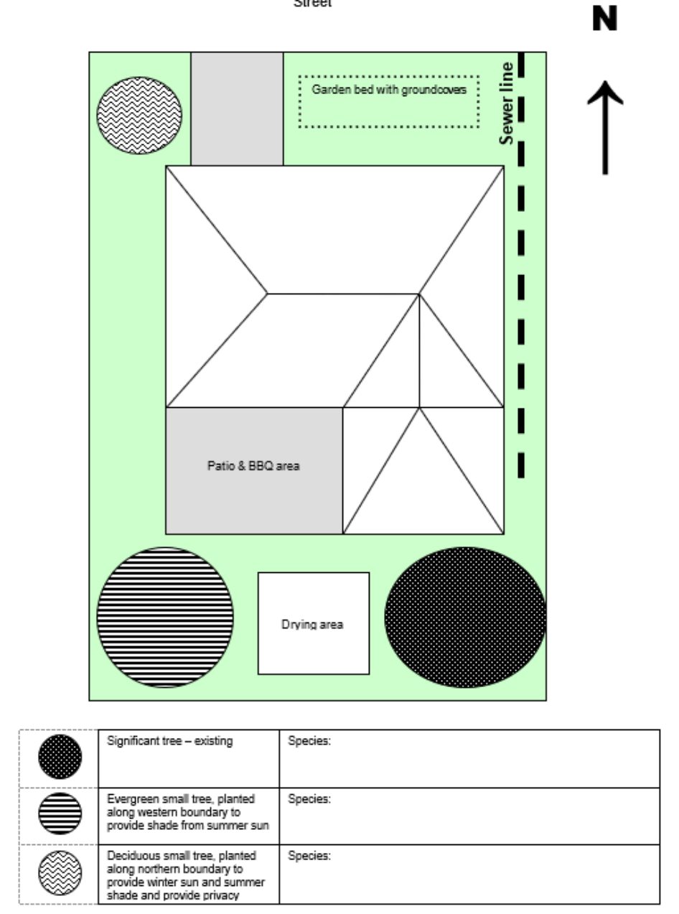
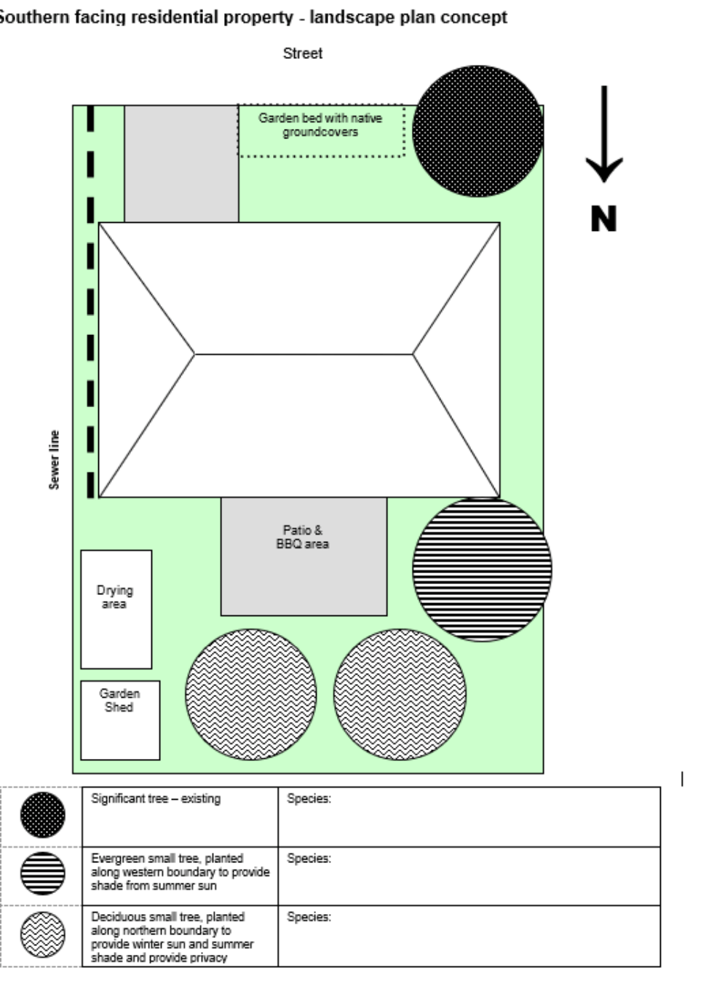
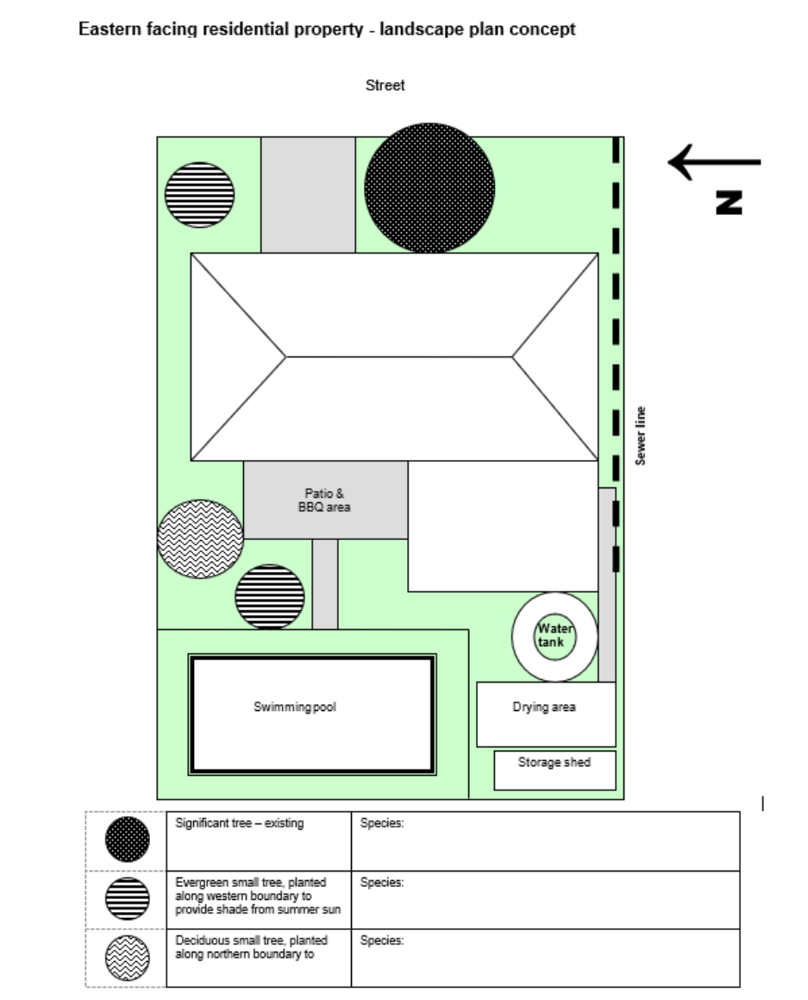
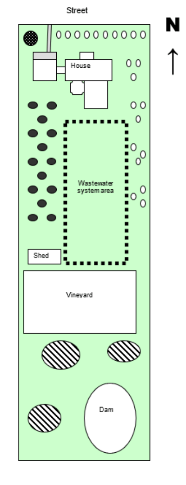
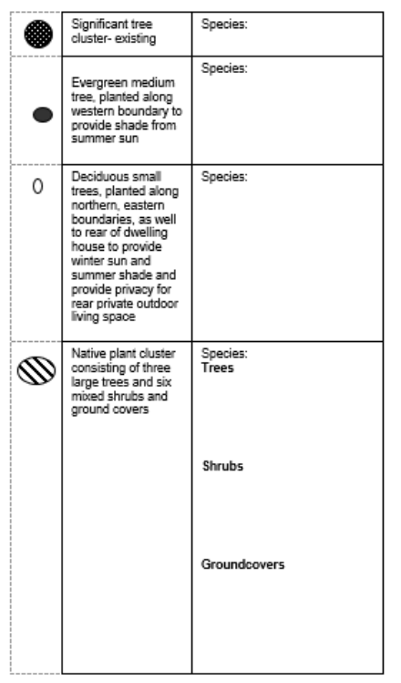

## 3. Landscape Works

Landscaping undertaken properly on site will ensure plants that have been identified on approved landscaping plans have a greater rate of survival, particularly in dry and warm periods.

#### Objectives

a) To ensure landscaping plans are executed as shown on approved plans.

b) To ensure plants survive their early establishment phase.

#### Controls

a) All planting should use water crystals expanded in water before planting to help keep plant roots well watered.

b) All landscape beds must be mulched to a depth of 100mm to keep the ground from drying out.

c) All landscape works must ensure that plants are tagged, ready for Council inspection. A list of native and exotic trees, shrubs, groundcovers and ferns is provided below.

#### Plant List Native Species

#### Trees  - Bold denotes native to Fairfield City

| Native tree Botanical Name | Common Name | Height X Width | Native tree Botanical Name | Common Name | Height X Width |
|---|---|---|---|---|---|
| Acmena smithii | Lillypilly | 12.0mx6.0m | Glochidion ferdinandi | Cheese Tree | 10.0mx6.0m |
| Angophora subvelutina | Broadleaved Apple | 15.0mx8.0m | Lophostemon confertus | Brush Box | 20.0mx8.0m |
| Backhousia myrtifolia | Grey Myrtle | 6.0mx5.0m | Melaleuca decora | White Feather Honeymyrtle | 10.0mx3.0m |
| Banksia integrifolia | Coastal Banksia | 15.0mx4.0m | Melaleuca linarifolia | Snow in Summer | 10.0mx5.0m |
| Brachychiton acerifolium | Illawarra Flame Tree | 25.0mx5.0m | Melaleuca nodosa | Ball Honeymyrtle | 6.0mx2.0m |
| Araucaria cunninghamiana | Hoop Pine | 25.0mx10.0m | Melaleuca quinquenervia | Broad-leafed Paperbark | 15.0mx7.0m |
| Callistemon viminalis | 'Hanna Bay' Weeping Bottlebrush | 10.0mx5.0m | Pittosporum rhombifolium | Queensland Laurel | 10.0mx5.0m |
| Elaeocarpus reticulates | Blueberry Ash | 12.0mx5.0m | Syzygium leuhmanni | Lilly Pilly | 15.0mx10.0m |
| Eucalyptus tereticornis | Forest Red Gum | 35.0mx12.0m | Tristaniopsis laurina | Water Gum | 10.0mx8.0m |

### Appendix F – Landscape Planning

#### Shrubs - Bold denotes native to Fairfield City

| Native shrub Botanical Name | Common Name | Height X Width | Native shrub Botanical Name | Common Name | Height X Width |
|---|---|---|---|---|---|
| Banksia ericifolia | Heath Banksia | 4.0mx3.0m | Grevillea rosmarinifolia | Rosemary Grevillea | 1.0mx1.0m |
| Banksia serrata | Old Man Banksia | 6.0mx4.0m | Hakea salicifolia | Willow-leaf Hakea | 5.0mx3.0m |
| Boronia floribunda | Pale Pink Boronia | 1.0mx1.0m | Hebe x franciscana | 'Blue Gem' Veronica Blue Gem | 1.5mx1.5m |
| Bursaria spinosa | Blackthorn | 3.0mx1.0m | Inigofera australis | Austral Indigo | 2.0mx2.0m |
| Callistemon | 'Kings Park Special' King's Park Bottlebrush | 4.0mx3.5m | Kennedia rubicunda | Dusky Coral Pea | 3.0m- |
| Callistemon citrinus | Crimson Bottlebrush | 4.0mx2.0m | Kunzea ambigua | Tick Bush | 2.5mx2.5m |

| Native shrub Botanical Name | Common Name | Height X Width | Native shrub Botanical Name | Common Name | Height X Width |
|---|---|---|---|---|---|
| Callistemon salignus | Pink Tipped Bottlebrush | 9.0mx4.0m | *Leptospermum juniperinum | Prickly Tea-tree | 3.0mx2.0m |
| Ceratopetalum gummiferum | NSW Christmas Bush | 6.0mx1.5m | * Leptospermum petersonii | Lemon Scented Tea Tree | 4.0mx2.0m |
| Coleonema pulchrum | Diosma | 1.5mx1.5m | * Leptospermum polygalifolium | Pacific Beauty | 1.5mx2.0m |
| Correa alba | White Correa | 1.5mx1.0m | * Melaleuca thymifolia | Thyme Honey- myrtle | 0.8mx1.5m |
| Dodonaea viscose | Hop Bush | 2.0mx1.5m | Westringia brevifolia var. Raleighii | Native Rosemary | 1.0mx1.5m |
| Doryanthus excelsa | Gymea Lily | 2.0mx2.0m | Westringia fruticosa | Coastal Rosemary | 2.0mx2.0m |
| Grevillea 'Ivanhoe' | Ivanhoe Grevillea | 4.0mx3.0m |  |  |  |

#### Groundcovers - Bold denotes native to Fairfield City

| Native Groundcover Botanical Name | Common Name | Height X Width | Native Groundcover Botanical Name | Common Name | Height X Width |
|---|---|---|---|---|---|
| Anigozanthos 'Bush Ranger' | Kangaroo Paw | 0.5mx0.2m | Grevillea 'Poorinda Royal Mantle' | Grevillea Royal Mantle | 0.2mx3.0m |
| Baumea articulata | Jointed Twigrush | 1.5m- | Grevillea juniperina | Prickly Spider Flower | 1.5mx1.5m |
| Baumea rubiginosa | Twigrush | 1.0m- | Hardenbergia violacea Happy Wanderer Native | 'Happy Wanderer' | 3.0mx3.0m |
| Carex appressa | Tall Sedge | 0.75mx0.75m | Sarsparilla Hibertia scandens | Snake Vine | 2.0mx |
| Danthonia racemosa | Wallaby Grass | 0.7mx0.1m | Isolepsis nodosa | Knobbly Clubrush | 1.0mx0.5m |
| Dianella caerulea | Paroo Lily | 0.6mx0.6m | Juncus usitatus | Tussock Rush | 1.0m |
| Dianella revoluta | Black Anther Flax Lily | 0.8mx0.8m | Lomandra confertifolia ' Little Con' | Little Con Grassy Mat- rush | 0.3mx0.3m |
| Dianella tasmanica | Flax Lily | 0.4mx0.5m | Lomandra longifolia | Mat Rush | 0.7mx1.0m |
| Dichondra repens | Kidney Weed | 0.1m- | Myoporum parvifoliium | Creeping Boobialla | 0.2mx1.5m |

### Appendix F – Landscape Planning

| Native Groundcover Botanical Name | Common Name | Height X Width | Native Groundcover Botanical Name | Common Name | Height X Width |
|---|---|---|---|---|---|
| Dietes bicolor | Yellow Wild Iris | 1.0mx1.0m | Pandorea pandorana | Wonga Wonga Vine | 5.0m- |
| Dietes grandiflora | Wild Iris- | 1.0m- | Poa labillardieri | Tussock Grass | 0.8mx0.5m |
| Eragrostis elongate | Lavender Grass | 0.6mx0.15m | Scaevola albida | Fanflower | 0.15mx0.4m |
| Festuca glauca | Blue Fescue | 0.3mx0.2m | Scaevola humilus | Fanflower | 0.15mx0.4m |
| Grevillea 'Bronze Rambler' | Bronze Rambler Grevillea | 0.3mx4.0m | Themeda australis Viola hederacea | Kangaroo Grass Native Violet | 0.8mx0.3m 0.1mx0.3m |

#### Ferns

#### Palms

| Native Fern Botanical Name | Common Name | Height X Width | Palm Botanical Name | Common Name | Height X Width |
|---|---|---|---|---|---|
| Asplenium australasicum | Birds Nest Fern | 1.0mx1.0m | Phoenix canariensis | Canary Island Date Palm | 15.0mx10. 0m |

### Appendix F – Landscape Planning

#### Plant List Exotic Species

#### Trees

| Exotic Tree Botanical Name | Common Name | Height X Width | Exotic Tree Botanical Name | Common Name | Height X Width |
|---|---|---|---|---|---|
| Acer palmatum | Japanese Maple | 8.0mx3.0m | Platinus x hybrida | Oriental Plane | 25.0mx10.0m |
| Calodendrum capenseCape | Chestnut | 15.0mx12.0m | Podocarpus elatus | Brown Pine | 30.0mx5.0m |
| Cupressus glabra | 'Blue Ice' Blue Ice Arizona Cypress | 10.0mx2.5m | Prunus cerasifer | 'Negra' Flowering Plum | 10.0mx10.0m |
| Cupressus sempervirens | Italian Cypress | 10.0mx2.5m | Prunus calleryana | 'Chanticlear' Ornamental Pear | 10.0mx4.0m |
| Juniperus scopulorum | 'Blue Arrow'Blue Arrow Juniper | 4.0mx0.8m | Prunus ussurensis | Manchurian Pear | 13.0mx6.0m |
| Lagerstroemia indica | Crepe Myrtle | 6.0mx3.0m | Schinus molle | Peppercorn Tree | 10.0mx8.0m |
| Liriodendron tulipifera | Tulip Tree | 15.0mx10.0m | Ulmus parvifolia | Chinese Elm | 10.0mx4.0m |

| Exotic Tree Botanical Name | Common Name | Height X Width | Exotic Tree Botanical Name | Common Name | Height X Width |
|---|---|---|---|---|---|
| Platinus digitata | Cypress Plane | 20.0mx10.0m |  |  |  |

#### Shrubs

| Exotic Shrub Botanical Name | Common Name | Height X Width | Exotic Shrub Botanical Name | Common Name | Height X Width |
|---|---|---|---|---|---|
| Abelia x grandiflora | Albelia | 2.0mx2.0m | Lavendula dentata | French Lavender | 1.5mx1.0m |
| Agave attenuata | Century Plant | 1.5mx1.5m | Phormium tenax 'Bronze Baby' | Bronze Baby Flax | 0.75mx0.8m |
| Boronia floribunda | Pale Pink Boronia | 1.0mx1.0m | Photinia glabra | 'Rubens' Photinia | 3.0mx2.0m |
| Convolvulus cneorum | Silverbush | 0.6mx0.7m | Pittosporum tobira | Japanese Pittorporum | 0.8mx1.5m |
| Eriostemon myoporoides | Long-leaf Wax Flower | 1.5mx2.5m | Thryptomene saxicola | Thryptomene | 1.0mx1.5m |
| Hebe 'Inspiration' | Veronica Inspiration | 0.7mx1.0m | Viburnum tinus | Laurestinus | 3.0mx2.0m |
| Hebe 'Wiri Cloud' |  | 0.4mx0.4m | Westringia longifolia | Rosemary | 2.0mx1.5m |
| hebe x franciscana 'Blue Gem' | Veronica Blue Gem | 1.5mx1.5m | Yucca filamentosa | Adam's Needle | 1.5mx1.0m |
| Lavendula angustifolia | English Lavender | 1.5mx1.0m |  |  |  |

### Appendix F – Landscape Planning

#### Groundcovers

| Exotic Groundcover Botanical Name | Common Name | Height X Width | Exotic Groundcover Botanical Name | Common Name | Height X Width |
|---|---|---|---|---|---|
| Dietes grandiflora | Wild Iris | 1.0m- | Juniperus conferta prostrate | Japanese Shore Juniper | 0.3mx2.5m |
| Dietes bicolor | Yellow Wild Iris | 1.0mx1.0m |  |  |  |

#### Fern

| Exotic fern Botanical Name | Common Name | Height X Width | Exotic fern Botanical Name | Common Name | Height X Width |
|---|---|---|---|---|---|
| Blechnum cartilagineum | Gristle Fern | 1.0mx1.0m | Cyathea cooperi | Scaly Tree Fern | 6.0mx5.0m |
| Blechnum nudum | Fishbone Water Fern | 0.7mx0.5m | Doodia aspera | Rasp Fern | 0.2mx0.4m |

### Appendix F – Landscape Planning

| Exotic fern Botanical Name | Common Name | Height X Width | Exotic fern Botanical Name | Common Name | Height X Width |
|---|---|---|---|---|---|
| Cyathea australis | Rough Tree Fern | 10.0mx3.0m |  |  |  |

#### North facing residential property - landscape plan concept

> [Picture on page 13: a picture, saved as a picture (images/appendix-f-landscape-planning-page-13-2.gif, 150 dpi).]

### Appendix F – Landscape Planning

### Appendix F – Landscape Planning

> [Picture on page 14: a picture, saved as a picture (images/appendix-f-landscape-planning-page-14-2.gif, 150 dpi).]

### Appendix F – Landscape Planning

> [Picture on page 15: a picture, saved as a picture (images/appendix-f-landscape-planning-page-15-2.gif, 150 dpi).]

#### Rural Property – Typical 1 Hectare lot – Landscape plan concept

> [Picture on page 16: a picture, saved as a picture (images/appendix-f-landscape-planning-page-16-2.gif, 150 dpi).]

> [Picture on page 16: a picture, saved as a picture (images/appendix-f-landscape-planning-page-16-3.gif, 150 dpi).]

### Appendix F – Landscape Planning
