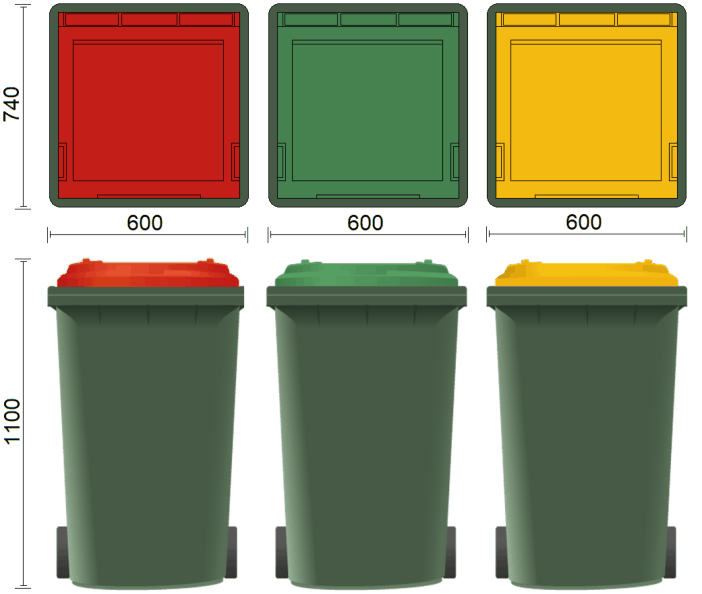
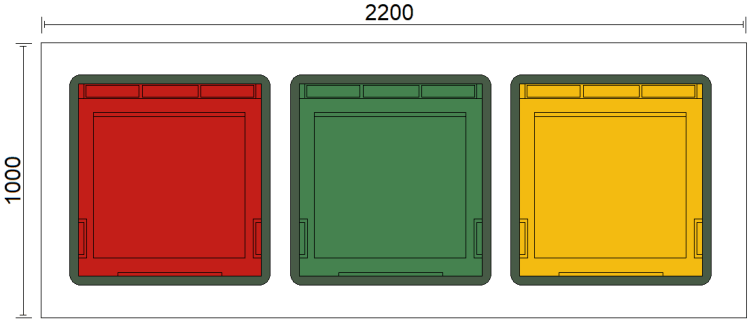
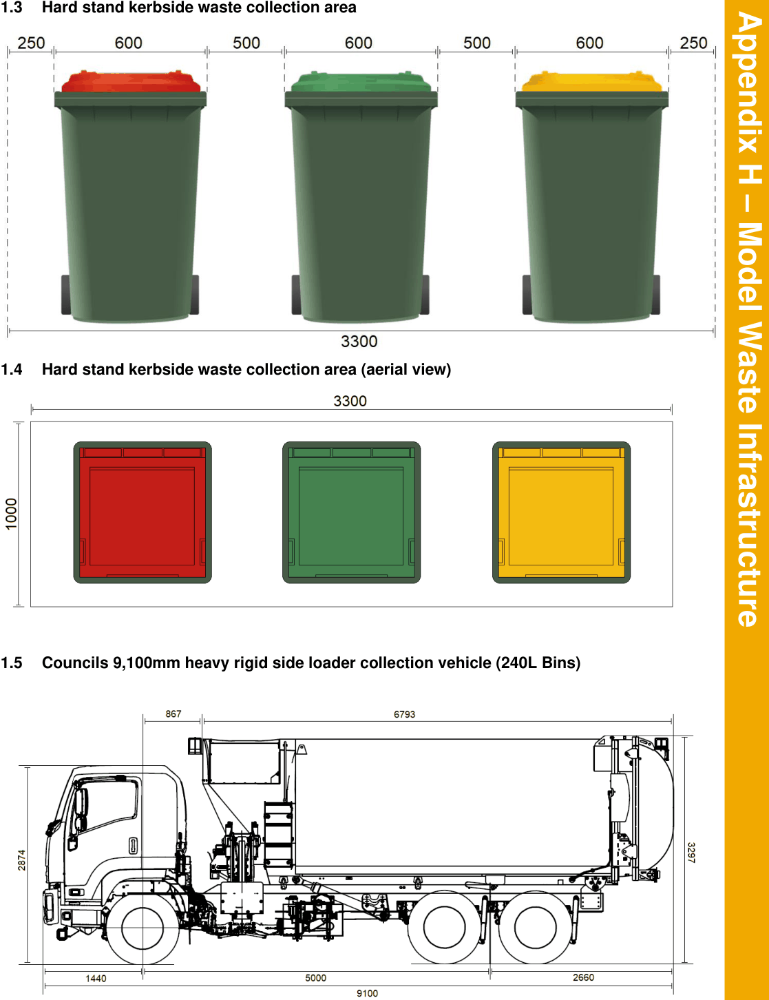
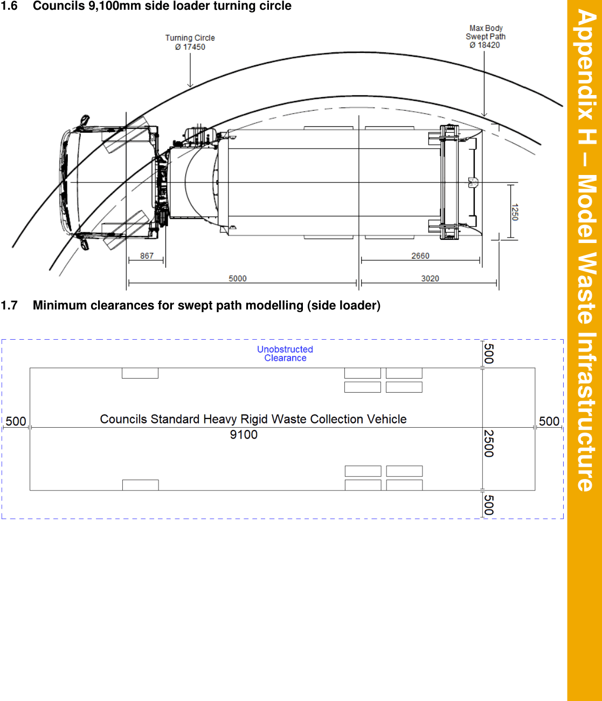
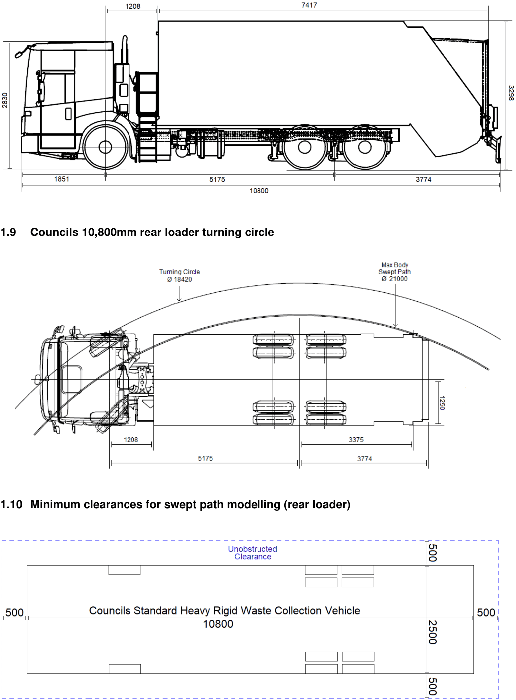

## 1 Dwelling Houses

### 1.1 Councils standard waste service Infrastructure (240L bins)

> [Picture on page 4: a picture, saved as a picture (images/appendix-h-model-waste-infrastructure-page-4-3.gif, 150 dpi).]

### 1.2 Waste and Recycling hard stand storage area

> [Picture on page 4: a picture, saved as a picture (images/appendix-h-model-waste-infrastructure-page-4-5.gif, 150 dpi).]

### Appendix H – Model Waste Infrastructure

> [Picture on page 5: a picture, saved as a picture (images/appendix-h-model-waste-infrastructure-page-5-1.gif, 150 dpi).]

### 1.3 Hard stand kerbside waste collection area

### 1.4 Hard stand kerbside waste collection area (aerial view)

### Appendix H – Model Waste Infrastructure

### 1.5 Councils 9,100mm heavy rigid side loader collection vehicle (240L Bins)

> [Picture on page 6: a picture, saved as a picture (images/appendix-h-model-waste-infrastructure-page-6-1.gif, 150 dpi).]

### 1.6 Councils 9,100mm side loader turning circle

### 1.7 Minimum clearances for swept path modelling (side loader)

### Appendix H – Model Waste Infrastructure

### 1.8 Councils 10,800mm standard heavy rigid rear loader collection vehicle (Bulky Waste)

> [Picture on page 7: a picture, saved as a picture (images/appendix-h-model-waste-infrastructure-page-7-2.gif, 150 dpi).]

### 1.9 Councils 10,800mm rear loader turning circle

### Appendix H – Model Waste Infrastructure

### 1.10 Minimum clearances for swept path modelling (rear loader)
