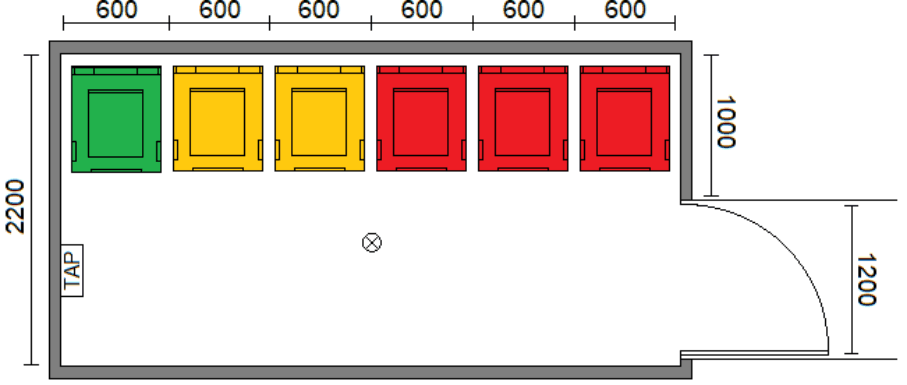
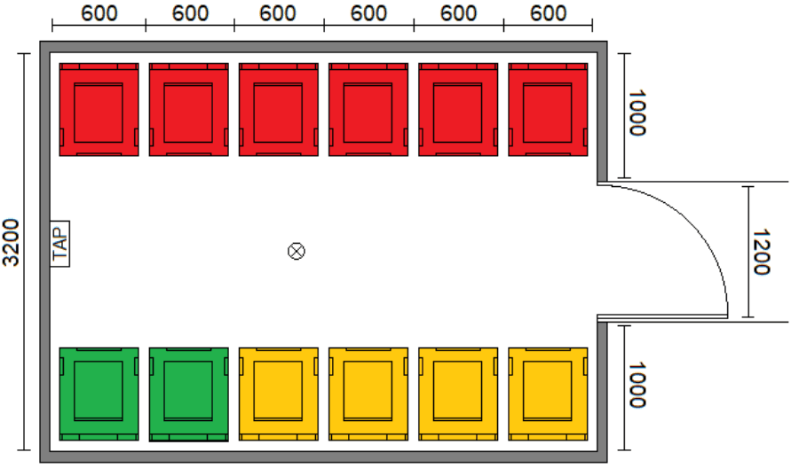
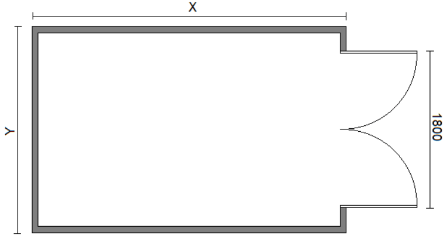
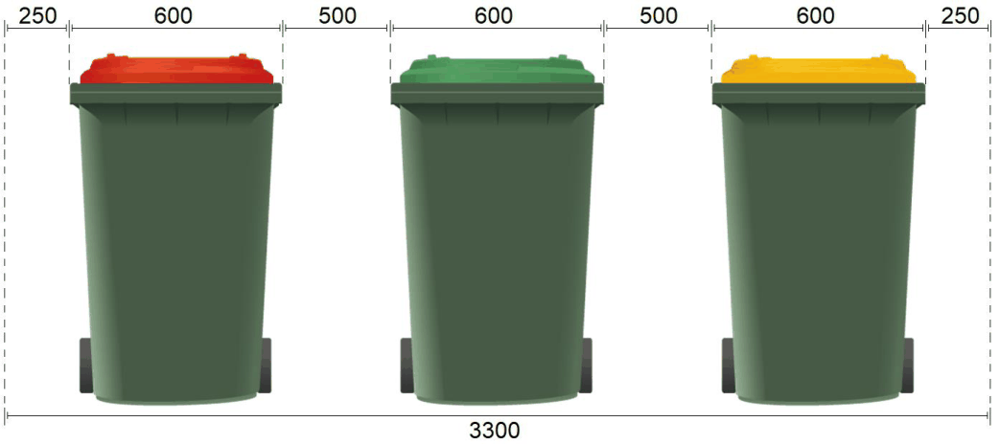
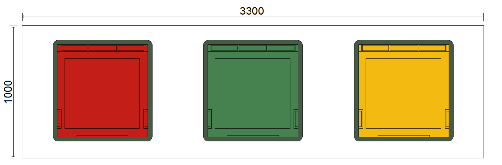
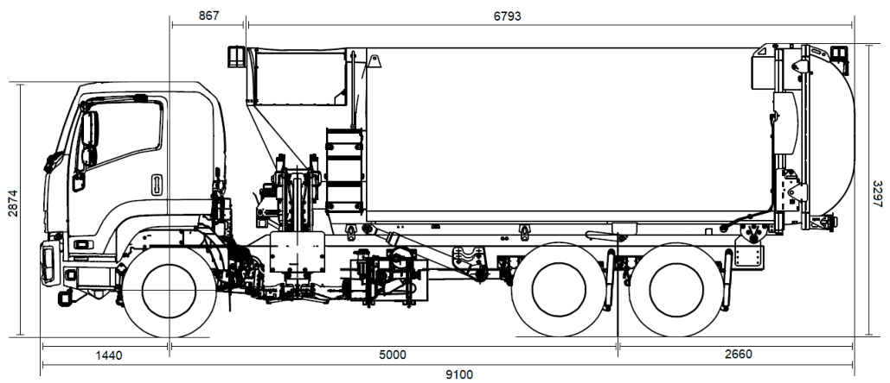
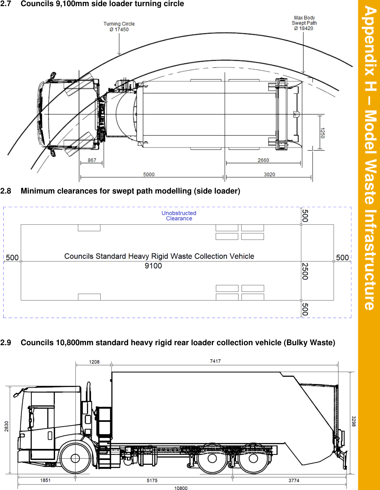
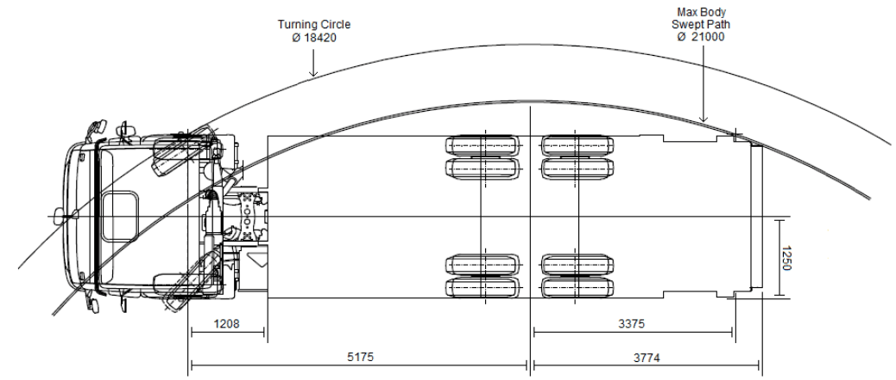
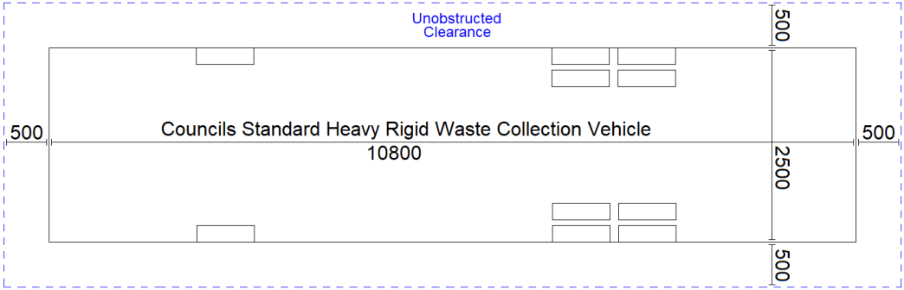

## 2 Multi Dwelling Housing

### 2.1 Single sided Waste and Recycling storage room

> [Picture on page 8: a picture, saved as a picture (images/appendix-h-model-waste-infrastructure-page-8-3.gif, 150 dpi).]

### 2.2 Double sided Waste and Recycling storage room

> [Picture on page 8: a picture, saved as a picture (images/appendix-h-model-waste-infrastructure-page-8-5.gif, 150 dpi).]

### Appendix H – Model Waste Infrastructure

### 2.3 Communal Bulky Waste collection room

> [Picture on page 9: a picture, saved as a picture (images/appendix-h-model-waste-infrastructure-page-9-2.gif, 150 dpi).]

### 2.4 Hard stand kerbside waste collection area clearances

> [Picture on page 9: a picture, saved as a picture (images/appendix-h-model-waste-infrastructure-page-9-4.gif, 150 dpi).]

### Appendix H – Model Waste Infrastructure

### 2.5 Hard stand kerbside waste collection area clearances (aerial view)

> [Picture on page 10: a picture, saved as a picture (images/appendix-h-model-waste-infrastructure-page-10-2.gif, 150 dpi).]

### 2.6 Councils 9,100mm heavy rigid side loader collection vehicle (240L Bins)

> [Picture on page 10: a picture, saved as a picture (images/appendix-h-model-waste-infrastructure-page-10-4.gif, 150 dpi).]

### Appendix H – Model Waste Infrastructure

> [Picture on page 11: a picture, saved as a picture (images/appendix-h-model-waste-infrastructure-page-11-1.gif, 150 dpi).]

### 2.7 Councils 9,100mm side loader turning circle

### 2.8 Minimum clearances for swept path modelling (side loader)

### Appendix H – Model Waste Infrastructure

### 2.9 Councils 10,800mm standard heavy rigid rear loader collection vehicle (Bulky Waste)

### 2.10 Councils 10,800mm rear loader turning circle

> [Picture on page 12: a picture, saved as a picture (images/appendix-h-model-waste-infrastructure-page-12-2.gif, 150 dpi).]

### 2.11 Minimum clearances for swept path modelling (rear loader)

> [Picture on page 12: a picture, saved as a picture (images/appendix-h-model-waste-infrastructure-page-12-4.gif, 150 dpi).]

### Appendix H – Model Waste Infrastructure
