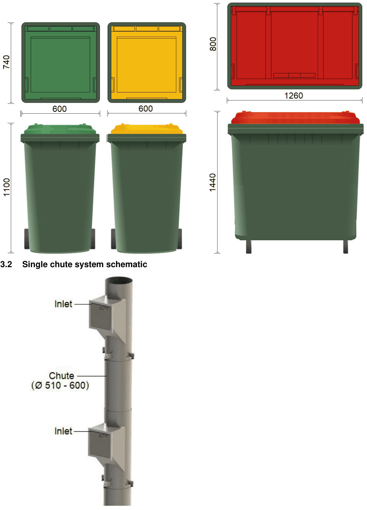
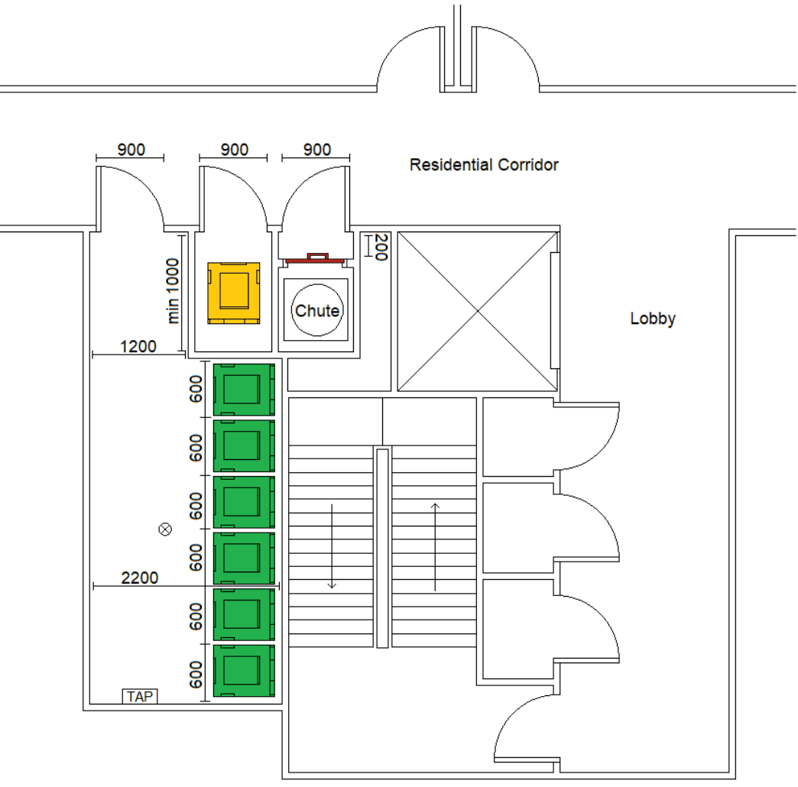
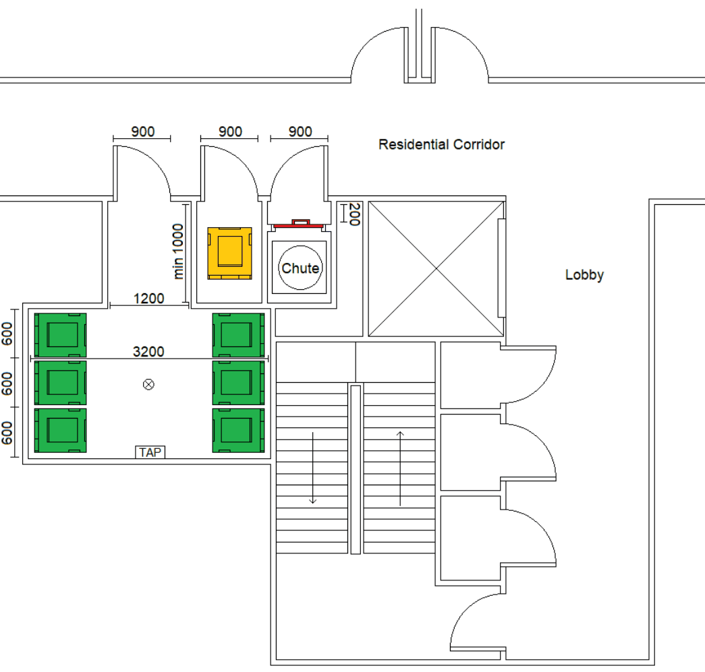
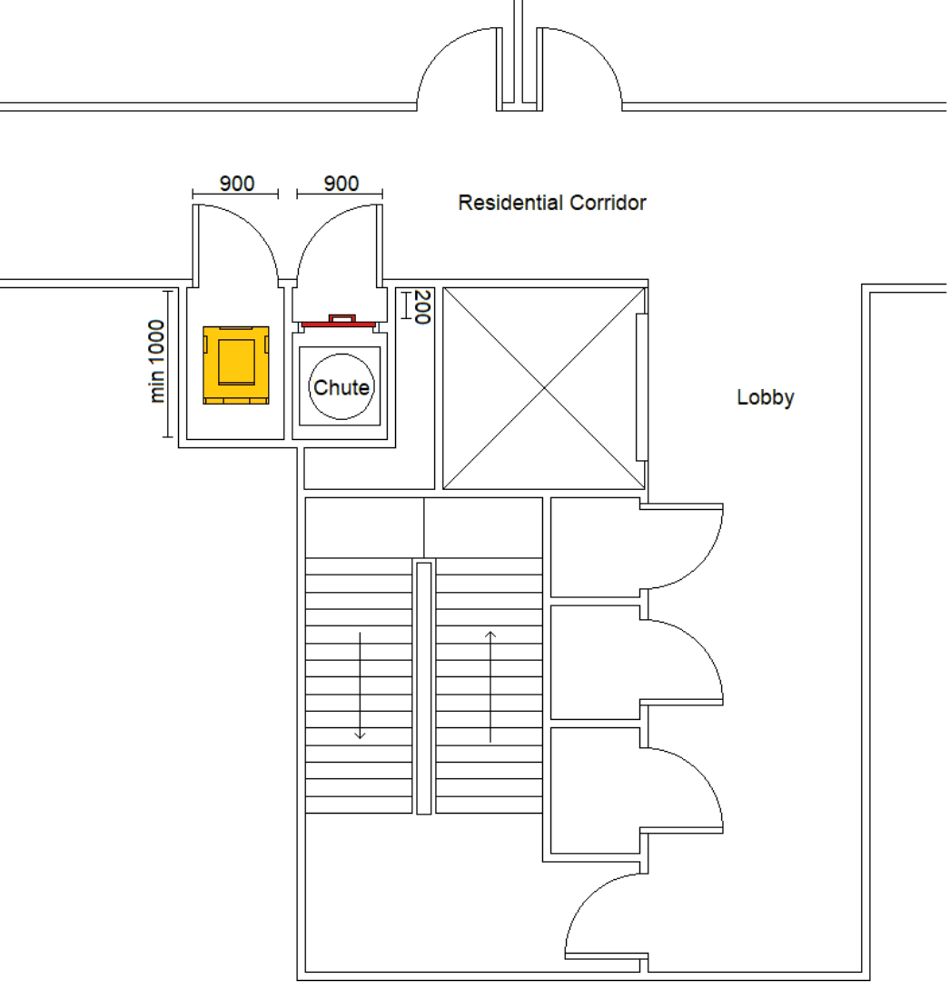
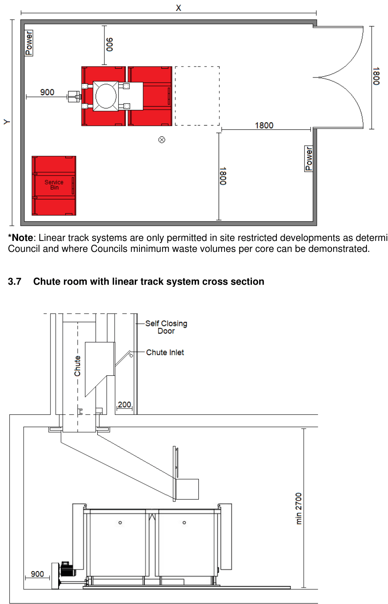
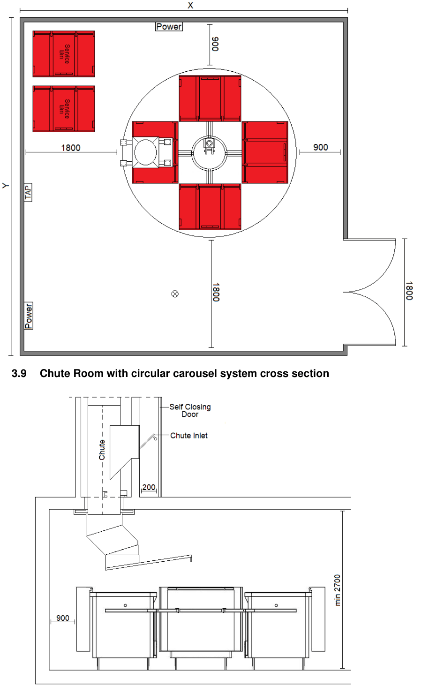
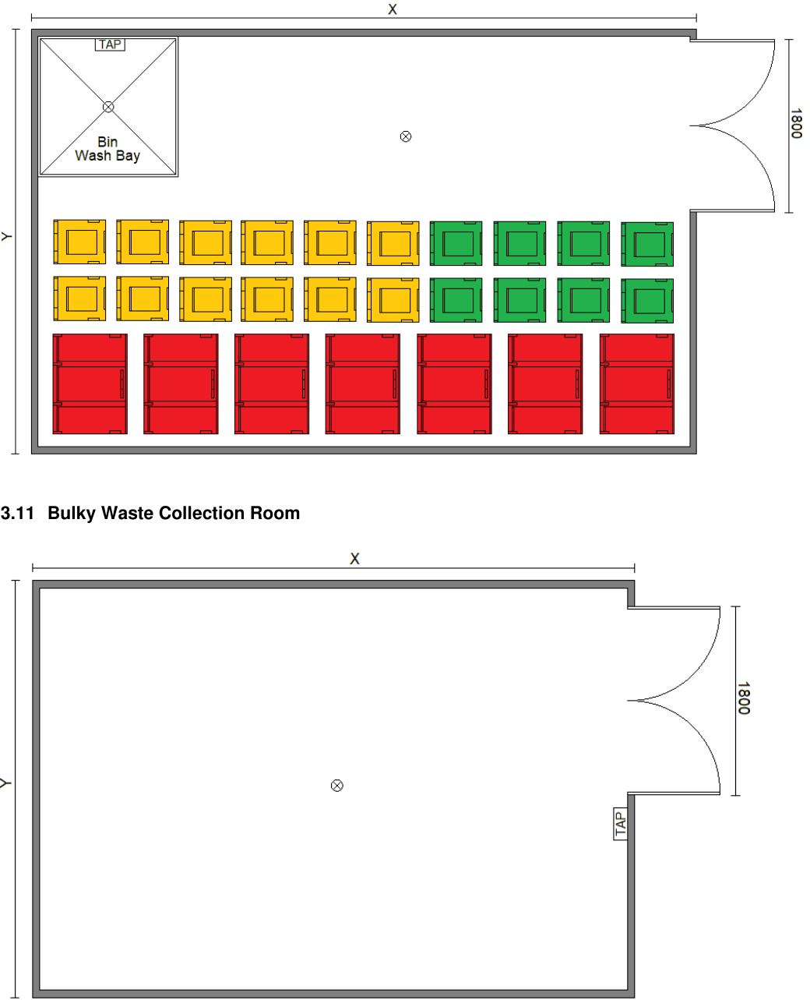
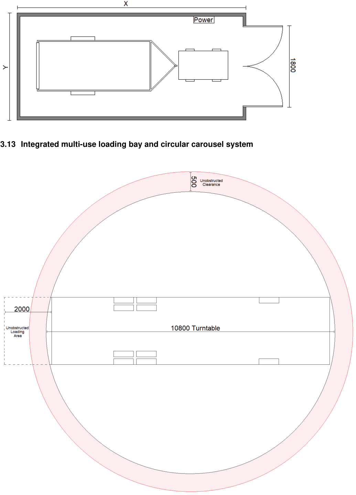
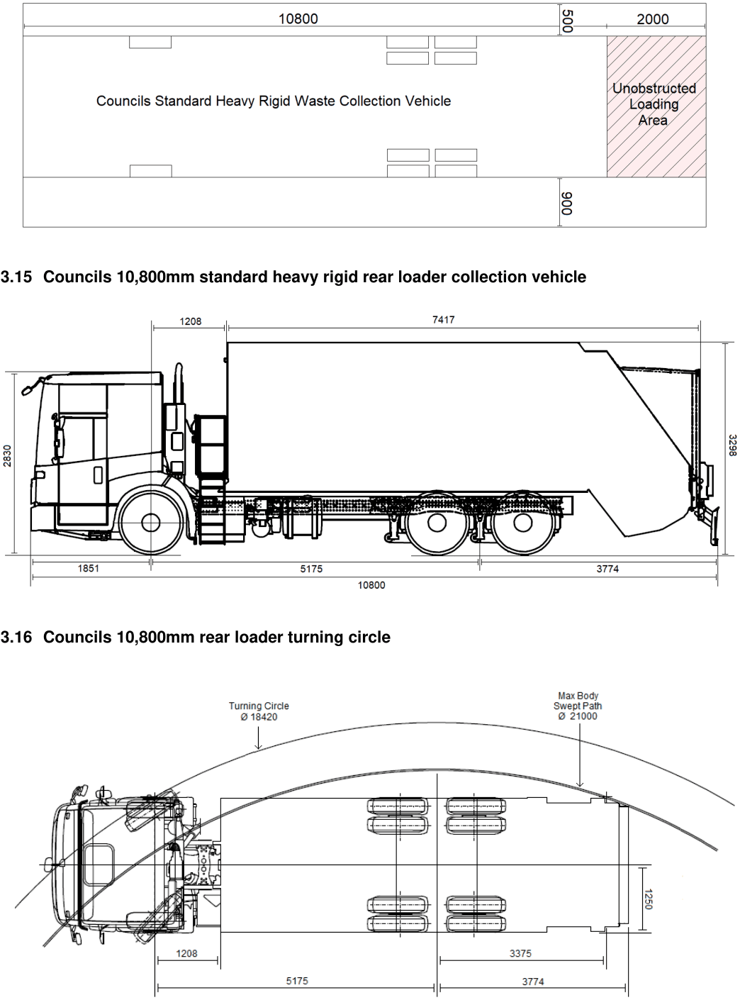
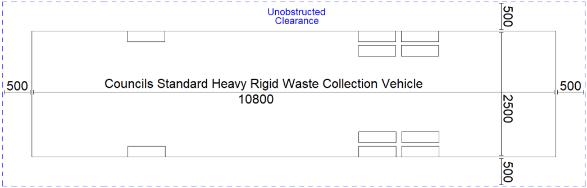

## 3 Residential Flat Buildings

### 3.1 Councils standard waste service Infrastructure (240L & 660L Bins)

> [Picture on page 13: a picture, saved as a picture (images/appendix-h-model-waste-infrastructure-page-13-3.gif, 150 dpi).]

### 3.2 Single chute system schematic

### Appendix H – Model Waste Infrastructure

### 3.3 Chute, bin cupboard, & organics waste room (Ground Floor – single sided)

> [Picture on page 14: a picture, saved as a picture (images/appendix-h-model-waste-infrastructure-page-14-2.gif, 150 dpi).]

### Appendix H – Model Waste Infrastructure

### 3.4 Chute, bin cupboard, & organics waste room (Ground Floor – double sided)

> [Picture on page 15: a picture, saved as a picture (images/appendix-h-model-waste-infrastructure-page-15-2.gif, 150 dpi).]

### Appendix H – Model Waste Infrastructure

### 3.5 Chute system and bin cupboard (Level 1 +)

> [Picture on page 16: a picture, saved as a picture (images/appendix-h-model-waste-infrastructure-page-16-2.gif, 150 dpi).]

### Appendix H – Model Waste Infrastructure

### 3.6 Chute room with linear track system (small volumes)

> [Picture on page 17: a picture, saved as a picture (images/appendix-h-model-waste-infrastructure-page-17-2.gif, 150 dpi).]

\*Note: Linear track systems are only permitted in site restricted developments as determined by Council and where Councils minimum waste volumes per core can be demonstrated.

### 3.7 Chute room with linear track system cross section

### Appendix H – Model Waste Infrastructure

### 3.8 Chute Room with Circular Carousel System

> [Picture on page 18: a picture, saved as a picture (images/appendix-h-model-waste-infrastructure-page-18-2.gif, 150 dpi).]

### 3.9 Chute Room with circular carousel system cross section

### Appendix H – Model Waste Infrastructure

### 3.10 Waste Collection Room

> [Picture on page 19: a picture, saved as a picture (images/appendix-h-model-waste-infrastructure-page-19-2.gif, 150 dpi).]

### 3.11 Bulky Waste Collection Room

### Appendix H – Model Waste Infrastructure

#### 3.12 12 Bin Tug Device and Trailer

> [Picture on page 20: a picture, saved as a picture (images/appendix-h-model-waste-infrastructure-page-20-2.gif, 150 dpi).]

### 3.13 Integrated multi-use loading bay and circular carousel system

### Appendix H – Model Waste Infrastructure

### 3.14 Integrated multi-use loading bay clearances

> [Picture on page 21: a picture, saved as a picture (images/appendix-h-model-waste-infrastructure-page-21-2.gif, 150 dpi).]

### 3.15 Councils 10,800mm standard heavy rigid rear loader collection vehicle

### Appendix H – Model Waste Infrastructure

### 3.16 Councils 10,800mm rear loader turning circle

### 3.17 Minimum clearances for swept path modelling (rear loader)

> [Picture on page 22: a picture, saved as a picture (images/appendix-h-model-waste-infrastructure-page-22-2.gif, 150 dpi).]

### Appendix H – Model Waste Infrastructure
