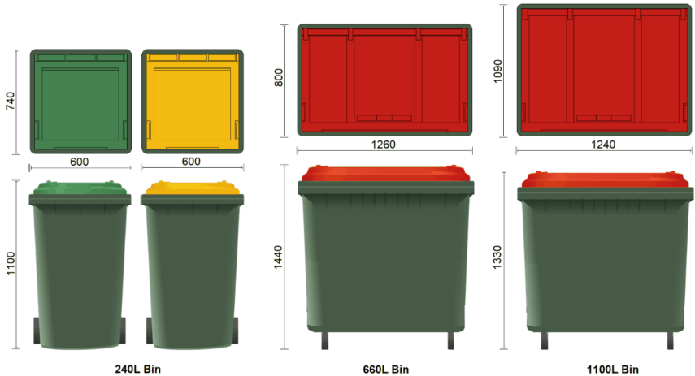
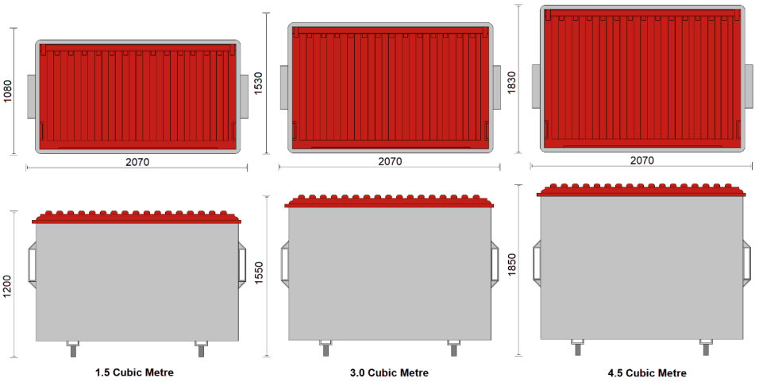
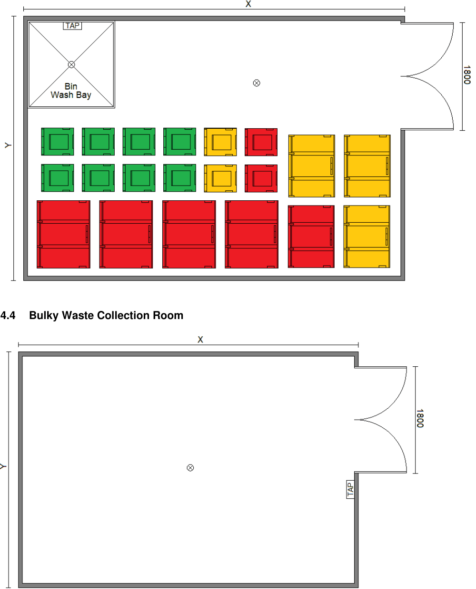
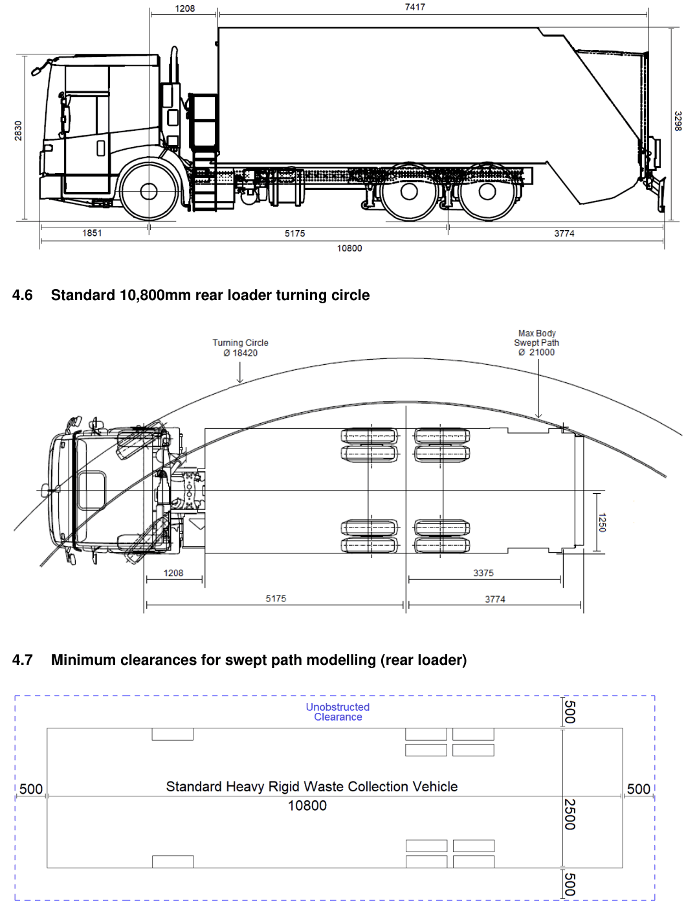
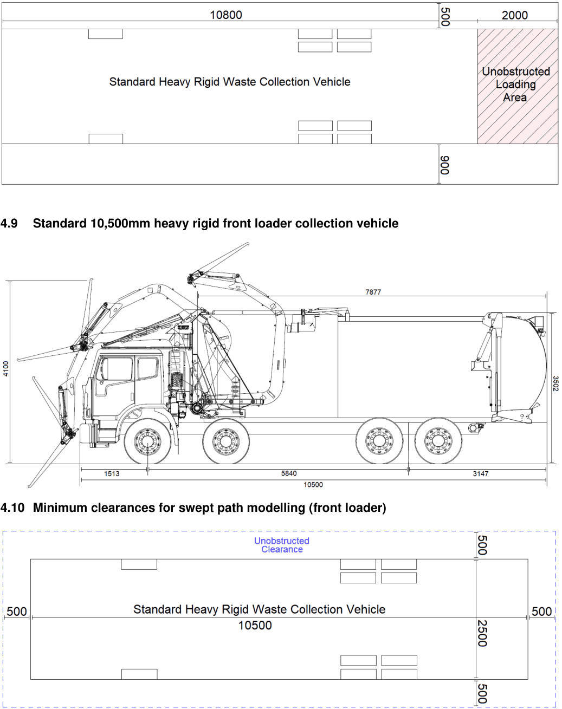

## 4 Commercial and Industrial Developments

### 4.1 Industry standard waste service Infrastructure (rear loaded)

> [Picture on page 23: a picture, saved as a picture (images/appendix-h-model-waste-infrastructure-page-23-3.gif, 150 dpi).]

### 4.2 Industry standard waste service Infrastructure (front loaded)

> [Picture on page 23: a picture, saved as a picture (images/appendix-h-model-waste-infrastructure-page-23-5.gif, 150 dpi).]

### Appendix H – Model Waste Infrastructure

### 4.3 Waste Collection Room

> [Picture on page 24: a picture, saved as a picture (images/appendix-h-model-waste-infrastructure-page-24-2.gif, 150 dpi).]

### 4.4 Bulky Waste Collection Room

### Appendix H – Model Waste Infrastructure

### 4.5 Standard 10,800mm heavy rigid rear loader collection vehicle

> [Picture on page 25: a picture, saved as a picture (images/appendix-h-model-waste-infrastructure-page-25-2.gif, 150 dpi).]

### 4.6 Standard 10,800mm rear loader turning circle

### Appendix H – Model Waste Infrastructure

### 4.7 Minimum clearances for swept path modelling (rear loader)

### 4.8 Integrated multi-use loading bay clearances

> [Picture on page 26: a picture, saved as a picture (images/appendix-h-model-waste-infrastructure-page-26-2.gif, 150 dpi).]

### 4.9 Standard 10,500mm heavy rigid front loader collection vehicle

### Appendix H – Model Waste Infrastructure

### 4.10 Minimum clearances for swept path modelling (front loader)
