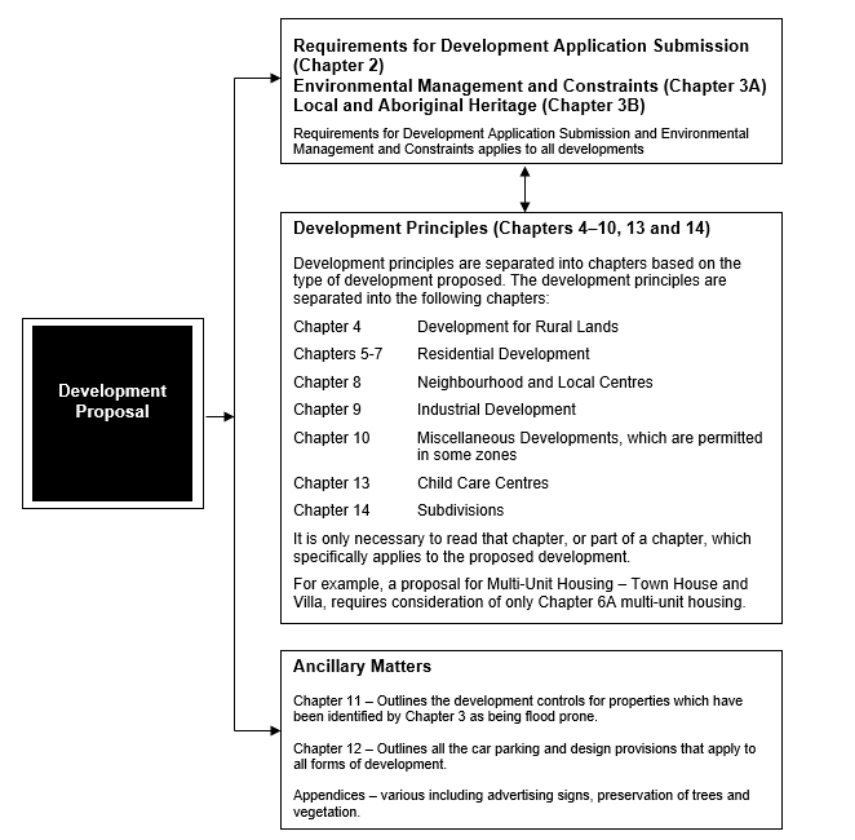

## Chapter 1 - Introduction

The Fairfield City Wide Development Control Plan fundamentally assists in the preparation of development applications. The DCP contains detailed development controls which will be used by Council as benchmarks of what is acceptable development taking into consideration an environmental site analysis.

> [Picture on page 4: a picture, saved as a picture (images/chapter-01-introduction-page-4-17.gif, 150 dpi).]

### 1.7 Date of Adoption and Amendment History

This Development Control Plan came into effect on 22 August 2024. From time to time, the Development Control Plan will be amended. The following table outlines the amendments that have taken place and their status at the time of printing.

It is the responsibility of those submitting development applications to ensure that their proposal is in accordance with the most recent version of the development control plan.

| Amend- ment No. | File Ref. | Purpose | Public exhibition | Effective Date |
|---|---|---|---|---|
| 1 | 25/11014 | Amendments throughout the DCP include formatting and grammatical updates, as well as several minor development control changes within the following chapters: 4A, 4B, 5A, 5B, 5C and 6B. All the chapters listed above include the following amendments: • Inclusion and update of BASIX requirements, • Privacy controls have been amended, and • Cut and fill controls have been amended to incorporate any soil movement or retaining walls which are associated as part of a development application to Council must be included in the description in the development application, which allows Council Officers to complete a full and accurate assessment. Chapter 4A include: • A reference to Council Vehicular Crossing Policy Chapter 4B include: • Changes to the internal design controls and combine the minimum square metre of the living, dining and kitchen area. Chapter 5A include: • Calculations of GFA to include basement, stairs, lift shafts • The minimum size of bedrooms amended to 9sqm • A reference to Council Vehicular Crossing Policy Chapter 5B include: • The internal design of living, dining and kitchen areas has increased, and removing a control for a minimum floor area of 11sqm for additional rooms, • Removing the detached outbuilding • Private open space controls have been amended to create consistency Chapter 5C include: • Removing a number of sections which had been previously deleted in the recent major review of the DCP, • A restriction on unusable void space, • Fencing control has been updated to reflect the SEPP (Exempt and Completing Development Codes) 2008, • Size of rooms have been updated Chapter 6B include: • Remove side setbacks controls • Additional control for corner lots • Size of rooms have been updated • Fencing control has been updated to reflect SEPP (Exempt and Completing Development Codes) 2008, and • Swimming pool controls | 28 Jan 2025 | 26 May 2025 |
| 2 | 25/13177 | Amendment 2 primarily relates to waste and recycling services. The proposed changes ensure that the development controls provide clear direction to all stakeholders in relation to waste and recycling servicing across all development sites. This is particularly important given the new requirement to have Food Organics and Garden Organics (FOGO) bins for all residential development. | 10 Nov 2025 | 23 Feb 2026 |
