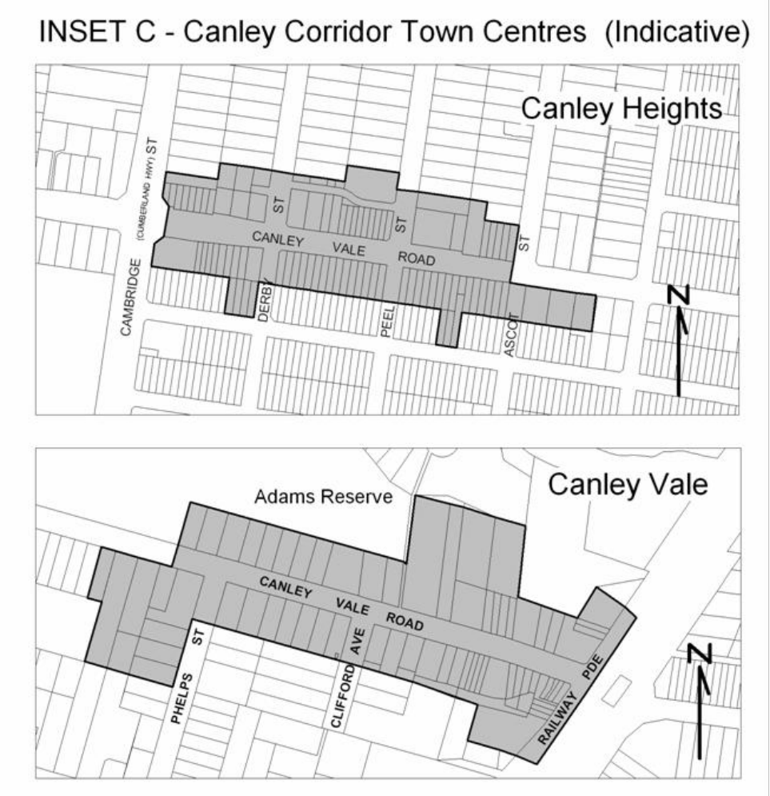

## Chapter 1 - Introduction

> [Picture on page 11: a picture, saved as a picture (images/chapter-01-introduction-page-11-2.gif, 150 dpi).]

Refer to:

Canley Corridor DCP and in accordance with clause 3.43(3) of the Environmental Planning & Assessment Act 1979

Fairfield City Wide DCP 2024 - Chapter 2, Chapter 3A, Chapter 10, Chapter 11, Chapter 12, Chapter 13 and Chapter 14
