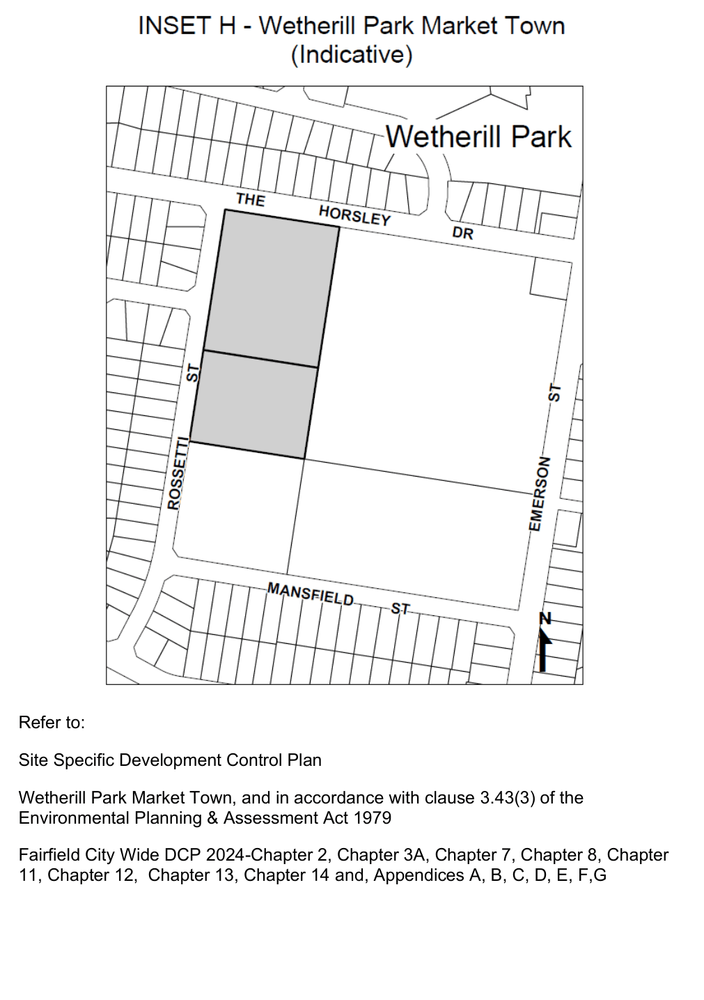

## Chapter 1 - Introduction

> [Picture on page 16: a picture, saved as a picture (images/chapter-01-introduction-page-16-2.gif, 150 dpi).]
> Words printed on the picture (title and legend, copied from the PDF):
> Refer to:

Site Specific Development Control Plan

Wetherill Park Market Town, and in accordance with clause 3.43(3) of the Environmental Planning & Assessment Act 1979

Fairfield City Wide DCP 2024-Chapter 2, Chapter 3A, Chapter 7, Chapter 8, Chapter 11, Chapter 12,  Chapter 13, Chapter 14 and, Appendices A, B, C, D, E, F,G
