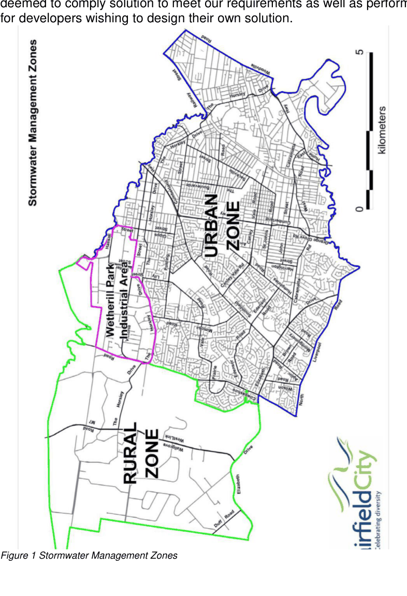

## Chapter 2 – Development Application Process

• Single dwellings and dual occupancies where the final site impervious area is greater than 70%,

• All multi dwelling housing and residential flat buildings ,

• All commercial and industrial development,

• Buildings, car parks and other sealed areas (including artificial lawn) of sporting and recreational facilities

Rural Stormwater management Zone

• All development greater than 30sqm except:

- For properties less than or equal to 1ha – OSD is not required for up to 100sqm of non-habitable building/impervious area;

- For properties greater than 1ha – OSD is not required for up to 1% of the site for a non-habitable building/impervious area (i.e. 150sqm building for a 1.5ha site).

Wetherill park Industrial Area Stormwater Management Zone - On Site Detention does not apply to this area

A map of the Stormwater Management Zones can be found in figure 1.

#### 2.5.6 Water Conservation

Potable mains water conservation is already implemented through the BASIX scheme for residential development.

All industrial and commercial development are required to meet the water conservation targets in Chapter 5 of the Stormwater Management Policy – September 2017.

#### 2.5.7 Water Quality Improvement

Water quality improvement is only required within the Wetherill Park Industrial Area Stormwater Management Zone.

Chapter 6 of the Stormwater Management Policy – September 2017 provides a

> [Picture on page 13: a picture, saved as a picture (images/chapter-02-development-application-process-page-13-10.gif, 150 dpi).]

Figure 1 Stormwater Management Zones

deemed to comply solution to meet our requirements as well as performance criteria for developers wishing to design their own solution.
