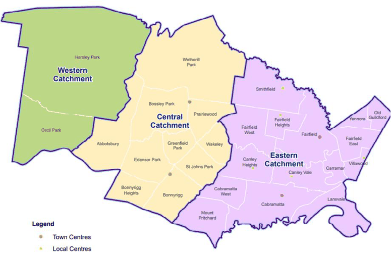

## Chapter 2 – Development Application Process

The Local Infrastructure Contributions Plan 2023 applies to all of Fairfield City. The plan separates the city into three (3) distinct catchments (Eastern, Central and Western) which align with suburb boundaries and Australian Bureau of Statistics (ABS) Areas. The three (3) catchments also align with Council’s high level strategic planning documents, including the Local Strategic Planning Statement (“LSPS”) and Local Housing Strategy (“LHS”). As shown in the Figure below, the suburbs in each catchment include:

Eastern Catchment  Old Guildford, Yennora, Fairfield East, Villawood, Lansvale, Fairfield, Canley Vale, Cabramatta, Smithfield, Fairfield Heights, Fairfield West, Canley Heights, Cabramatta West, Mount Pritchard.

Central Catchment  Wetherill Park, Prairiewood, Wakeley, St Johns Park, Bonnyrigg, Bossley Park, Greenfield Park, Edensor Park, Abbotsbury and Bonnyrigg Heights.

Western Catchment  Horsley Park and Cecil Park.

> [Picture on page 20: a picture, saved as a picture (images/chapter-02-development-application-process-page-20-1.gif, 150 dpi).]

Figure 2:  Local Infrastructure Contribution Areas

#### NSW Government - Housing and Productivity Contribution

On 1 October 2023, the NSW Government introduced a Housing and Productivity Contribution that affects most new development. From the 1st October 2023, most new Development Applications in the Greater Sydney, Illawarra-Shoalhaven, Lower Hunter and Central Coast regions need to pay the Housing and Productivity Contribution on top of the existing Local Council Section 7.11 Development Contributions.

The Housing and Productivity Contribution will apply to:
