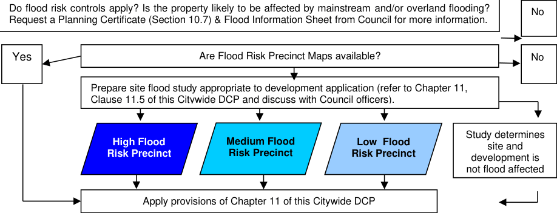
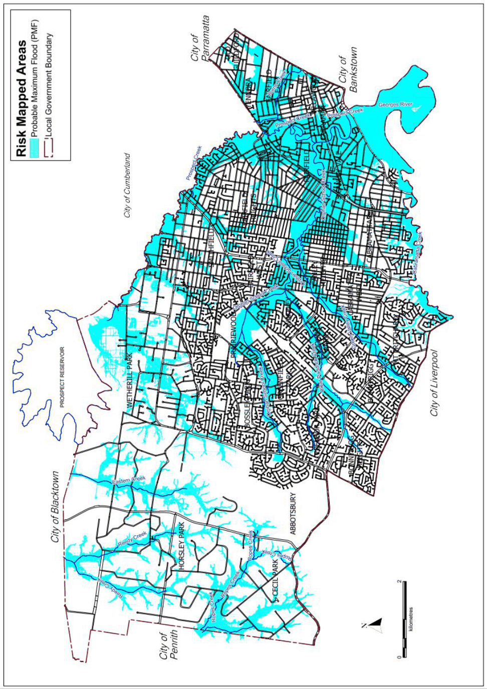

#### 3A.5 Flood Risk Assessment

Fairfield City Council is located within the upper reaches of two floodplains associated with the Georges River (generally to the east of the Sydney Regional Parklands) and Hawkesbury/Nepean River (generally to the west of the Sydney Regional Parklands) Catchment areas.

As such, parts of the City are flood prone and from time to time are subject to the risk of flooding from either mainstream (e.g. associated with discharge from creeks) or overland (e.g. local runoff) flooding.

As part of ongoing flood studies, Fairfield City Council has undertaken a number of investigations into flooding in the City, identifying risk mapped areas.

## Chapter 3A – Environmental Management & Constraints

There are still large sections of the City that require investigation and mapping and as these are completed, additional information and controls will be added to Chapter 11 – Flood Risk Management of this DCP.

The following points set out the steps that need to be followed for all development applications in relation to flood risk analysis and management, regardless of whether or not Council has conducted a flood study for the land. Please read this section carefully and seek assistance from Council officers as required:

a) Check the proposal is permissible in the zoning of the land by reference to Fairfield Local Environment Plan 2013.

b) Consider other relevant planning controls found in other chapters of the City-Wide DCP (e.g. controls which govern size and setback of development).

c) Determine whether the property is flood prone, this can be achieved by obtaining a 10.7(2) Planning Certificate.

d) If the property is flood prone the Section 10.7 Planning Certificate will also indicate which flood risk precincts (i.e. low, medium or high) are applicable to the site.

e) Additional information about the relative flood risk levels to Australian Height Datum (AHD) and floodplain in which a property is located (eg. Georges River, Upper Prospect Creek, etc.) can be obtained by applying for a Section 10.7(5) Certificate which includes this information on a Flood Information Sheet.

f) Enquire with Council regarding existing flood risk mapping or whether a site-specific assessment may be warranted in your case (for example, if local overland flooding is a potential problem). A property may be located in more than one floodplain (e.g. mainstream and overland) and/or more than one Flood Risk Precinct, in which case the assessment must consider the controls relative to each floodplain and each Precinct.

g) Determine the land use category relevant to your development proposal, by firstly confirming how it is defined by the relevant environmental planning instrument and secondly by ascertaining the applicable land use category from Schedule 2 of Chapter 11 of this Plan.

h) Assess and document how the proposal will achieve the performance criteria for development and associated fencing provided by Clauses 11.5 and 11.6 found in Chapter 11.

i) Check if the proposal will satisfy the prescriptive controls for different land use categories in different flood risk precincts, as specified in Schedules 3 to 5 in Chapter 11 of this Plan depending on which floodplain the site is located.

## Chapter 3A – Environmental Management & Constraints

If the proposal does not comply with the prescriptive controls, determine whether the performance criteria are nonetheless achieved. The assistance of Council staff or an experienced floodplain consultant may be required at various steps in the process to ensure that the requirements of this Plan are fully and satisfactorily addressed.

The following flow diagram below summarises the overall consideration process.

> [Picture on page 25: a picture, saved as a picture (images/chapter-03a-environmental-management-and-constraints-page-25-2.gif, 150 dpi).]
> Words printed on the picture (title and legend, copied from the PDF):
> No
> Do flood risk controls apply? Is the property likely to be affected by mainstream and/or overland flooding?
> Request a Planning Certificate (Section 10.7) & Flood Information Sheet from Council for more information.
> Are Flood Risk Precinct Maps available?
> No
> Yes
> Prepare site flood study appropriate to development application (refer to Chapter 11,
> Clause 11.5 of this Citywide DCP and discuss with Council officers).
> Study determines
> Medium Flood
> Risk Precinct
> High Flood
> Risk Precinct
> Low  Flood
> Risk Precinct
> site and
> development is
> not flood affected
> Apply provisions of Chapter 11 of this Citywide DCP

Note: Please refer to clause 6.4 Floodplain Risk Management for additional provisions that apply within Fairfield Local Environmental Plan 2013 in relation to safe occupation of and evacuation of certain flood liable land.

## Chapter 3A – Environmental Management & Constraints

## Chapter 3A – Environmental Management & Constraints

> [Picture on page 26: a picture, saved as a picture (images/chapter-03a-environmental-management-and-constraints-page-26-2.gif, 150 dpi).]
