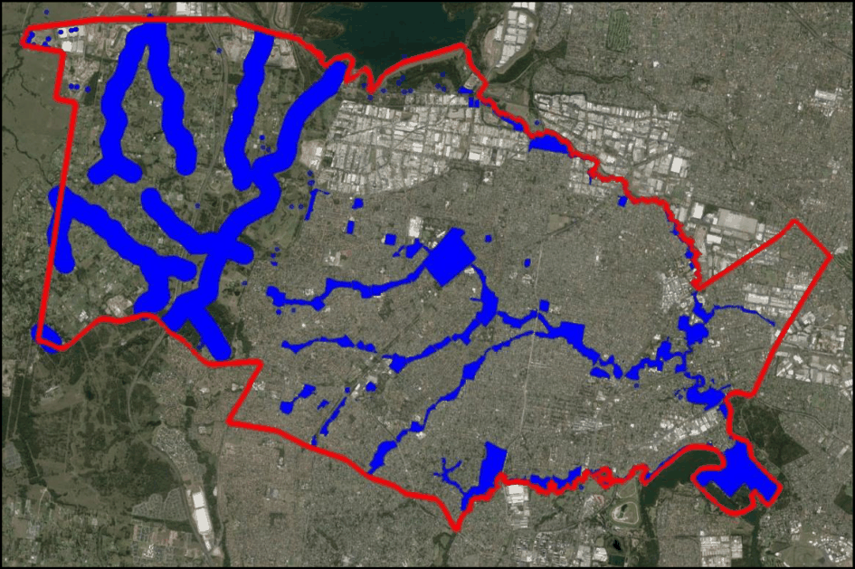

#### 3B.1 Aboriginal Heritage 3B.1 Introduction

The information and contents of Part 1 of this Chapter are based from the findings and recommendations of the Fairfield City Council Aboriginal Heritage Study 2017 which can be viewed on Council’s website at www.fairfieldcity.nsw.gov.au. The specific technical requirements of this section originate from the Department Climate Change, Energy , the Environment and Water (now known as Heritage NSW) Due Diligence Code of Practice for the Protection of Aboriginal Objects in New South Wales accessible via their website www.environment.nsw.gov.au.

#### 3B.1.1 Context

Aboriginal people have lived in the Fairfield Local Government Area for thousands of years. Their presence shaped the land encountered by the first Europeans and gave places like Cabramatta their name. Fairfield City Council understands the importance of both protecting and celebrating Aboriginal culture and heritage. One of the key ways to achieve this is by ensuring that the potential impacts of a development on Aboriginal heritage are considered.

## Chapter 3B – Heritage and Development

This section is designed to help applicants address the requirements of State Legislation and polices, including due diligence required by the National Parks and Wildlife (NP&W) Act 1974, as well as the Environmental Planning and Assessment (EP&A) Act 1979.

The objectives of Part 1 Aboriginal Heritage are:

a) To ensure that new development takes appropriate account of the significance of Aboriginal heritage and that no Aboriginal objects are damaged in the development;

b) To promote the protection or conservation of Aboriginal objects or places; and

c) To respect and celebrate Aboriginal Heritage in Fairfield City.

#### 3B.1.2 What is Aboriginal Heritage

Aboriginal heritage can include any object or place used by Aboriginal people up to and including the present day. Aboriginal heritage is not limited to the physical remains of a place such as a structure or archaeological site, but can also include the associations people have had, or continue to have with a place – a place’s social history and social significance.

Managing Aboriginal heritage is therefore not only limited to protecting a place from development impact, it is also about celebration, remembrance and recognition. In some cases, this can be achieved through permanent signage onsite (even where nothing physical remains of the place), documenting oral histories, curating an arts exhibition or creating a website.

#### 3B.1.3 Statutory Requirements

Aboriginal heritage is protected by a range of State legislation and policies. Consideration of the potential impacts of development on Aboriginal heritage is a key part of the environmental impact assessment process under the Environmental Planning and Assessment (EP&A) Act 1979. Additionally, under Section 86 of the National Parks & Wildlife (NP&W) Act 1974 it is an offence to harm either an Aboriginal object or Aboriginal Place in NSW either knowingly [s86(1)] or unknowingly [s86(2)].

#### 3B.1.4 Due Diligence

For activities that are not low impact and not on disturbed land (as defined within the National Parks and Wildlife Regulation 2019), evidence of following due diligence procedures in development is a defence against prosecution for the strict liability offence under s86(2) of the NP&W Act 1974 if an Aboriginal Object or Place is unknowingly harmed without an Aboriginal Heritage Impact Permit (AHIP).

The Office of Environment and Heritage has a Due Diligence Code of Practice, designed to assist proponents to exercise due diligence when carrying our activities that may harm Aboriginal objects and to determine whether they should apply for consent in the form of an Aboriginal Heritage Impact Permit (AHIP).

The due diligence procedure sets out reasonable and practicable steps which individuals and organisations need to take in order to:

a) Identify whether or not Aboriginal objects are, or are likely to be, present in an area.

## Chapter 3B – Heritage and Development

b) Determine whether or not their activities are likely to harm Aboriginal objects (if present).

c) Determine whether an AHIP application is required.

Council has its own detailed due diligence procedure that is applied during the Development Assessment process based on the Department Climate Change, Energy, the Environment and Water Due Diligence Code of Practice.

Prior to a submission of a Development Application proponents are able undertake an initial assessment of the potential impacts of their development on Aboriginal Heritage in accordance with the Due Diligence Code of Practice.

#### 3B.1.5 Low impact activities on disturbed land

The requirement to undertake Due Diligence for proposed activities has exemptions for ‘low impact activities’ in ‘disturbed lands’. These are defined by the National Parks and Wildlife Regulation and may be subject to change.

See http://www.legislation.nsw.gov.au/ for up to date regulations. The list of ‘low impact activities’ in the Regulation is lengthy and includes many common open space maintenance activities, however for example, does not include activities such as the construction of a new dwelling or road.

The list of ‘disturbed lands’ in the Regulation is also lengthy however, generally, land is considered ‘disturbed’ if it has been the subject of a human activity that has changed the land’s surface, being changes that remain clear and observable. Some examples of activities that may have disturbed land include soil ploughing, the construction of rural infrastructure (such as dams and fences), roads, trails and tracks, buildings or structures, substantial grazing or earthworks.

The exemption only applies to ‘low impact activities’ in ‘disturbed land’. It does not apply to other activities in ‘disturbed land’. For example, constructing a house on land defined under the Regulation as ‘disturbed’ is not an exempt activity.

NOTE: The exemption for ‘low impact activities’ in ‘disturbed land’ does not apply to Aboriginal Scarred trees whether or not they are ‘known’ through recording on the AHIMS Register.

#### 3B.1.6 Potential Investigation Areas (PIA)

To assist in the identification of areas of the City where Aboriginal Heritage needs to be taken into account, Council’s Aboriginal Heritage Study identified Potential Investigation Areas based on best current archaeological practice (Figure 1). These areas include:

• Relatively undisturbed ground within 200 metres of creekline or major ridgeline.

• Land within 50 metres of known aboriginal Sites.

• Aboriginal Historical Places.

## Chapter 3B – Heritage and Development

Properties within Potential Investigation Areas will be noted within a Section 10.7 (2) &(5) certificate.

More information on the methodology behind the determination of Potential Investigation Areas in Fairfield City is available within Section 6.2.2 of the Fairfield City Council Aboriginal Heritage Study 2017.

> [Picture on page 6: a picture, saved as a picture (images/chapter-03b-heritage-development-page-6-1.gif, 150 dpi).]

Figure 1: Potential Investigation Areas within Fairfield City Council.

#### 3B.1.7 Procedure for Development Assessment

Each Development Application’s impact on Aboriginal Heritage will be assessed by Council in accordance with the principles of Council’s own Aboriginal Heritage Management system as recommended under Council’s Aboriginal Heritage Study 2017.

## Chapter 3B – Heritage and Development

If Council deems that a development may have an impact on Aboriginal Heritage, an Aboriginal Heritage Assessment will be required. The requirements for an Aboriginal heritage Assessment are outlined below (Section 15.1.8 and 15.1.9). Under the development assessment process, if Council advises that an Aboriginal Heritage Assessment is not required, this indicates that there is a low likelihood that Aboriginal objects will be impacted by the proposal. It does not however constitute a guarantee that no Aboriginal heritage may be exist on a site.

Any Aboriginal objects which may be present within the property are still legally protected. All development applications in potential investigation areas contain an advisory note that outlines the legal responsibilities of all proponents regarding Aboriginal heritage.

NOTE 1: The presence of Aboriginal objects on a site does not prevent development from occurring. However, modifications may be required to a development to accommodate the presence of Aboriginal heritage.

#### 3B.1.8 Requirements for Aboriginal Heritage Assessment

Where proponents are required to provide an Aboriginal heritage assessment, the following standards need to be met. This will ensure that the assessment is consistent with the Department Climate Change, Energy, the Environment and Water Due Diligence Assessment Code of Practice for the Protection of Aboriginal Objects in New South Wales and the obligations of Council. Any Aboriginal heritage assessment report submitted to Council should:

• Be undertaken by a suitably qualified Aboriginal heritage consultant;

• Also meet the requirements for Due Diligence as per the Due Diligence Code of Practice for the Protection of Aboriginal Objects in New South Wales;

• Contain evidence of Aboriginal community consultation with the relevant Local Aboriginal Land Councils;

• Include evidence of a current (no more than 12 months old) search of the AHIMS Aboriginal Sites Register and consideration of relevant previous Aboriginal heritage investigations;

• Involve a field inspection, or justification as to why an inspection was not considered necessary (for example if background research confirmed that the land has been comprehensively disturbed in the past);

• Consider ways in which harm to known or potential Aboriginal objects can be avoided in relation to the proposed activity and outline the steps to be followed to ensure this (e.g. an alternative location or method of construction);

• Identify further requirements in situations where harm cannot be avoided (e.g. archaeological test excavation, applications for an Aboriginal Heritage Impact Permit).

## Chapter 3B – Heritage and Development

#### 3B.1.9 Actions resulting from Aboriginal Heritage Assessments

All Aboriginal heritage assessments received by Council will be reviewed to determine:

a) If the assessment and documentation is sufficient to support a determination in relation to the proposal;

b) If the assessment report and proposal will require referral to Heritage NSW as Integrated Development under Part 4 of the Environmental Planning and Assessment Act (1979).

It is noted that there are some options under current procedure which allow further investigation without referral to Heritage NSW. Under the Department Climate Change, Energy, the Environment and Water Code of Practice for the Archaeological Investigation of Aboriginal Objects in NSW, in certain circumstances, archaeological test excavation can be undertaken without an Aboriginal Heritage Impact Permit.

As part of the Aboriginal Heritage Assessment, a proponent may decide, on advice from their Aboriginal heritage consultant, that such test excavations will take place prior to obtaining development consent. The resulting report is described as an Aboriginal Cultural Heritage Assessment report and will require referral to Heritage NSW unless no Aboriginal objects were uncovered during the excavations and it is assessed that no potential harm will arise from the proposed development activity.

NOTE: The requirements stated in 2.1 and 2.2 above will not apply to developments where there is no:

a) Disturbance of the soil, or

b) Construction works on the land. For the purposes of this section, any internal or external works to an existing building is not deemed to be construction work.
