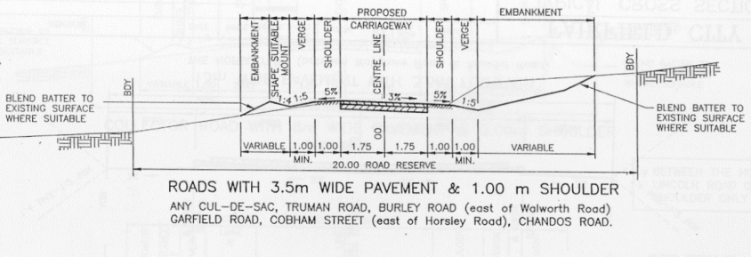
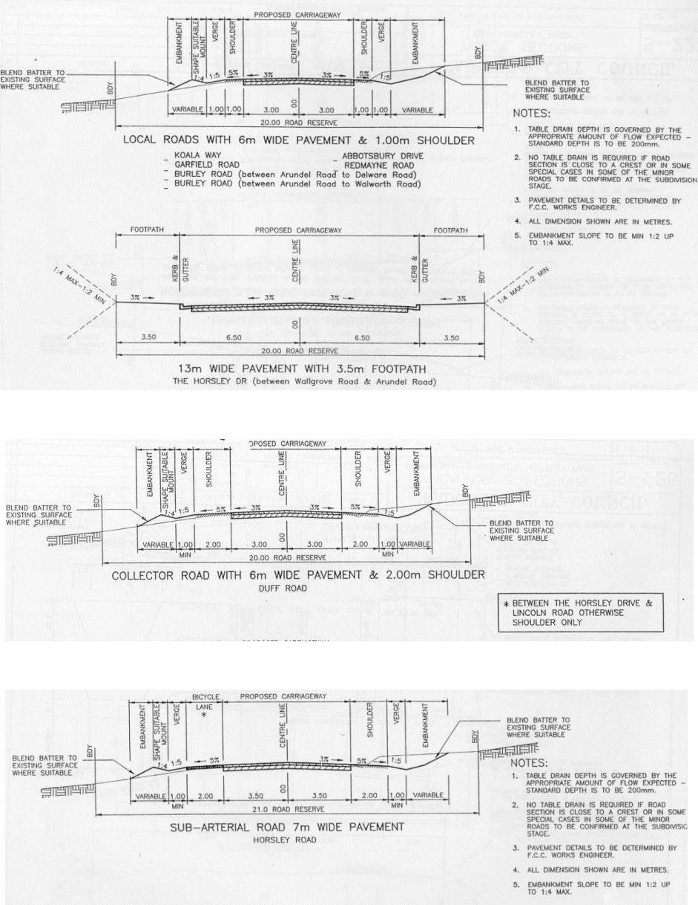
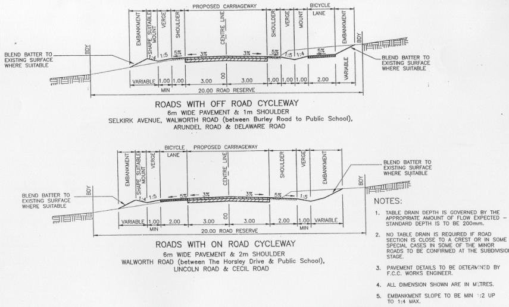
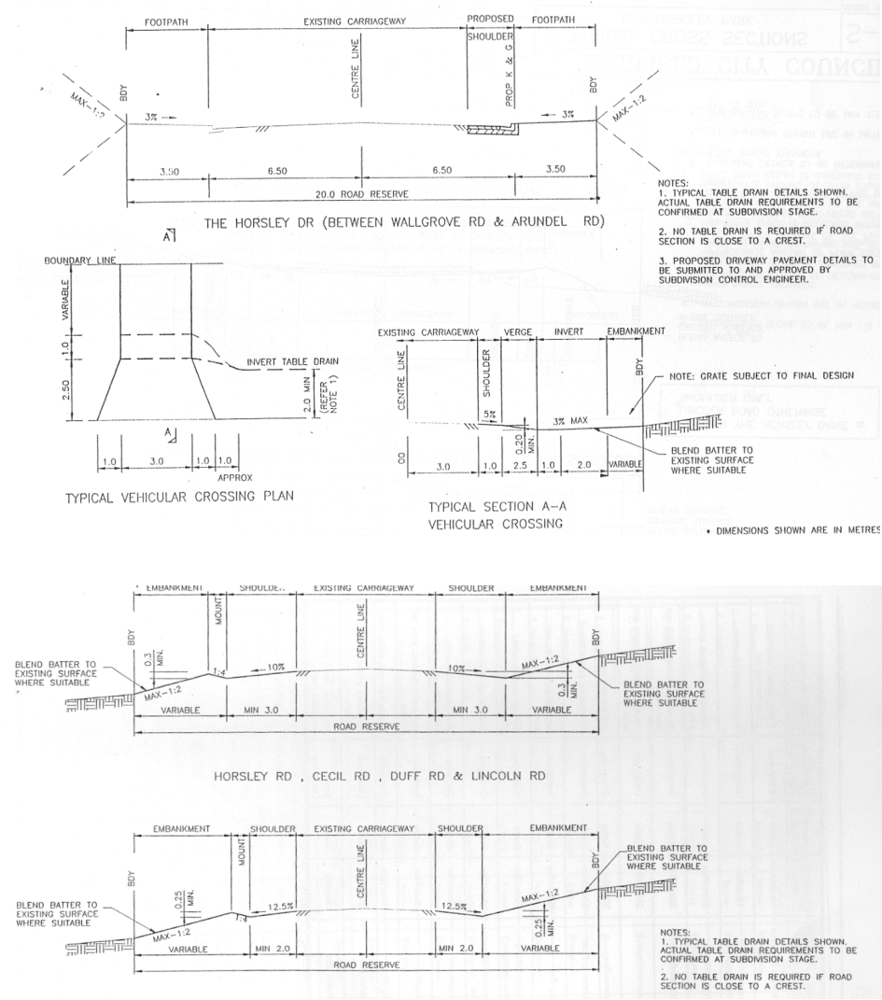
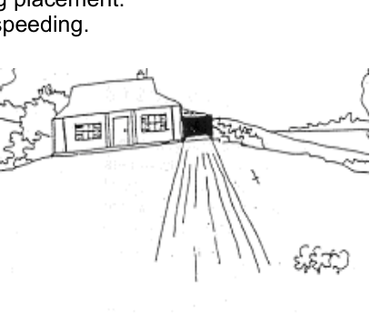
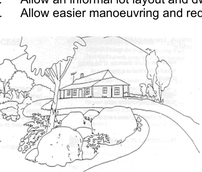

#### 4A.2  Road Access and Points

#### Overview

To outline development controls regarding road widths, construction of road verges, cycle ways and access points to properties.

#### Objective

To ensure road construction in the rural area is consistent with other areas of the City and where appropriate provided in a manner conducive to local conditions.

#### Controls

#### 4A.2.1 Roads (General)

a) A 20 metre road reserve applies for all public roads in the rural area as it does across other areas of the City. Generally, the sealed carriageway width will be shown on the typical cross sections for the roads in the area. These cross sections are outlined in the following figures:

#### Typical Cross Sections – DCP Horsley Park

> [Picture on page 4: a picture, saved as a picture (images/chapter-04a-development-in-rural-zones-page-4-19.gif, 150 dpi).]

## Chapter 4A – Development in the Rural Zones

## Chapter 4A – Development in the Rural Zones

> [Picture on page 5: a picture, saved as a picture (images/chapter-04a-development-in-rural-zones-page-5-2.gif, 150 dpi).]

> [Picture on page 6: a picture, saved as a picture (images/chapter-04a-development-in-rural-zones-page-6-1.gif, 150 dpi).]

#### 4A.2.2 Regional Roads

For these roads, a 7 metre wide sealed carriageway with 2 metre wide shoulders plus table drain applies

#### 4A.2.3 Collector Roads

For these roads, a 6 metre wide sealed carriageway with 2 metre wide shoulders plus table drain applies.

#### 4A.2.4 Local Roads

For these roads, a 6 metre wide sealed carriageway with 1 metre wide shoulders plus table drain applies.

## Chapter 4A – Development in the Rural Zones

#### 4A.2.5 Minor Access Roads and Cul-de-sac

a) For these roads, a 3.5 metre wide sealed carriageway with 1 metre wide shoulders plus table drain applies.

b) Each developer will be required to carry out the following works for the full property frontage:

## Chapter 4A – Development in the Rural Zones

> [Picture on page 7: a picture, saved as a picture (images/chapter-04a-development-in-rural-zones-page-7-2.gif, 150 dpi).]

i. Construction of a low maintenance turfed road verge in accordance with the following figures.

ii. That the velocity of stormwater run-off exceeds the scour velocity of the turf lining.

iii. Avenue type tree planting to be provided.

iv. Where deemed necessary by Council, construction of a turfed flow path through the property carrying flows from road culverts away from development sites.

v. Construction of a sealed access from the existing road pavement to the property boundary for all existing and proposed houses or lots.

vi. Where possible all existing piped driveway crossings will be removed and replaced with a sealed access pavement.

c) Before commencement of any works requiring the removal of any ground cover, suitable soil erosion protection measures must be implemented. Such measures may include but need not be limited to sediment traps or ponds, diversion banks and silt fencing.  All exposed areas of soil must be turfed or seeded and mulched immediately following completion of earthworks.

#### 4A.2.6 Cycleways

a) A cycleway network has been designed for the area, which is a combined on-road and off-road facility.  The on-road cycleway will be 2.5 metre wide and will be delineated from the normal road carriageway by the use of a different coloured asphalt.

b) The off-road facility will also be 2.5 metre wide and will be a combined pedestrian footway and cycleway.  This facility will have a turfed surface.

#### 4A.2.7 Access Points

a) Access driveways should as far as possible follow natural contours rather than cutting across the contours. Extensive cut and fill should be avoided in order to:

i. Retain the natural character of the site by reducing the intrusive appearance of driveways.

ii. Lessen the possibility of erosion thereby minimising maintenance costs.

> [Picture on page 8: a picture, saved as a picture (images/chapter-04a-development-in-rural-zones-page-8-21.gif, 150 dpi).]

> [Picture on page 8: a picture, saved as a picture (images/chapter-04a-development-in-rural-zones-page-8-22.gif, 150 dpi).]

iii. Allow an informal lot layout and dwelling placement.

iv. Allow easier manoeuvring and reduce speeding.

## Chapter 4A – Development in the Rural Zones

#### Satisfactory

#### Unsatisfactory

#### Unsatisfactory

Driveways located straight down slopes are susceptible to erosion and will require constant maintenance. They are clearly visible to the public and destroy the natural character of the land.

#### Satisfactory

A well positioned driveway which flows natural contours is pleasant and easy to drive on and preserves the natural character of the site

A well-positioned driveway which follows  natural contours is pleasant and easy to drive on and preserves the natural character of the site.

Driveways located straight down slopes are susceptible to erosion and will require constant maintenance. They are clearly visible to the public and destroy the natural character of the land.

b) Driveways are to be landscaped along the edges and should be constructed of compacted gravel, paved or sealed in brown, green, grey or ochre tones. Regardless of the proposed method of internal construction all driveways must be sealed between and the property boundary in accordance with drawing S-226 found in this chapter.

c) Access handles serving more than one hatchet lot must be not less than 10 metres in width. Driveways within such access handles should have a 3 metres wide sealed pavement and should avoid long straight sections.  Access handles serving a single lot must be not less than 7 metres in width; single lot driveways must have an all weather surface with a minimum width of 3 metres.  Details of proposed driveway lots and landscaping are to be submitted with the development application.

d) The number of access points to arterial roads should be minimised. Subdivision design should provide access via adjacent local roads. Where such arrangements cannot be made, common access points/driveways should be established as part of the proposed subdivision. A buffer area of 10 metres should be provided between a regional road and an access driveway. This setback should be appropriately landscaped to reduce visible road. Suitable landscaping should include vegetation.

e) Refer to Council’s Vehicular Crossing Policy for further information regarding driveway and layback design controls.
