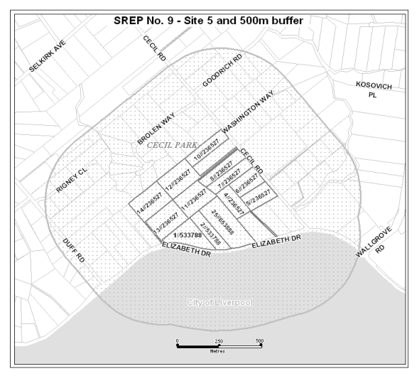
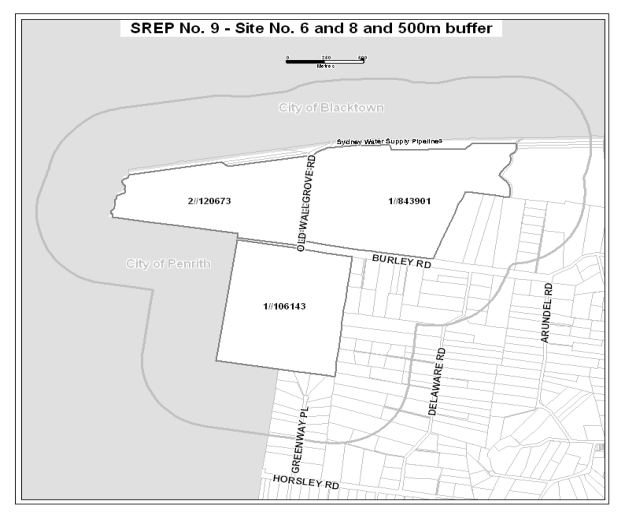
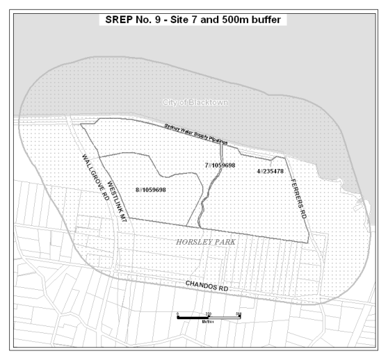

#### 4A.5  Residential Development near Extractive Industries

#### Overview

## Chapter 4A – Development in the Rural Zones

State Environmental Planning Policy (Resources and Energy) 2021 provides for controls, referrals to State Government Departments and other matters for consideration for developments located within the vicinity of extractive industry.

The following extractive industry sites are identified within Fairfield City under Schedule 3, Division 1 within SEPP (Resources and Energy) 2021. If your property is located within 500 metres of an extractive industry boundary, certain development controls may apply to your land.

#### Site 5

Lots 4–8 and 10–14, DP 236527; Lots 1–2, DP 533788 and Part Lot 25 (Section 5), DP 2954, Cecil Road, Cecil Park. PGH Brickworks, Cecil Park. (Now Lots 4-8 and 10-14, DP 236527; Lots 1-2, DP 533788 and Lot 25, DP 653888).

#### Site 6

Lot 1, DP 106143 Cnr. Old Wallgrove Road and Burley Road, Horsley Park.

PGH, Horsley Park.

#### Site 8

## Chapter 4A – Development in the Rural Zones

Lot 2, DP 120673, Old Wallgrove Road, Horsley Park. Land in Conveyance Book 2842 No 807, excluding Lot 1, DP 579002, Old Wallgrove Road, Horsley Park, being Part Portion 32 and Part Portion 45, Parish of Melville, County of Cumberland. Austral Plant 3, Horsley Park. (Now Lot 2, DP 120673; Lot 1, DP 843901).

> [Picture on page 11: a picture, saved as a picture (images/chapter-04a-development-in-rural-zones-page-11-28.gif, 150 dpi).]

> [Picture on page 11: a picture, saved as a picture (images/chapter-04a-development-in-rural-zones-page-11-29.gif, 150 dpi).]

Site 7 - Lots 3 and 4, DP 235478; Lot 1, DP 206617; Lot E, DP 384514 Wallgrove Road, Horsley Park. Austral Plants 1 and 2, Horsley Park. (Now Lot 4, DP 235478; Lots 7-8, DP 1059698).

> [Picture on page 12: a picture, saved as a picture (images/chapter-04a-development-in-rural-zones-page-12-8.gif, 150 dpi).]

#### Objectives

a) To ensure development will not be adversely affected by noise, dust, vibration or reduced visual amenity from any nearby extractive industry.

b) To ensure development will not adversely affect any existing or future activity associated with any nearby extractive industry.

#### Controls

a) Council must not consent to development in the vicinity of extractive industry sites unless it is satisfied that:

## Chapter 4A – Development in the Rural Zones

i. the proposed development will not be adversely affected by noise, dust, vibration or reduced visual amenity from any nearby extractive industry, and

ii. the proposed development will not in any way adversely affect any existing nearby extractive industry or prevent any such extractive industry from realising its full economic potential by adversely affecting future expansion of the extractive industry of which the Council is aware.

b) Noise and Vibration Reports – For dwelling houses, secondary dwellings and sensitive land uses located within the 500 metre buffer from a nominated extractive industry site, the submission of an acoustic report must accompany all development applications.

i. A noise and vibration report, prepared by a suitably qualified acoustic engineer, showing how the predicted maximum noise levels will be mitigated, must be submitted to Council. As a guide:

ii. the predicted noise is to be attenuated to a level that complies with AS/NZS 2107:2000 Australian/New Zealand Standard™ Acoustics—Recommended design sound levels and reverberation times for building interiors. Appropriate criteria for external recreational areas of the dwelling that fall within the 500 metre buffer are to be determined by the acoustic consultant.

c) Dust suppression and visual amenity - Landscaping plans should demonstrate appropriate landscaping that will assist to both reduce dust (permitted through environmental regulations) and visually screen quarry sites.
