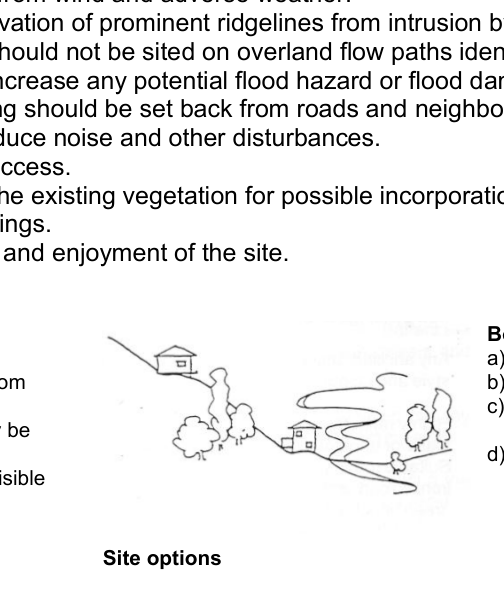
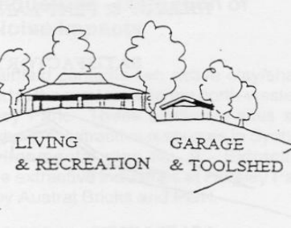
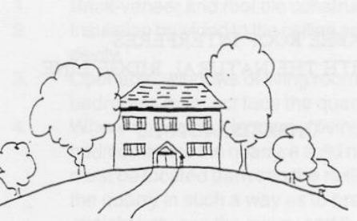
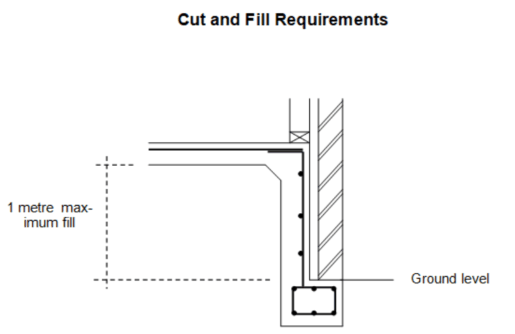

#### 4A.7  Criteria for Rural Building Design

#### Overview

The controls as described below set out the criteria for building design on rural land. Sensitive siting and design of structures and the use of landscaping are important to minimise the impact of the overall development on the landscape.

Consideration also needs to be given to the design and siting of buildings on rural land prior to determining the subdivision layout, as this will determine the future pattern of the built environment.  Controls for subdivision of rural land are set out in Chapter 14, Section 14.3.

#### Objectives

a) To ensure building designs respond to the natural features and topography of the land.

b) To preserve existing landscape features.

#### Controls

#### 4A.7.1 Siting of development

#### Mid slope

a) Views

b) Protected from

#### Bottom slope

a) Least exposed

b) Least prominent

c) Could be in frost

winds

c) Access may be

hollow

d) Easily accessible

## Chapter 4A – Development in the Rural Zones

difficult

d) Not highly visible

(except in periods of flood)

a) In determining the siting of a building, consideration should be given to the following factors:

i. Dwellings should be orientated to make the best use of sunlight and views. Living areas should have a northerly aspect to maximise energy and the amount of sunshine that a building is exposed to during the year.

ii. West facing walls should have very few windows for protection against hot westerly winds and summer sun.

iii. Slopes and access to views.

> [Picture on page 15: a picture, saved as a picture (images/chapter-04a-development-in-rural-zones-page-15-31.gif, 150 dpi).]
> Words printed on the picture (title and legend, copied from the PDF):
> Site options

iv. Protection from wind and adverse weather.

v. The preservation of prominent ridgelines from intrusion by new buildings.

vi. Buildings should not be sited on overland flow paths identified by Council. This may increase any potential flood hazard or flood damage to buildings.

vii. The dwelling should be set back from roads and neighbouring dwellings in order to reduce noise and other disturbances.

viii. Driveway access.

ix. Retaining the existing vegetation for possible incorporation with the landscape of the buildings.

x. Future use and enjoyment of the site.

#### 4A.7.2 Specific building design criteria

a) Avoid monolithic structures by grouping buildings in a more sympathetic way, through the use of landscaped features and contours, as depicted in the figures above and below.

#### Clumsy

solution:

Living, recreation, garage, tool room and storage spaces all incorporated into one monolithic structure

> [Picture on page 16: a picture, saved as a picture (images/chapter-04a-development-in-rural-zones-page-16-12.gif, 150 dpi).]

#### Satisfactory

> [Picture on page 16: a picture, saved as a picture (images/chapter-04a-development-in-rural-zones-page-16-14.gif, 150 dpi).]

#### Unsatisfactory

The roofline of a building is critical to the way that the building blends in with the natural topography of the land. On flat landscapes and sites with hills as backdrops, hipped roofs are generally more appropriate.  Split-level homes are generally more suited to sloping sites.

The roofline can be staggered according to degree of slope. The use of wider eaves, and in particular, verandas, can bring the roof edge closer to the ground thereby integrating the dwelling into the overall landscape. Dormer windows can be used to allow upper floor accommodation while minimising wall height and roof bulk.

#### 4A.7.3. Building Materials

a) The predominant colours of the rural area are the range of greens, greys and brown of the vegetation. Similar or complementary colours are therefore appropriate for new buildings and additions. Any ancillary buildings should be similar materials, style and colour to the main dwelling building.

b) Highly reflective surfaces such as large expanses of glass or unpainted metal decking should be avoided.  Suitable roofing materials include painted corrugated iron, colourbond, slate, shingles or tiles in grey, brown, green or ochre tones

## Chapter 4A – Development in the Rural Zones

c) The materials used must also achieve the following outcomes:

i. Durable and robust construction, and

ii. Achieve adequate acoustic amenity, natural ventilation and access to sunlight for the occupants of the secondary dwelling.

d) The table below identifies set colours and material that are to be used which allow the building to be compatible with the character of the locality.

| Building Element | Material | Colours |
|---|---|---|
| Roof | Tiles Corrugated metal | Olive, Brown, Red (no black) Olives - Evening Haze, Cove, Mangrove, Pale Eucalypt, Jasper, Bushland. Greys – Windspray, Gully, Wallaby, Smurfmist, Dune. Browns- Paperbark, Terrain. (no black) |
| Walls | Face brick Timber weatherboard | Monochromatic, dichromatic and polychromatic or recycled (no black) Avoid dark colours (no black) |
| Guttering | Metal (aluminium, zinc, steel, copper, lead) | Unpainted or to match roof |
| Downpipes | Metal (aluminium, zinc, steel, copper, lead) | Unpainted or to match walls |
| Door and window framing | Timber Metal (steel or aluminium) | Avoid dark colours Avoid dark colours |
| Ground surfaces | Gravel Recycled bricks Pavers Bitumen with brick edge | Red, grey, brown N/A N/A N/A |
| *Avoid black, dark grey and stark/bright white for large surfaces including walls and roofs and limit non- permeable ground surfaces like concrete. |  |  |

#### 4A.7.4 Setbacks

## Chapter 4A – Development in the Rural Zones

a) Front:

i. No building is to be built within 30 metres of either Wallgrove Road or Elizabeth Drive.

ii. In all other situations the minimum setback shall be no less than 15 metres or the average existing setback whichever is the less.

b) Side & Rear:

i. Dwellings must be setback a minimum of 5 metres.

ii. Ancillary structures must be setback a minimum of 3 metres, from the boundary, this includes retaining walls and driveways.

#### 4A.7.5 Swimming Pools

#### Objectives

a) Ensure swimming pool safety.

b) Minimise noise levels.

#### Controls

a) Swimming pools are to be separated from any residential building situated on the premises, by a child resistant barrier, in accordance with the Swimming Pools Act.

b) Swimming pools must be located in the rear yard.

c) Swimming pool filters are to be installed in a location that will not cause a noise nuisance to surrounding residents. The louder a swimming pool filter is the greater the required installation distance from any adjoining property boundary.

d) Swimming pools are to be built on, or in the ground and not elevated more than

1.0 metre above the ground.

e) In addition to the swimming pool controls, all private open space and landscaping requirements must be met.

Note 1: To lessen the required distance from an adjoining boundary the swimming pool filter can be located within an approved prefabricated acoustic enclosure. These enclosures will quieten the filter by approximately 15 – 20 dB(A) which will decrease the required distance from an adjoining boundary.

#### 4A.7.6 Building Height

a) Building Height is determined by reference to the Building Height Map which forms a part of Fairfield LEP 2013.

b) The maximum building height within the RU2, RU4 and RU5 zone is 9 metres at any point. Within these zones dwellings should be no greater than two storeys in height.

c) The wall height of the building should not exceed 6.5 metres above natural ground level at any point and the overall height of the building including the roof shall not exceed 9 metres.

d) Ancillary structures should not exceed 5 metres in height, including the roof, above

> [Picture on page 18: a picture, saved as a picture (images/chapter-04a-development-in-rural-zones-page-18-26.gif, 150 dpi).]

natural ground level.

## Chapter 4A – Development in the Rural Zones

#### 4A.7.7 Cut and Fill

#### Objectives

a) Reduce the necessity for retaining walls.

b) Reduce stormwater problems associated with changing the natural contours of the land.

c) Reduce the necessity to import fill onto the premises

d) Reduce stormwater problems associated with changing the natural contours of the land.

#### Controls

a)  All proposed and existing ground levels are to be shown to Australian height datum

b) A maximum fill level of 1 metre will be permitted where the filling is contained within the building envelope by a drop edge beam.

c) Filling of land outside of the building envelope is not permitted.

d) Any cut proposed is required to be appropriately retained.

e) Proposed retaining walls must be included in the description of works in the development application.

f) The height of retaining walls are to be shown along with a minimum 3 metre setback from the boundary.

Note 1 - Where retaining walls are required as a result of cut for the development, details of the retaining walls or other approved methods necessary to prevent soil movement, together with associated stormwater drainage measures shall be submitted. Development consent shall be obtained for any proposed retaining wall not defined as exempt development under the State Environmental Planning Policy (Exempt and Complying Development Codes) 2008.

## Chapter 4A – Development in the Rural Zones

#### 4A.7.8 Rural ancillary structures

a) The maximum size of a rural ancillary structure proposed on a site with an approved dwelling shall be:

i. for an awning 100sqm,

ii. for a carport 100sqm,

iii. for an attached garage for 100sqm,

iv. for a detached garage 100sqm,

v. for a basement 300sqm,

vi. for an outbuilding 75sqm,

vii. for a rural shed 150sqm.

b) Only two enclosed rural ancillary structures of any type such as a detached garage or rural shed or the like are permitted per dwelling.

c) For enclosed rural ancillary structures over 60sqm in size, an internal layout must be provided.

d) Habitable outbuildings are not supported.

#### 4A.7.9 Fencing

To maintain a rural setting, boundary and other fencing should be inconspicuous. Post and wire or post and rail fences in natural or earth tones are preferred. Hedges are also suitable.

#### 4A.7.10 Proposals for or to retain a dam

a) All existing dams on flood liable land are to be removed and the surface reinstated at the time of subdivision or building construction (whatever comes first) unless the applicant can demonstrate that retention of a dam will mitigate flooding.

b) The stability of a dam proposed to be retained must be certified by a suitably qualified engineer before approval of any development application relating to that property.

c) Development downstream of any dam is to be located clear of the flow path created

## Chapter 4A – Development in the Rural Zones

in the event of a dam-break. The flow path is to be determined by a qualified engineer and provided with the development application.

d) A proposal to fill an existing dam or excavate a new dam requires a development application accompanied by an environmental assessment and a qualified engineer’s report, which must detail aspects of dam safety and effects on neighbouring properties and the potential impact on the environment.

e) The Office of Water should be consulted for licensing requirements if the new dam to be constructed exceeds the harvestable right.
