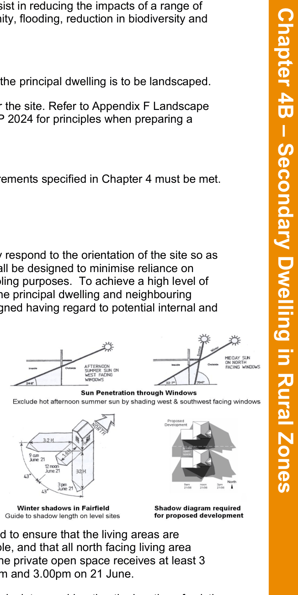

#### 4B.4  Open Space and Landscaping 4B.4.1 Private Open Space

To ensure that all residents have access to private open space to meet their needs, such as clothes drying and gardening, it is necessary to require a separate private open space for the secondary dwelling.

## Chapter 4B – Secondary Dwelling in Rural Zones

#### Objectives

a) To ensure all proposed private open space is usable, functional and easily accessible for the residents.

b) To ensure private open space includes soft soil zones.

c) To ensure direct access and a relationship between indoor and outdoor living areas is provided.

#### Controls

a) The principal and secondary dwelling must have its own separate private open space.

b) The secondary dwelling must have 24sqm of private open space.

c) The private open space area must have a 4 metre by 4 metre level ground area of soft soil zone in the rear yard.

d) The private open space should be appropriately located to ensure occupants of either dwelling do not pass through the private open space of the other dwelling.

e) In the calculation of the 24sqm of private open space:

i. no area less than 2.5 metres in width will be included;

ii. outdoor clothes drying areas are included as private open space; and

iii. car parking spaces are not included in open space calculations.

f) The private open space must adjoin any alfresco area and living areas, such as a lounge room, a family room, a dining room or a kitchen.

g) Alfresco areas are to be completely open on two or more sides.

h) A garage or gate must provide access between the private open space and the driveway. This will allow items stored in backyards (e.g., garbage bins, garden tools) to be moved to the street without needing to come through the house.

i) Fencing located on secondary road boundary, a maximum of 1.5 metre height applies to 50% of the length of all contiguous secondary road boundaries, a maximum of 50% of the secondary road boundary may have a maximum of 1.8 meters high fencing.

j) Private open space must be located behind a 1.8 metre high fencing.

#### 4B.4.2 Landscaping

All new secondary dwelling proposals in the rural zones are required to provide landscaping to complement existing vegetation on the site and neighbouring area.

## Chapter 4B – Secondary Dwelling in Rural Zones

Applicants are encouraged to engage the services of a qualified landscape person to prepare a landscape plan to accompany the application for a secondary dwelling.

#### Objectives

a) To encourage native plantings within the rural area

b) To soften the built form of a secondary dwelling

c) To ensure that soft soil zones proposed responds to natural features, soften the appearance of developments, improve the living quality of the neighbourhood

> [Picture on page 13: a picture, saved as a picture (images/chapter-04b-secondary-dwelling-in-rural-areas-page-13-1.gif, 150 dpi).]

d) To encourage soft soil areas which assist in reducing the impacts of a range of environmental problems including salinity, flooding, reduction in biodiversity and climate change.

#### Controls

a) A minimum of 50% of the front yard of the principal dwelling is to be landscaped.

b) A landscape plan must be prepared for the site. Refer to Appendix F Landscape Planning of the Fairfield City Wide DCP 2024 for principles when preparing a landscape plan.

#### 4B 4.3 Fencing

For fencing provisions, any relevant requirements specified in Chapter 4 must be met.
