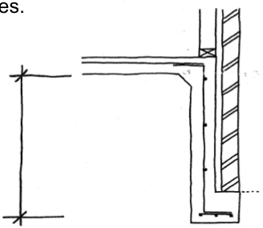

#### 4B.6  Stormwater

The provision of drainage and reuse of rainwater is important to reduce flooding, stormwater damage, and overland flow.  To achieve this concept plans and rainwater tanks are regulated.

#### 4B.6.1 Stormwater Disposal

#### Objectives

Stormwater disposal objectives include;

a) To direct stormwater runoff to Council’s drainage system without adversely impacting on neighbouring or downstream properties.

b) To ensure the efficient and effective planning, management and maintenance of Council’s existing and future stormwater systems and reduce environmental and property damage.

#### Controls

a) OSD requirements apply to parcels where there is an increase in the impervious nature of the site.

b) All pervious areas draining into the detention basin shall be treated as impervious unless runoff routing calculations are performed.

## Chapter 4B – Secondary Dwelling in Rural Zones

c) Where the site is fully affected by flooding, or overland flow paths, OSD requirements do not apply.  Applicants should seek more information on flooding by applying for a Section 10.7(2) and (5) certificate from Council, referring to Council’s Flood Risk Management Policy and by checking compliance with Council’s Flood Risk Management requirements (refer to Chapter 11 of this DCP).

d) The permissible site discharge shall be 78 l/s/ha.

e) In the interests of safety and amenity, ponded water depths are not to exceed:

i. Parking/paved areas – 0.2 metre.

ii. Landscaped areas – 0.5 metre.

iii. Covered storage – no limit.

iv. Fenced storage – no limit

v. Roof area – as required for structural integrity

f) Finished floor levels are to be at the following minimum levels:

i. Lockup garages – above the maximum 1 in 100 year water surface level.

ii. Finished habitable floor levels – 0.3 metre above the maximum 1 in 100 year water surface level.

g) OSD requires integration with the architectural design and layout of the development, ie the OSD system needs to be located so as not to compromise the location of the septic system.

All development applications must comply with Council’s Stormwater Management Policy 2017.For more information on Council’s policy on stormwater detention in rural areas applicants should refer to Council’s Rural Area On-site Detention Guidelines.

#### 4B.6.2 On Site Detention

#### Objectives

a) To ensure that through the use of OSD, stormwater discharge is controlled thereby ensuring development does not increase the risk of downstream flooding, erosion of unstable waterways or a reduction of the capacity of Council’s drainage network.

b) Relevant controls, performance criteria and where the policy applies can be found in Chapter 4 of the Stormwater Management Policy – September 2017.

#### 4B.6.3 Cut and Fill

#### Objectives

a) Reduce the necessity for retaining walls;

b) Reduce stormwater problems associated with changing the natural contours of the

> [Picture on page 16: a picture, saved as a picture (images/chapter-04b-secondary-dwelling-in-rural-areas-page-16-22.gif, 150 dpi).]

land;

c) Reduce the necessity to import fill onto the premises.

d) Reduce stormwater problems associated with changing the natural contours of the land.

e) Reduce the necessity to import fill onto

## Chapter 4B – Secondary Dwelling in Rural Zones

1 Metre

the premises.

#### Controls

Ground Level (existing)

a) All proposed and existing ground levels

#### The maximum permitted fill.

are to be shown to Australian height datum

b) A maximum fill level of 1 metre will be permitted where the filling is contained within the building envelope by a drop edge beam.

c) Filling of land outside of the building envelope is not permitted.

d) Any cut proposed is required to be appropriately retained.

e) Proposed retaining walls must be included in the description of works  in the development application.

f) The height of retaining walls are to be shown along with a minimum 3 metres from the boundary.

Note 1 - Where retaining walls are required as a result of cut for the development, details of the retaining walls or other approved methods necessary to prevent soil movement, together with associated stormwater drainage measures shall be submitted. Development consent shall be obtained for any proposed retaining wall not defined as exempt development under the State Environmental Planning Policy (Exempt and Complying Development Codes) 2008.

#### 4B.6.4 Rainwater Tanks

#### Objectives

a) Satisfy the requirement of the Building Code of Australia.

b) Position rainwater tank(s) to maximise rear yard space.

#### Controls

a) Above ground rainwater tanks are to be located a minimum of 3 metres from any neighbouring property boundary.

b) Only underground water tanks are permitted in the front yard and are encouraged to be placed under the driveway.

c) Pumps must comply with the noise requirements of the New South Wales Protection of the Environment Operations Act, 1997.
