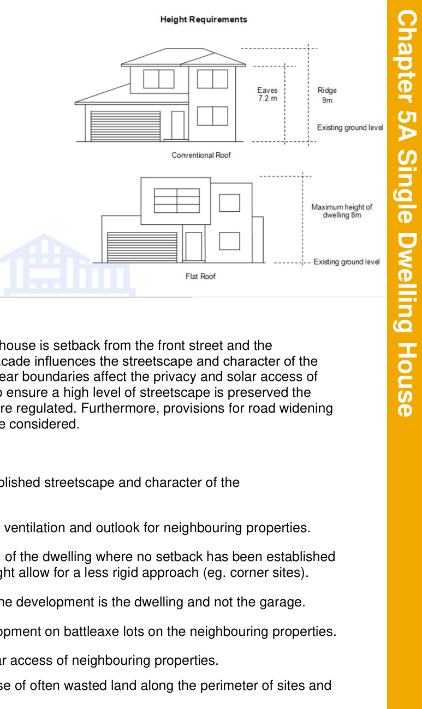
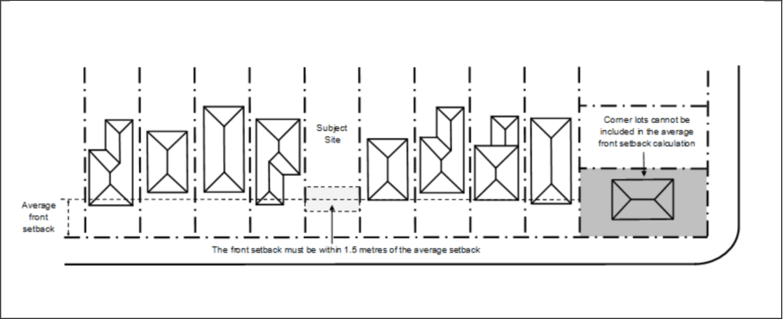
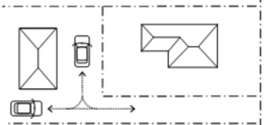
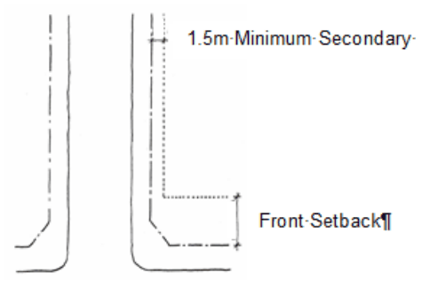
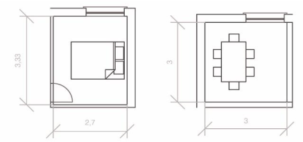
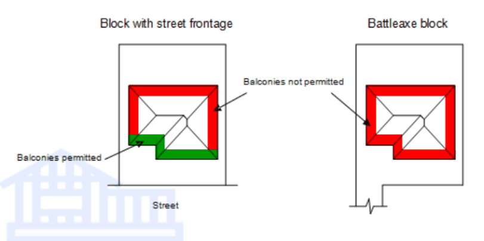
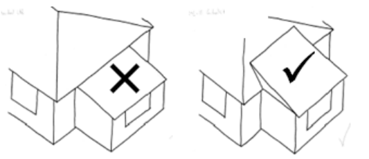

#### 5A.2 Built Form and Urban Design

The appearance, position and height of a single dwelling house may affect the streetscape and character of the neighbourhood. How a dwelling addresses the street and integrates with its neighbours influences the streetscape. To ensure a high level of residential amenity is maintained various building design elements are regulated.

#### 5A.2.1 Floor Space Ratio (FSR)

#### Objective

Ensure building bulk, site coverage and open space provisions are compatible with neighbouring development.

#### Controls

a) The maximum permissible floor space ratio for any development must comply with the floor space ratio standards prescribed on the Fairfield LEP 2013 Floor Space Ratio Map. The most common maximum floor space ratio for a single dwelling house development is 0.45:1

b) Calculation of Floor Space Ratio must comply with the Floor Space Ratio provisions defined in clause 4.5 Calculation of Floor Space Ratio and Site Area of the Fairfield LEP 2013.

c) Due to site constraints and other requirements of this plan, the maximum FSR may not always be achieved on every development site.

d) A basement is permitted within the footprint of the ground floor of the building, Note

- the footprint of the building does not include any outdoor areas such as alfresco or patio. Any basements in excess of the following maximum basement areas will be included in the total FSR calculations.

i. a site less than 450sqm permits a basement of 75sqm,

ii. a site more than 450sqm and less than 900sqm permits a basement of 150sqm,

iii. A site greater than 900sqm, permits a basement of 300sqm.

e) Lift shafts and service shafts cannot be excluded from FSR calculations in this chapter

f) Calculated gross floor area includes:

## Chapter 5A Single Dwelling House

i. the area of a mezzanine,

ii. habitable rooms in a basement or an attic, and

iii. Basement stairs, lift shafts on all floor levels.

g) Non calculated gross floor areas are:

i. any basement:

a. storage, and

b. vehicular access.

ii. car parking to meet any requirements of the consent authority (including access to that car parking), and

iii. terraces and balconies with outer walls less than 1.4 metres high, and

iv. voids above a floor at the level of a storey or storey above.

Note 1: The floor space ratio of buildings on a site is the ratio of the gross floor area of all buildings within the site to the site area.

Note 2: The gross floor area means the sum of the floor area of each storey of a building measured from the internal face of external walls, or from the internal face of walls separating the building from any other building, measured at a height of 1.4 metres above the floor.

Note 3: A maximum concession of 33sqm will be deducted for the garage area where two or more car parking spaces are proposed when calculating the gross floor area.

Note 4: Refer to the State Environmental Planning Policy (Exempt and Complying Developments Codes) 2008 for the Gross Floor Area definition.

Note 5: Refer to Fairfield Local Environmental Plan 2013 for definition of a basement.

#### 5A.2.2 Building Height

#### Objectives

a) Ensure new development is consistent and compatible with the established built form and hence results in a physically cohesive neighbourhood.

b) Ensure minimal overshadowing of neighbouring properties.

c) Ensure privacy of neighbouring properties is protected by limiting side and rear views of neighbouring properties.

d) Maintain sunlight in public and private open spaces.

#### Preamble

The maximum permissible building height for any development must comply with the building height standards prescribed on the Fairfield LEP Height of Building Map.

a) Ground level (existing) is defined in Fairfield LEP 2013 as the existing level of a site at any point. Note: Such ground level must be natural or lawfully approved.

b) Clause 5.6 of Fairfield LEP 2013 allows the maximum building height to be exceeded where the roof is determined to be a decorative architectural feature. Refer Clause 5.6 of Fairfield LEP 2013 for details.

## Chapter 5A Single Dwelling House

c) Some dwellings may need to be lowered in height to comply with the DCP’s requirements for solar access and privacy (See 5A.5.1 Solar Access and 5A.5.3 Privacy).

d) All two storey dwelling applications must include a sectional diagram that indicates the height of the dwelling from ground level (existing).

#### Controls

The following controls apply in all cases where the Fairfield LEP Height of Building Map indicates a maximum building height of 9 metres is applicable. Such height typically applies in the RU5 Village, R1 Residential and R2 Low Density Residential zones.

a) A maximum of two (2) storeys above ground level (existing) plus an attic or basement is permitted.

b) The maximum heights of the eave and the ridge from the ground level (existing) must be 7.2 metres and 9 metres respectively.

c) Development  proposing parapet walls, flat roofs and high continuous walls shall be limited to 8 metres in height from ground level (existing) and are to provide articulation.

d) Pedestrian access to a roof terrace on flat roofs will not be supported.

e) For battleaxe blocks, the maximum ridge height is 8 metres and

6.5 metres to the underside of the eaves or 8 metres for flat roofed dwellings to allow for sloping blocks.

f) For battleaxe blocks, habitable rooms other than bedrooms or studies will not be supported on the upper floor.

#### 5A.2.3 Setbacks

> [Picture on page 7: a picture, saved as a picture (images/chapter-05a-single-dwelling-house-page-7-19.gif, 150 dpi).]

## Chapter 5A Single Dwelling House

The distance a single dwelling house is setback from the front street and the appearance of the dwelling’s facade influences the streetscape and character of the neighbourhood. The side and rear boundaries affect the privacy and solar access of the neighbouring properties. To ensure a high level of streetscape is preserved the front, rear, and side setbacks are regulated. Furthermore, provisions for road widening to improve the road network are considered.

#### Objectives

a) Maintain and enhance established streetscape and character of the neighbourhood.

b) Maintain and enhance light, ventilation and outlook for neighbouring properties.

c) Permit flexibility in the siting of the dwelling where no setback has been established or where circumstances might allow for a less rigid approach (eg. corner sites).

d) Ensure the visual focus of the development is the dwelling and not the garage.

e) Lessen the impact of development on battleaxe lots on the neighbouring properties.

f) Protect the privacy and solar access of neighbouring properties.

g) Encourage more efficient use of often wasted land along the perimeter of sites and buildings.

h) Ensure vehicular and pedestrian safety.

i) Encourage on-site parking.

#### 5A.2.3.1 Front Setback Controls

a) Any part of the single dwelling house(except landscaping and retaining walls) must be located within 1.5 metres of the average existing front street setback.

b)  For the purpose of determining the average front street setback, this is calculated from the primary road to the building line of the four dwelling houses on each side of the proposed development.

> [Picture on page 8: a picture, saved as a picture (images/chapter-05a-single-dwelling-house-page-8-7.gif, 150 dpi).]

c) The garage and carport setback must be in accordance with control (a).

d) In cases where control (a) equates to a minimum setback less than 5.5 metres, the garage and carport front setback must be a minimum of 5.5 metres.

e) For cases where a garage or carport is proposed on the secondary frontage or

## Chapter 5A Single Dwelling House

fronting an access handle, the garage or carport must be setback 5.5 metres from the boundary or the access handle.

f) A single dwelling house front setback must be in accordance with control (a).  In cases where control (a) equates to a minimum setback less than 4.5 metres, the dwelling front setback must be a minimum of 4.5 metres.

g) Regardless of control (e), a single dwelling house located on battleaxe lots must be setback a minimum of 1.5 metres from all boundaries.

h) Battleaxe lots do not have an additional front setback requirement. However, vehicles must be able to enter and exit the site in a forward direction.

i) Retaining walls located within the front building line, shall not protrude past natural ground level. Fencing shall not be used to retain fill.

> [Picture on page 8: a picture, saved as a picture (images/chapter-05a-single-dwelling-house-page-8-24.gif, 150 dpi).]

#### 5A.2.3.2 Side and Rear Setback Controls

a) Side and rear setbacks for all ground floor walls must be a minimum of 900mm from the boundary.

b) The upper floor side walls of the southern and western facade require a minimum

1.5 metre setback from the boundary, the upper floor side walls of the Northern and Eastern facade require a minimum of 900 millimetres setback from the boundary to comply with the DCP’s requirements for solar access and privacy (See 5A.5.1 Solar Access and 5A.5.3 Privacy which provides deemed to comply setback distances).

c) The upper floor rear walls require a minimum 4 metre setback from rear boundaries where they adjoin residential properties.

d) The rear wall of a single dwelling house located on a battle axe block is deemed to be the wall on the opposite side of the dwellings’ front façade.

e) For a proposal with a combined area above a staircase and void space greater than 20sqm, the upper floor side setback must be a minimum of 4 metres from the southern and western boundaries of the property.

f) A basement development requires a minimum of 900 milliemetres setback from the boundary, and must be within the footprint of the building.

> [Picture on page 9: a picture, saved as a picture (images/chapter-05a-single-dwelling-house-page-9-18.gif, 150 dpi).]

#### 5A.2.3.3 Corner Lot Setback Controls

## Chapter 5A Single Dwelling House

a) Corner sites require a minimum secondary setback of 1.5 metres.

b) Corner sites must have a front setback behind the Splay Corner as indicated at 5A.3.6.

#### 5A.2.4 Building Appearance

The appearances, position and height of the detached single dwelling may affect the streetscape and character of the neighbourhood. How the dwelling addresses the street and integrates with its neighbours influences the streetscape. To ensure the building appearance is maintained in a uniform manner the dwelling position, dwelling height and cut and fill are regulated.

#### Objectives

a) Avoid a blank/plain facade along the most publicly visible part of the development.

b) Visually integrate the development into established streetscapes.

c) Provide visual interest through the incorporation of features traditionally associated with those facades facing the street.

d) Ensure the dwelling is oriented toward the street frontage to achieve unobtrusive natural surveillance.

#### Controls

a) A single dwelling house which fronts onto a street and is immediately visible to observers must be designed to address the street.

b) The front door should be visible or at least partially visible from the street and from the driveway.

c) Recessed doorways should be avoided as they restrict opportunities for casual surveillance of the door from outside of the dwelling.

d) On corner sites one elevation must address the street. The other must incorporate architectural features including articulation to the dwelling and to the roof form.

e) Front verandas and windows are to be situated to maximise observation of pedestrian and vehicle movement outside of the dwelling.

#### 5A.2.5 Size of Rooms

#### Objective

a) To maintain a high quality of amenity within each dwelling.

b) To ensure room sizes are functional, are of sufficient size and cater for intended purpose.

#### Controls

## Chapter 5A Single Dwelling House

a) Bedrooms shall be a minimum of 9sqm in size with a minimum 3 metre dimension.

b) Dining rooms shall be a minimum of 10sqm in size with a minimum 3 metre dimension.

c) A living room shall have a minimum   4 metre dimension.

d) Where an open plan combined lounge / dining is proposed, a minimum area of 27sqm and a minimum dimension of 4 metres is required.

e) A furniture plan must be shown on plans in order for alternative minimum areas to be considered.

Stand alone living room a minimum size of 18sqm 4 metres dimension

Minimum bedroom size 9sqm – 3 metre dimension

Stand alone dining room minimum size 10sqm– 3 metre dimension

> [Picture on page 10: a picture, saved as a picture (images/chapter-05a-single-dwelling-house-page-10-36.gif, 150 dpi).]

Minimum size for bedrooms, dining rooms & living rooms

Note 1: All architectural floor plans shall show full dimensions of internal floor layout to demonstrate that the above controls have been achieved.

#### 5A.2.6 Building Design First Floor Balconies

#### Objectives

Reduce overlooking or intrusion into the privacy of the private open space or windows of the neighbouring dwellings, from the rear and side elevations of the single dwelling house.

#### Controls

a) First floor balconies to the side and rear elevations of a single dwelling houses are prohibited except where a side or rear balcony looks onto a public reserve, public space or a secondary street and there is no likelihood of overlooking or intrusion into the privacy of the private open space or windows of the neighbouring dwellings

b) Battleaxe shape allotments - First floor balconies are prohibited to all elevations of dwelling houses which are proposed to be sited on battleaxe shape allotments, except where a balcony would look onto a public reserve or public space and there is no likelihood of overlooking or intrusion into the privacy of the private open space or windows of the neighbouring dwellings.

> [Picture on page 11: a picture, saved as a picture (images/chapter-05a-single-dwelling-house-page-11-17.gif, 150 dpi).]

## Chapter 5A Single Dwelling House

#### 5A.2.7 Additions to a Single Dwelling House

Additions to a single dwelling house contribute to the streetscape and character of the neighbourhood and the amenity of the adjoining properties. Council sets out the following controls to minimise the impacts of additions and to manage the design and construction of additions so that the amenity of neighbouring properties and streetscape is protected.

#### Objective

Ensure additions to a single dwelling house are complimentary and integrated into the existing dwelling.

#### Controls

a) Dwelling additions are to be internally integrated with the existing dwelling. For example, living rooms are to be connected via openings, and not separated by bedrooms, kitchens, bathrooms or laundries. No internal windows or glass sliding

> [Picture on page 12: a picture, saved as a picture (images/chapter-05a-single-dwelling-house-page-12-5.gif, 150 dpi).]

doors will be permitted.

b) The roof of the dwelling addition shall be integrated to complement the existing dwelling’s roof form by:

i. adopting the existing roof form when seen from a public place or street; or

ii. adopting the existing roof form or a skillion roof where the addition cannot be seen from a public place or street provided that the skillion roof is not more than 25% of the total roof area.

c) Dwelling additions shall be constructed of materials which complement the existing dwelling, e.g. brick veneer dwelling requires a brick veneer addition.

d) Dwelling additions shall not be capable of being easily adapted to create a dual occupancy.

e) Accredited materials should be used only for their intended purposes. Accreditation by the approved accreditation bodies includes CSIRO, NATA, etc. The manufacturing specifications should be checked to ensure its intended use is appropriate.

## Chapter 5A Single Dwelling House

f) Dwelling additions will be considered on the relevant requirements in this document. Relevant requirements may include Floor Space Ratio (Section 5A.2.1), Setbacks (Section 5A.2.3), and Private Open Space (Section 5A.4.1.1).

#### 5A.2.8 Ancillary Structures

Ancillary structures include outbuildings whether attached and detached (such as a secondary dwelling, a detached garage, a detached carport, a detached shed, alfresco area or awning, a gazebo, a pergola) swimming pools and satellite dishes. See Chapter 5B for secondary dwelling controls.

#### Objectives

a) Ensure outbuildings are established in conjunction with the single dwelling house and visually incorporated into the development.

b) Ensure outbuildings do not restrict the flow and drainage of ground water and generate excessive overshadowing onto private open space and neighbouring properties.

#### 5A.2.9 Detached Outbuildings

A detached outbuilding includes any of the following

• balcony, alfresco, deck, patio, pergola, terrace or verandah that is detached from a dwelling house;

• cabana, cubby house, fernery, garden shed, gazebo or greenhouse;

• carport that is detached from a dwelling house;

• garage that is detached from a dwelling house;

• rainwater tank (above ground) that is detached from a dwelling house;

• shade structure that is detached from a dwelling house; or

• shed.

#### Controls

a) Outbuildings, except a secondary dwelling, proposing a habitable use such as a studio, entertainment room, games room, gym and the like will not be supported.

b) One enclosed outbuilding such as a shed, detached garage, secondary dwelling or the like is permitted per dwelling.

c) The maximum size for a detached outbuilding is 50sqm, other than a secondary dwelling (Chapter 5B) and a carport (Section 5A.3.5). .

d) The maximum height of a detached outbuilding is not to exceed 4.5 metres, as measured from natural ground level to the topmost point of the detached outbuilding.

## Chapter 5A Single Dwelling House

e) Setbacks for outbuildings, except a secondary dwelling, are to be a minimum of 500 millimetres, unless the Building Code of Australia requires a greater setback.

f) Outbuildings proposing the storage of a vehicle will only be permitted where stormwater can be gravity fed to either a street gutter or drainage easement.

g) A maximum size for a detached carport is 40sqm.

#### 5A.2.10 Attached Outbuildings

An Attached building including  any of the following

• alfresco,

• deck,

• carport,

• patio,

• pergola,

• terrace or verandah that is attached to the dwelling house;

#### Controls

a) Attached Outbuildings cannot exceed a maximum combined total floor area of 50sqm, other than a secondary dwelling and a carport

b) The minimum setback shall be 900 millimetres from the boundary.

c) The maximum ceiling height of an attached outbuilding shall not exceed 4.5 metres when measured from natural ground level.

d) The finished floor level of an attached outbuilding shall not exceed 500mm when measured from natural ground level

e) A maximum size for a detached carport is 40sqm (Section 5A.3.5)..

Note 1: For Secondary Dwelling controls, refer to Chapter 5B of the City Wide DCP.

#### 5A.2.11 Swimming Pools

#### Objectives

a) Ensure swimming pool safety.

b) Minimise noise levels.

#### Controls

a) Swimming pools are to be separated from any residential building situated on the premises, by a child resistant barrier, in accordance with the Swimming Pools Act.

b) Swimming pools must be located in the rear yard.

## Chapter 5A Single Dwelling House

c) Swimming pool filters are to be installed in a location that will not cause a noise nuisance to surrounding residents. The louder a swimming pool filter is the greater the required installation distance from any adjoining property boundary.

d) Swimming pools are to be built on, or in the ground and not elevated more than

1.0 metre above the ground.

e) In addition to the swimming pool controls, all private open space and landscaping requirements must be met.

Note 1: To lessen the required distance from an adjoining boundary the swimming pool filter can be located within an approved prefabricated acoustic enclosure. These enclosures will quieten the filter by approximately 15 – 20 dB(A) which will decrease the required distance from an adjoining boundary.
