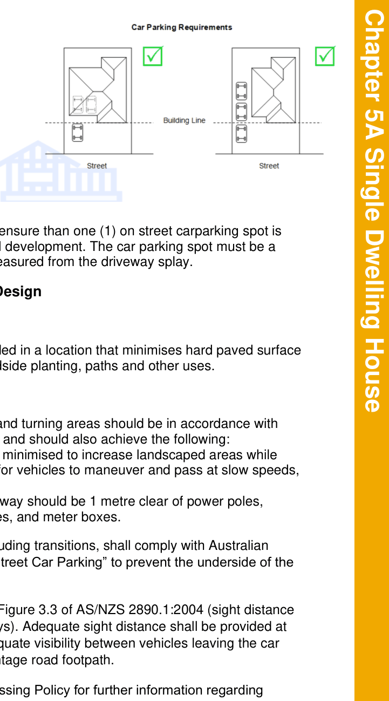
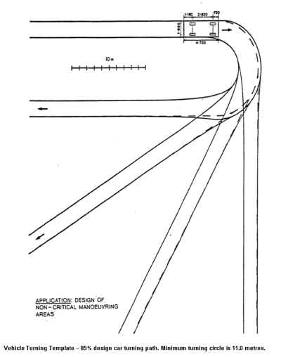
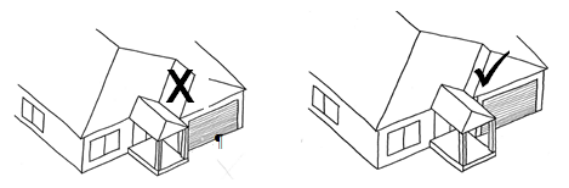
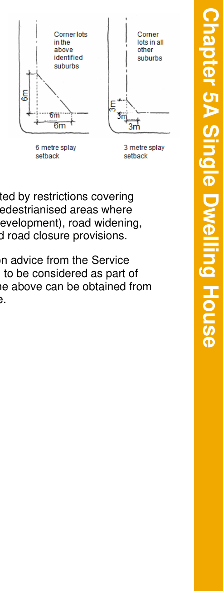

#### 5A.3 Car Parking and Access

Access for vehicles to safely enter and exit a single dwelling house lot is essential. For general design information on car parking, refer to Chapter 12 of this DCP. In the event of an inconsistency between the provisions contained within this chapter and those contained in Chapter 12, the provisions of Chapter 12 apply to the extent of the inconsistency.

To ensure that garages and carports area appropriately designed and integrated into development, off-street parking, vehicular access design, driveway location, and driveway materials are regulated.

#### 5A.3.1 Car Parking Rate

#### Objective

Minimise the visual impact of off-street parking on the streetscape.

#### Controls

a) Three car spaces must be provided onsite and two of the three car spaces must be located behind the building line.

> [Picture on page 15: a picture, saved as a picture (images/chapter-05a-single-dwelling-house-page-15-11.gif, 150 dpi).]

b) Driveways must be designed to ensure than one (1) on street carparking spot is provided in front of the proposed development. The car parking spot must be a minimum of 5.5 metres when measured from the driveway splay.

#### 5A.3.2 Vehicular Access Design

#### Objectives

Ensure that vehicle access is provided in a location that minimises hard paved surface and maintains opportunities for roadside planting, paths and other uses.

#### Controls

## Chapter 5A Single Dwelling House

a) Dimensions for parking spaces and turning areas should be in accordance with Australian Standard 2890 Part 1 and should also achieve the following:

i. Driveway widths should be minimised to increase landscaped areas while providing adequate space for vehicles to maneuver and pass at slow speeds, and

ii. The entry point to the driveway should be 1 metre clear of power poles, telephone poles, street trees, and meter boxes.

b) The grades of the driveway, including transitions, shall comply with Australian Standard 2890.1 (2004) – “Off-Street Car Parking” to prevent the underside of the vehicles scraping.

c) The driveway shall comply with Figure 3.3 of AS/NZS 2890.1:2004 (sight distance requirements at access driveways). Adequate sight distance shall be provided at the boundary line to ensure adequate visibility between vehicles leaving the car park and pedestrians on the frontage road footpath.

d) Refer to Council’s Vehicular Crossing Policy for further information regarding driveway and layback design controls.

e) Vehicles must be able to enter and exit the site in a forward direction for all Battle axe lots.

f) Where a basement with garage is proposed all vehicles must be able to enter and exit the site in a forward direction, the grades of the driveway shall include a level

transition at the boundary line to ensure adequate visibility between vehicles leaving the car park and pedestrians on the frontage road footpath.

Note 1: The development is to be designed having regard to existing constraints such as street trees, power poles, gully pits etc.

#### 5A.3.3 Driveway Materials and Design

#### Objectives

a) To provide for driveways which appear as courtyards into which vehicles intrude

> [Picture on page 16: a picture, saved as a picture (images/chapter-05a-single-dwelling-house-page-16-8.gif, 150 dpi).]

rather than spaces designed primarily for cars.

b) To ensure a high standard of surface finish.

c) To minimise the visual impact of expansive driveway surfaces.

d) To provide for driveways that will, as far as possible, retain their original condition and appearance and resist the wear and marking from car movement.

#### Controls

a) Coloured concrete that is textured or patterned

## Chapter 5A Single Dwelling House

must be used and finished with a non-slip surface or coating

b) All driveways are to be set a minimum of 0.5 metres from any side boundary and incorporate a soft soil zone for turf/landscaping.

#### 5A.3.4 Driveway Location

#### Objectives

a) Improve traffic safety by providing vehicle access to properties in a location that avoids possible traffic congestion, high speed traffic and bus-only roads.

b) Ensure that vehicle access is kept clear of proposed permanent road closures for other means

#### Controls

a) Vehicle access and driveways to properties should be in the location that allows for the shortest and most direct access over the nature strip from the road.

b) Vehicle access and driveways from a physically closed road will only be permitted where there is no alternative access opportunity and with the approval of Council’s Traffic Branch.

c) Vehicle access and driveways to properties should be at least 30 metres or as far as possible from an intersection with a Classified State and Regional Road or Unclassified Regional Roads (Refer to appendix G).

d) Vehicular access on a corner lot requires a minimum of a 6 metres setback from corner tangent on a local road.

e) Vehicular access should be designed to avoid existing traffic calming devises, round-a-bouts, gully pits, etc.

f) Multiple driveways will only be considered for properties where access and egress is difficult. These applications will be assessed based on merit and must be designed in consultation with Council and the Roads and Maritime Services.

#### 5A.3.5 Garages and Carports

#### Objectives

a) Maintain an integrated façade of the dwelling that is not dominated by the garage or carport.

b) Soften the appearance of blank garage door(s) and large expanses of concrete driveways.

c) Ensure the visual focus of the development is the dwelling, not the garage or carport.

d) Reduce the amount of filling required beneath the driveway.

## Chapter 5A Single Dwelling House

#### Controls

a) Garages and carports should not be a dominant feature of the building façade. These structures should be subservient in scale to the dwelling, and integrated and compatible with the overall design of the dwelling in terms of height, form, materials, detailing and colour.

b) Garages and carports shall not occupy more than 50% of the dwelling façade that fronts the street.

c) Carports shall have a maximum roof area of 40sqm.

d) Carports must integrate with the dwelling by the use of complementary colours and decorative work.

e) Garages must complement the roof form and construction types of the dwelling house.

f) All carports and garages must not be located more than 600 millimetres in front of external face of the foremost part of the dwelling living areas.

g) Attached Garages will only be considered where the garage is integrated within the building and does not detract from the streetscape or create a bulky building.

h) Landscaping is to be maximised at the property boundary and in between two or more garages in order to soften the appearance of blank garage doors and large

> [Picture on page 18: a picture, saved as a picture (images/chapter-05a-single-dwelling-house-page-18-3.gif, 150 dpi).]

expanses of concrete driveways.

i) The floor level (finished) of the garage shall be no greater than 300mm above ground level (existing) at the entrance of the garage.

j) Vehicle access and driveways from a physically closed road will only be permitted where there is no alternative access opportunity and with the approval of Council’s Traffic Branch.

k) Vehicle access and driveways to properties should be at least 30 metres or as far as possible from an intersection with a Classified State and Regional Road or Unclassified Regional Roads (Refer to appendix G).

l) Vehicular access should be located 6 metres from the corner for a local road.

m) Vehicular access should be designed to avoid existing traffic calming devises, round-a-bouts, gully pits, etc.

#### 5A.3.6 Splay Corner Setbacks and Road Widening

#### Objectives

## Chapter 5A Single Dwelling House

a) Restrict building and landscaping within close proximity to road intersections.

b) Improve traffic safety by increasing site distances for drivers at intersections.

c) Provide the opportunity for Council to acquire land for local road widening, which will improve the road network.

#### Controls

a) Development on properties adjoining Boundary Lane, Cabramatta should be set back at least 9 metres from the centreline of the road. Council may seek to acquire up to 3 metres width of land for road widening.

b) All corner lots at the intersections of public roads will be required to maintain a setback to the corner of the public road to improve sight distances at intersections. In this splay corner setback no buildings, fences or other structures will be permitted. Landscaping will be restricted to lawn or low growing shrubs and other plant species. Splay corner setbacks will generally be required to be 6 metres by 6 metres in the following suburbs: Wetherill Park, Bossley Park, Prairiewood, Wakeley, Greenfield Park, Edensor Park, St Johns Park, Abbotsbury and Bonnyrigg Heights. Splay corner setbacks in the others suburbs will generally be required to be 3 metres by 3 metres.

> [Picture on page 19: a picture, saved as a picture (images/chapter-05a-single-dwelling-house-page-19-15.gif, 150 dpi).]

Note 1: A number of properties in Fairfield City are affected by restrictions covering vehicular access denied (e.g. to a major road or heavy pedestrianised areas where alternative access should be provided as part of a new development), road widening, splay corner (to improve sight lines on corner blocks) and road closure provisions.

These restrictions are updated from time to time based on advice from the Service NSW and investigations carried out by Council and need to be considered as part of new development. Up-to-date information is relation to the above can be obtained from Council by requesting a Section 10.7 Planning Certificate.

## Chapter 5A Single Dwelling House
