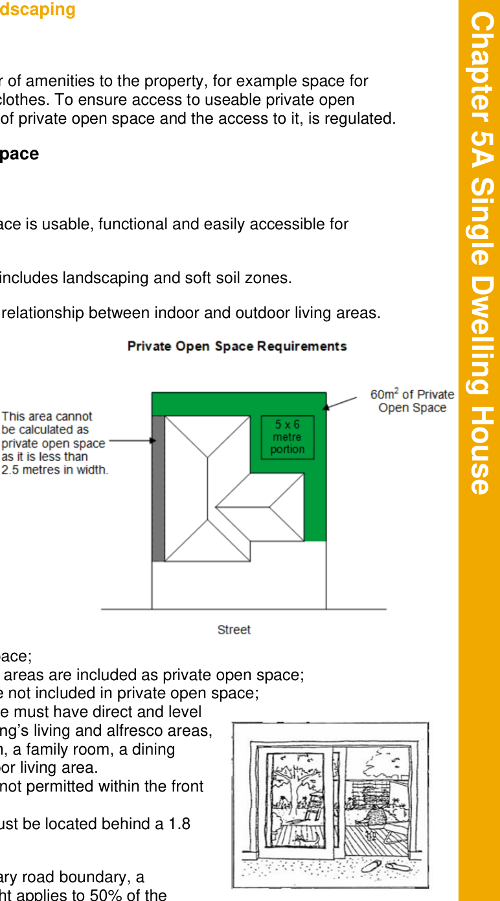
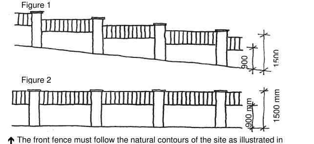

#### 5A.4  Open Space and Landscaping 5A.4.1 Open Space

> [Picture on page 20: a picture, saved as a picture (images/chapter-05a-single-dwelling-house-page-20-3.gif, 150 dpi).]

Open space provides a number of amenities to the property, for example space for children to play and for drying clothes. To ensure access to useable private open space is achieved, the amount of private open space and the access to it, is regulated.

#### 5A.4.1.1 Private Open Space

#### Objectives

a) Ensure the private open space is usable, functional and easily accessible for residents.

b) Ensure private open space includes landscaping and soft soil zones.

c) Ensure direct access and a relationship between indoor and outdoor living areas.

#### Controls

a) A dwelling house must

## Chapter 5A Single Dwelling House

have a minimum private open space area of 60sqm, with at least one 5 metre by 6 metre level ground area of soft soil zone in the rear yard. In the calculation of private open space:

i. must not have a gradient more than 1:50,

ii. no area less than

2.5 metres in width will be included as part of private open space;

iii. outdoor clothes drying areas are included as private open space;

iv. car parking spaces are not included in private open space;

v. The private open space must have direct and level access from the dwelling’s living and alfresco areas, such as a lounge room, a family room, a dining room, kitchen or outdoor living area.

vi. Private open space is not permitted within the front setback.

vii. Private open space must be located behind a 1.8 metre height fencing.

b) Fencing located on secondary road boundary, a maximum of 1.5 metre height applies to 50% of the length of all contiguous secondary road boundaries, a maximum of 50% of the secondary road boundary may have a 1.8 metre height fencing.

c) A garage or gate must provide access between the private open space and the driveway. This will allow items stored in backyards (eg, garbage bins, garden tools) to be moved to the street without needing to pass through the dwelling house.

#### 5A.4.2 Landscaping

There are many advantages to having soft soil zones surrounding a dwelling house. Soft soil zones include landscaping that enhance the streetscape through softening the impact of hard surfaces, i.e. buildings, driveways, walls, parked cars, fences and the

like. Landscaping provides shade and minimises glare from road, footpaths, buildings, and cars. Landscaping also improves air quality as trees use carbon dioxide and give off oxygen. To ensure these contributions are considered, controls governing landscaping, existing trees, and new plantings are provided.

#### Control

A detailed landscape plan is required to be submitted with development applications.

For single dwelling house development, applicants are encouraged to liaise with a horticulturalist at local nurseries and can prepare their own plans using the controls as a guide. Council’s Landscape Assessment Officers can provide more information. Landscaping principles, landscaping planning controls and templates are provided in the Landscape planning appendix to this DCP.

Significant trees as those trees that contribute substantially, either individually or as a member of a tree group, to the landscape character, amenity, cultural values or biodiversity of their locality. Generally, trees with a girth greater than 500 millimetre and a canopy spread of a 6 metre radius are trees of significance.

## Chapter 5A Single Dwelling House

#### Objectives

a) To require landscape plans to respond to natural features, soften the appearance of developments and improve the living quality of the neighbourhood.

b) To encourage landscaping areas which assist in reducing the impacts of a range of environmental problems including salinity, flooding, reduction in biodiversity and climate change.

#### Controls

a) A minimum of 30% of the site is to be dedicated for a soft soil zone.

b) A minimum of 50% of the soft soil zone is to be located in the rear yard.

c) A minimum of 50% of the front yard is to be a soft soil zone.

d) When calculating your Soft Soil zone, any area less than 1.5 metres wide will not be included . To be included in a soft soil zone. This area must be clear of any structure and overhang above.

e) A landscape plan must be prepared for the site. Refer to Landscaping Appendix F for landscaping principles when preparing a landscape plan.

#### 5A.4.3 Fencing

Fencing is an important element in creating a pleasant streetscape. To enhance the character of the City’s neighbourhoods, fencing design, height and materials are regulated.

#### Objectives

a) To provide design requirements for side, rear, and corner lot fencing that create a unified streetscape.

b) To allow for fencing that acts as a noise attenuation measure along Classified State and Regional Roads.

c) To allow for security fencing that minimises visual impact on the streetscape.

#### Controls

#### 5A.4.3.1 Fencing Design

a) Fencing must be designed to highlight entrances and be compatible with the materials used in the dwelling’s facade, incorporate a letterbox and garbage storage area and provide a clearly identifiable street number.

b) Fences visible from a public place or within common area property must be divided into segments no longer than 5 metres. (In the fencing design there must a change in the façade plan or an expressed column to avoid flat featureless fence.) Details of a fence must be submitted with the Development Application.

## Chapter 5A Single Dwelling House

c) Fencing design must provide opportunities for natural surveillance into public spaces.

d) Fencing construction must meet the following criteria:

i. have adequate footings, be self-supporting and able to withstand loads, and

ii. not include barbed wire, chain wire, razor wire, broken glass, be electrified, or the like, and

iii. not stop or redirect surface waters so as to cause a nuisance and be open style fencing where the property is affected by flooding or by an overland flow, and

iv. be constructed wholly within the property boundary.

#### 5A.4.3.2 Front Boundary Fencing

a) Fencing in front of the building line shall be a maximum height of 1.5 metres above ground level (existing) and be of masonry and decorative panel construction.  The maximum height of the masonry wall portion in front of the building line is 900 millimetres above ground level (existing), with the exception of the masonry piers.

> [Picture on page 23: a picture, saved as a picture (images/chapter-05a-single-dwelling-house-page-23-1.gif, 150 dpi).]
> [Picture text on page 23 is stored in the PDF without readable letters (no character map), so it could not be copied; see the original PDF.]
> Words printed on the picture (title and legend, copied from the PDF):
> 1500
> 900 mm
> 1500 mm
> 900 mm
> The front fence must follow the natural contours of the site as illustrated in

Figure 1

Figure 2

Figure 1 and 2.

b) Infill panels and decorative inclusions must not be made out of non reflective materials and must be open to permit views into the front yard and the façade of the dwelling.

c) Gates located in front of the building line should be consistent with the infill panels and not open onto a roadway or public space.

#### 5A.4.3.3 Side, Rear and Corner Lot Fencing

a) Fencing behind the front building line shall be a maximum height of 1.8 metres above ground level (existing).

b) Fencing located on secondary road boundary, a maximum 1.5 metre height applies

## Chapter 5A Single Dwelling House

to 50% of the length of all contiguous secondary road boundaries, a maximum of 50% of the secondary road boundary may have a maximum 1.8 metre height fence.

c) Private open space must be located behind a 1.8 metre height fence.

#### 5A.4.3.4 Front boundary fencing along Classified State and Regional Roads

a) Solid front fences with a maximum height of 1.8 metres are permitted provided that the fence incorporates corners and planting beds every 5 metres.

b) Refer to appendix G for full list of Classified and Regional Roads.

Note 1: For exempt and complying fencing controls State Environmental Planning Policy (Exempt and Complying Development Codes) 2008 should be consulted.
