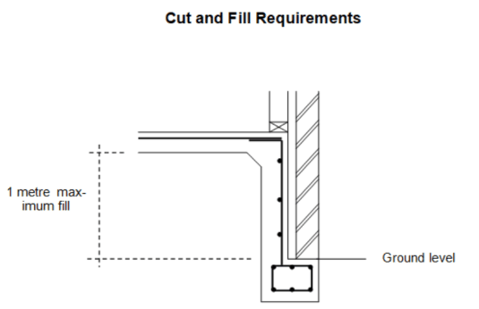

#### 5A.6 Stormwater

Proper drainage and reuse of rainwater is important to reduce flooding, stormwater damage, and overland flow. To achieve this concept plans and rainwater tanks are regulated.

#### 5A.6.1 Stormwater Disposal

#### Objectives

a) To direct stormwater runoff to Council’s drainage system without adversely impacting on adjoining or downstream properties.

b) To ensure the efficient and effective planning, management and maintenance of Council’s existing and future stormwater systems and reduce environmental and property damage.

#### Control

a) All development applications must comply with Council’s Stormwater Management Policy 2017

b) Relevant controls, performance criteria and where the policy applies can be found

> [Picture on page 26: a picture, saved as a picture (images/chapter-05a-single-dwelling-house-page-26-18.gif, 150 dpi).]

in Chapter 3 of the Stormwater Management Policy.

## Chapter 5A Single Dwelling House

#### 5A.6.3 Cut and Fill

#### Objectives

a) Reduce the necessity for retaining walls.

b) Reduce stormwater problems associated with changing the natural contours of the land.

c) Reduce the necessity to import fill onto the premises

d) Reduce stormwater problems associated with changing the natural contours of the land.

#### Controls

a)  All proposed and existing ground levels are to be shown to Australian height datum.

b) A maximum fill level of 1 metre will be permitted where the filling is contained within the building envelope by a drop edge beam.

c) Filling of land outside of the building envelope is not permitted.

d) Any cut proposed is required to be appropriately retained.

e) Proposed retaining walls must be included in the description of works in the development application.

f) The height of retaining walls are to be shown along with a suggested minimum setback of 500 millimetres from the boundary, or a distance in accordance with an engineer’s design, to provide adequate subsoil drainage within the boundaries.

Note 1 - Where retaining walls are required as a result of cut for the development, details of the retaining walls or other approved methods necessary to prevent soil movement, together with associated stormwater drainage measures shall be submitted. Development consent shall be obtained for any proposed retaining wall not defined as exempt development under the State Environmental Planning Policy (Exempt and Complying Development Codes) 2008.

#### 5A.6.4 Rainwater Tanks

#### Objectives

a) Satisfy the requirement of the Building Code of Australia.

b) Position rainwater tank(s) to maximise rear yard space.

#### Controls

a) Above ground rainwater tanks are to be located a minimum of 450mm from the boundary.

b) Only underground water tanks are permitted in the front yard and are encouraged

## Chapter 5A Single Dwelling House

to be placed under the driveway. All underground water tanks require structural certification from a qualified structural engineer.

c) Pumps and pipe system are to be provided for water recycling.

d) Pumps must comply with the noise requirements of the New South Wales Protection of the Environment Operations Act, 1997.
