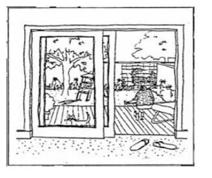
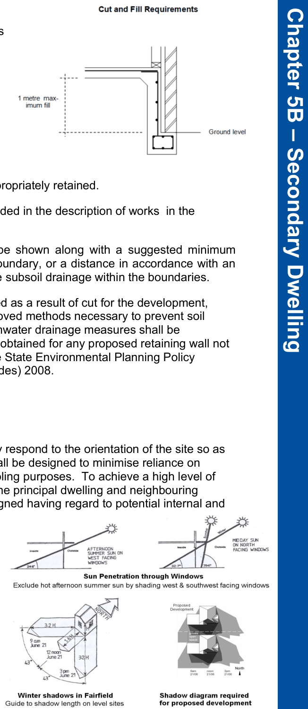

#### 5B.4 Open Space and Landscaping 5B.4.1 Open Space

To ensure that all residents have access to private open space to meet their needs, for example clothes drying, gardening and pet care areas, it is necessary to require a separate private open space for the secondary dwelling.

## Chapter 5B – Secondary Dwelling

#### 5B.4.1.1 Private Open Space

#### Objectives

a) Ensure the private open space is usable, functional and easily accessible for residents.

b) Ensure private open space includes soft soil zones.

c) Ensure direct access and a relationship between indoor and outdoor living areas.

> [Picture on page 14: a picture, saved as a picture (images/chapter-05b-secondary-dwelling-page-14-7.gif, 150 dpi).]

#### Controls

a) The principal and secondary dwelling must have its own separate private open space, with access point shown from the dwelling.

b) The secondary dwelling must have 24sqm of private open space.

c) The private open space area must have a 4 metre by 4 metre level ground area of soft soil zone in the rear yard.

d) The private open space should be appropriately located to ensure occupants of either dwelling do not pass through the private open space of the other dwelling.

e) In the calculation of the 24sqm of private open space:

## Chapter 5B – Secondary Dwelling

i. no area less than 2.5 metres in width will be included;

ii. outdoor clothes drying areas are included as private open space; and

iii. car parking spaces are not included in open space calculations.

f) The private open space must adjoin an alfresco area and/or living areas, such as a lounge room, a family room, a dining room or a kitchen, with access point shown from the dwelling.

g) Alfresco areas are to be completely open on two or more sides.

h) The garage or a gate must provide access between the private open space and the driveway. This will allow items stored in backyards (e.g., garbage bins, garden tools) to be moved to the street without needing to pass through the house.

i) Fencing located on secondary road boundary, a maximum of 1.5 metre height applies to 50% of the length of all contiguous secondary road boundaries, a maximum of 50% of the secondary road boundary may have a maximum of 1.8 meters high fencing.

j) Private open space must be located behind a 1.8 metre high fencing.

#### 5B.4.2 Landscaping

For secondary dwellings, applicants are encouraged to liaise with a horticulturalist at local nurseries and can prepare their own plans. Council’s Landscape Assessment Officers can provide more information.

## Chapter 5B – Secondary Dwelling

Significant trees as those trees that contribute substantially, either individually or as a member of a tree group, to the landscape character, amenity, cultural values or biodiversity of their locality. Generally, trees with a girth greater than 500 millimetres and a canopy spread of a 6 metre radius are trees of significance.

#### Objectives

a) To require landscape plans to respond to natural features, to soften the appearance of developments and improve the living quality of the neighbourhood.

b) To encourage soft soil zones which assist in reducing the impacts of a range of environmental problems including salinity, flooding, reduction in biodiversity and climate change.

#### Controls

a) A minimum of 30% of the site is to be dedicated for soft soil zones.

b) A minimum of 50% of the front yard of the principal dwelling is to be a soft soil zone.

c) A minimum of 50% of the soft soil zone is to be located in the rear yard.

d) When calculating your landscaping and soft soil zone, any area less than 1.5 metres wide will not be included and will not count towards landscaping. To be counted towards landscaping and soft soil zone this area must be clear of any structure and overhang above.

## Chapter 5B – Secondary Dwelling

#### 5B.4.3 Fencing

For fencing provisions, any relevant requirements specified in Chapter 5A must be met.

#### 5B.4.4 Cut and Fill

#### Objectives

a) Reduce the necessity for retaining walls.

b) Reduce stormwater problems associated with changing the natural contours of the land.

c) Reduce the necessity to import fill onto the premises

d) Reduce stormwater problems associated with changing the natural contours of the land.

#### Controls

a) All proposed and existing ground levels are to be shown to Australian height datum

b) A maximum fill level of 1 metre will be permitted where the filling is contained within the building envelope by a drop edge beam.

c) Filling of land outside of the building envelope is not permitted.

> [Picture on page 17: a picture, saved as a picture (images/chapter-05b-secondary-dwelling-page-17-11.gif, 150 dpi).]

d) Any cut proposed is required to be appropriately retained.

e) Proposed retaining walls must be included in the description of works  in the development application.

f) The height of retaining walls are to be shown along with a suggested minimum setback of 500 millimeters from the boundary, or a distance in accordance with an engineer’s design, to provide adequate subsoil drainage within the boundaries.

## Chapter 5B – Secondary Dwelling

Note 1 - Where retaining walls are required as a result of cut for the development, details of the retaining walls or other approved methods necessary to prevent soil movement, together with associated stormwater drainage measures shall be submitted. Development consent shall be obtained for any proposed retaining wall not defined as exempt development under the State Environmental Planning Policy (Exempt and Complying Development Codes) 2008.
