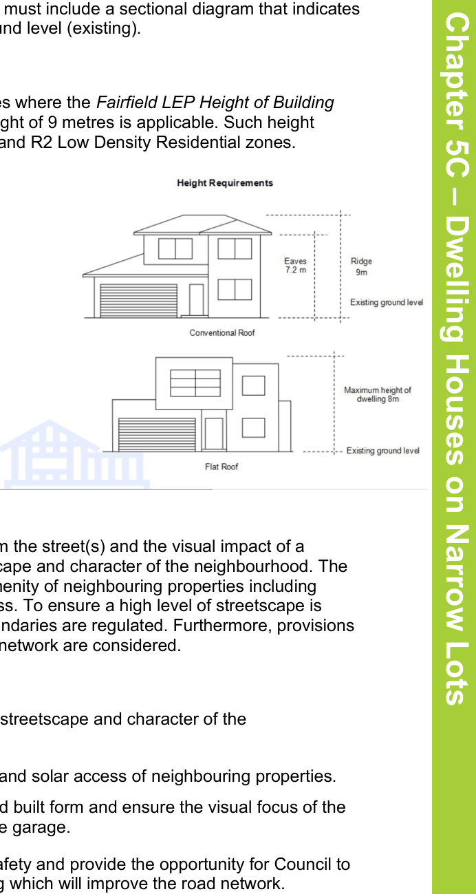
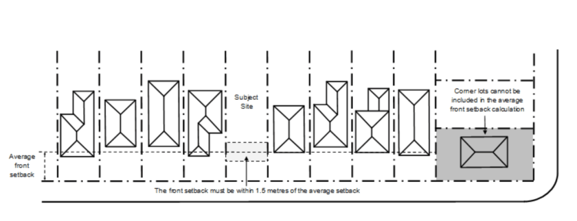
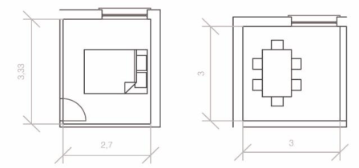

#### 5C.2  Built Form and Urban Design 5C.2.1 Floor Space Ratio (FSR)

The density of built structures on a lot affects the amenity of the residents living on the site as well as those living on the neighbouring sites and the residential area as a whole.

#### Objective

Ensure building bulk, site coverage and open space provisions are compatible with neighbouring development.

#### Controls

a) The maximum permissible floor space ratio for any development must comply with the floor space ratio standards prescribed on the Fairfield LEP 2013 Floor Space Ratio Map. The most common maximum floor space ratio for a narrow lot dwelling house development is 0.45:1.

b) Calculation of Floor Space Ratio must comply with the Floor Space Ratio defined in clause 4.5 Calculation of Floor Space Ratio and Site Area of the Fairfield LEP 2013.

c) Due to site constraints and other requirements of this plan, the maximum FSR will not always be achieved on every development site.

d) A void space over the stairs of 8sqm can be excluded from the gross floor area calculations. Any additional void area will be included in the gross floor area calculations.

e) Lift shafts and service shafts cannot be excluded from FSR calculations.

#### 5C.2.2 Building Height

#### Objectives

a) Ensure new development is consistent and compatible with the established built form and creates a physically cohesive neighbourhood.

b) Ensure minimal overshadowing of neighbouring properties.

c) Ensure privacy of neighbouring properties is protected by limiting side and rear views of neighbouring properties.

#### Preamble

## Chapter 5C – Dwelling Houses on Narrow Lots

a) The maximum permissible building height for any development must comply with the building height standards prescribed on the Fairfield LEP Height of Building Map.

b) Ground level (existing) is defined in Fairfield LEP 2013 as the existing level of a site at any point. Note: Such ground level must be natural or lawfully approved.

c) Clause 5.6 of Fairfield LEP 2011 allows the maximum building height to be exceeded where the roof is determined to be a decorative architectural feature. Refer Clause 5.6 of Fairfield LEP 2013 for details.

d) Some dwellings may need to be lowered in height to comply with the DCP’s requirements for solar access and privacy (See 5C.5.1 Solar Access and 5C.5.3 Privacy).

> [Picture on page 6: a picture, saved as a picture (images/chapter-05c-dwelling-houses-on-narrow-lots-page-6-1.gif, 150 dpi).]

e) All two storey dwelling applications must include a sectional diagram that indicates the height of the dwelling from ground level (existing).

#### Controls

The following controls apply in all cases where the Fairfield LEP Height of Building Map indicates a maximum building height of 9 metres is applicable. Such height typically applies in the R1 Residential and R2 Low Density Residential zones.

a) A maximum of 2 storeys above natural ground level (existing) is permitted.

b) The maximum heights to the eave and the ridge from the natural ground level (existing) are 7.2 metres and 9 metres respectively.

c) Dwellings proposing parapet walls, flat roofs and high continuous walls shall be limited to 8 metres in height from natural ground level (existing) and are to provide articulation.

#### 5C.2.3 Setbacks

The distance a dwelling is setback from the street(s) and the visual impact of a dwelling facade influences the streetscape and character of the neighbourhood. The side and rear boundaries affect the amenity of neighbouring properties including visual/acoustic privacy and solar access. To ensure a high level of streetscape is preserved the front, side, and rear boundaries are regulated. Furthermore, provisions for road widening to improve the road network are considered.

#### Objectives

a) Maintain and enhance established streetscape and character of the

## Chapter 5C – Dwelling Houses on Narrow Lots

neighbourhood.

b) Protect the visual/acoustic privacy and solar access of neighbouring properties.

c) Achieve a staggered and articulated built form and ensure the visual focus of the development is the dwelling, not the garage.

d) Ensure vehicular and pedestrian safety and provide the opportunity for Council to acquire land for local road widening which will improve the road network.

#### 5C.2.3.1 Front Setback

a) The minimum front setback of dwellings is 5.5 metres, measured from the front property boundary to the front of the dwellings including articulation area such as porticos and verandas.

b) Garage(s) must be setback a minimum of 6 metres from the front boundary and be located within 1.5 metres of the street average.

> [Picture on page 7: a picture, saved as a picture (images/chapter-05c-dwelling-houses-on-narrow-lots-page-7-7.gif, 150 dpi).]

c) Carport(s) must be setback a minimum of 5.5 metres from the front boundary will be assessed on merit.

d) Private courtyard and/or private open space is not permissible in the front setback area.

#### 5C.2.3.2 Side Setback Controls

a) One side of each dwelling must be setback a minimum of 900mm from the side boundary, excluding the garage, for drainage and overland flow purposes.

b) First floor may be built to the side boundary but only within the first 10 metres of the building line and if the following are satisfied:

## Chapter 5C – Dwelling Houses on Narrow Lots

i. The roof drainage is designed so that it is easily accessed and designed to drain roof stormwater to the front or back such as a front to back gable with a parapet on the boundary;

ii. Walls located on the boundary must comply with the requirements of the Building Code of Australia in terms of fire separation; and

iii. All boundary walls must extend at least 300mm above the roof line of the dwelling to ensure that roof drainage is contained within the site.

Note 1: The middle dwelling may be built to the boundary as long as the solar and privacy standards are met.

#### 5C.2.3.3 Rear Setback Control

a) Ground floor walls must be a minimum of 900 millimeters from the boundary.

b) First floor walls must be set back a minimum of 6 metres from the rear boundary where the lot adjoins residential properties.

#### 5C.2.3.4 Corner Lot Secondary Setback Controls

a) The reconfiguration of corner lots will only be considered where a better urban outcome is achieved and a quality design is proposed. Where boundaries are realigned, a reduced setback of 5.5 metres will be considered.

Secondary Street Frontage

21 metre Street Frontage Reconfigured Lot Alignment

7 metre Street Frontage Existing Lot Alignment

b) Dwellings shall be appropriately articulated along the primary and secondary setbacks to ensure that the dwellings address both streets.

c) All corner lots at the intersection of public roads will be required to provide a splay corner setback to improve sight distances at intersections. Splay corners setbacks of 3 metres by 3 metres are generally required to be provided. This setback shall be kept free of buildings and other structures and be used for landscaping purposes only. Refer also to Clause 5C.3.3 Splay Corners and road Widening.

#### 5C.2.4 Building Appearance

## Chapter 5C – Dwelling Houses on Narrow Lots

The appearances, position and height of a dwelling may affect the streetscape and character of the neighbourhood. How a dwelling addresses the street and integrates with its neighbours influences the streetscape. To ensure the building appearance is maintained in a uniform manner the dwellings position and dwelling height is regulated.

#### Objectives

a) Ensure that new development is visually integrated into the established streetscape.

b) Ensure the dwelling is oriented toward the street frontage to achieve unobtrusive natural surveillance.

a) The design of the entrance (i.e. portico, patio or elevation treatment) shall be a dominant element of the dwelling to provide a clear indication of the entrance.

b) The front door or a window must be visible from the street and from the driveway to provide surveillance.

c) Front verandas and windows are to be situated to maximise observation of pedestrian and vehicle movement outside of the dwelling.

d) On corner sites the dwelling must address both streets by incorporating appropriate architectural features, articulation to the dwelling and roof form.

#### 5C.2.5 Building Façade

#### Objective

a) Ensure that new development visually integrates into the established streetscape.

b) Provide visual interest through the incorporation of features traditionally associated with those facades facing the street.

#### Controls

a) Roof form should be articulated to provide interesting and varied elevations. This can be achieved through the use of gables or skillion roofs which assists the channeling of roof drainage.

b) Pedestrian access to a roof terrace on flat roofs will not be supported.

c) Switchboards for gas, electricity, etc. must not be attached to the front elevation of dwellings.

d) The maximum garage opening width for each dwelling is 2.7 metres.

e) Carports must be designed to integrate into the design of the dwelling.

#### 5C.2.6 Size of Rooms

## Chapter 5C – Dwelling Houses on Narrow Lots

#### Objectives

a) Maintain a high quality of amenity within each dwelling.

b) Ensure room sizes are functional, are of sufficient size and cater for intended purpose.

#### Controls

a) Bedrooms shall be a minimum of 10sqm in size with a minimum 3 metre dimension.

b) Dining rooms shall be a minimum of 9sqm in size with a minimum 3 metre dimension.

c) A living room shall be a minimum of 18sqm in size with a minimum 4 metre dimension.

d) Where an open plan combined living / dining is proposed, a minimum area of 27sqm and a minimum dimension of 4 metres are acceptable.

e) In addition to storage in the kitchen and bedrooms, the following storage is required:

i. a minimum of 6sqm is required within each dwelling, including a minimum width dimension of 500 millimeters.

ii. if located within the garage the storage space can be excluded from the FSR calculations.

Minimum bedroom size

- 10sqm 3 metre dimension

Minimum dining room size

– 9sqm 3 metre dimension

> [Picture on page 10: a picture, saved as a picture (images/chapter-05c-dwelling-houses-on-narrow-lots-page-10-17.gif, 150 dpi).]

Stand alone living room to have a minimum size – 18sqm     4 metres dimension

Minimum size for bedrooms, dining rooms & living rooms

f) A furniture plan must be shown on plans in order for alternative minimum areas to be considered. Note 1: All architectural floor plans shall show full dimensions of internal floor layout to demonstrate that the above controls have been achieved.

#### 5C.2.7 Access for all Residents

#### Objective

To ensure the needs of elderly and disabled persons are accommodated in narrow lot developments.

## Chapter 5C – Dwelling Houses on Narrow Lots

#### Control

For developments where two or more dwellings are proposed, within one of the dwellings at least one room shall be capable of being adapted for use as a bedroom located on the ground floor, and a shower and toilet shall also be located on the ground floor.

#### 5C.2.8 Swimming Pools

#### Objectives

a) Ensure swimming pool safety.

b) Minimise noise levels.

a) Swimming pools are to be separated from any residential building situated on the premises, by a child resistant barrier, in accordance with the Swimming Pools Act.

b) Swimming pools must be located in the rear yard.

c) Swimming pool filters are to be installed in a location that will not cause a noise nuisance to surrounding residents. The louder a swimming pool filter is the greater the required installation distance from any adjoining property boundary.

d) Swimming pools are to be built on, or in the ground and not elevated more than

1.0 metre above the ground.

e) In addition to the swimming pool controls, all private open space and landscaping requirements must be met.

Note 1: To lessen the required distance from an adjoining boundary the swimming pool filter can be located within an approved prefabricated acoustic enclosure. These enclosures will quieten the filter by approximately 15 – 20 dB(A) which will decrease the required distance from an adjoining boundary.

## Chapter 5C – Dwelling Houses on Narrow Lots
