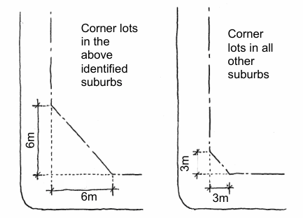

#### 5C.3  Car Parking and Access

The access for vehicles to safely enter a dwelling house lot is essential. For general design information on car parking, refer to Chapter 12 of this DCP. In the event of an inconsistency between the provisions contained within this clause and those of Chapter 12, the provisions of chapter 12 apply to the extent of the inconsistency.

#### 5C.3.1 Car Parking

#### Objectives

a) Ensure that vehicle access is provided in a location that minimise hard paved surface and maintains opportunities for onsite landscaping, roadside planting, on street parking, paths and other uses.

b) Maintain an integrated façade to ensure that the dwellings are not dominated by the garages or carport.

c) Ensure the visual focus of the development is the dwellings, not the garage(s) or carport(s).

#### Controls

a) Two car parking spaces shall be provided per dwelling.

b) A maximum of one undercover car parking space in the form of a garage or carport is to be provided for narrow lots that have access to one street only.

c) For narrow lots that are located on a corner lot with two street access, a double garage may be permitted if the dwelling complies with all other controls such as Private Open Space, Landscaping, Solar Access and Drainage.

d) Garages must be designed in a manner that prevents a garage dominant street environment.

e) Garages must be recessed or ‘flush’ with the 6 metre building line.

f) Dimensions for parking spaces and turning areas should be in accordance with Australian Standard 2890 Part 1 and should also achieve the following:

## Chapter 5C – Dwelling Houses on Narrow Lots

g) Driveway widths should be minimised to increase landscaped areas while providing adequate space for vehicles to manoeuvre, and

h) The entry point to the driveway should be 1 metre clear of power poles, telephone poles, street trees, metre boxes, and storm water pits.

i) Within the development, driveways are required to be a minimum of 5.5 metres of distance apart.

j) For corner lots, driveways, garages or carports must be located 6 metres from the tangent.

k) For sites affected by overland flow, at least one carport must be provided for one of the dwellings when two or more dwellings are proposed to allow the flows to travel through the site. Alternatives (including another garage) can be considered where they address these drainage concerns to the satisfaction of Council. (Note: Refer to Section 5.C.12 Drainage for details of further requirements).

l) Dimensions for parking spaces and turning areas should be in accordance with Chapter 12 of the City-Wide DCP.

Note 1: It is recommended that the development be designed with regard to existing constraints of street trees, power poles, gully pits etc.

Note 2: The design of carports need to ensure compliance with the Building Code of Australia (BCA) and may require the provision of fire resisting walls neighbouring any openings. To comply with the BCA, the location of windows near carports needs careful consideration.”

#### 5C.3.2 Driveway Materials

#### Objectives

a) Provide for driveways which appear as courtyards into which vehicles intrude rather than spaces designed primarily for cars

b) Ensure a high standard of surface finish.

c) Minimise the visual impact of expansive driveway surfaces.

d) Provide for driveways that will, as far as possible, retain their original condition and appearance and resist the wear and marking from car movement.

#### Controls

a) Driveway material must be clay/concrete pavers, cobblestones or coloured concrete.

b) Stencilled concrete must be sealed and be non-slip.

c) Plain concrete driveways are not permitted.

## Chapter 5C – Dwelling Houses on Narrow Lots

#### 5C.3.3 Splay Corner Setbacks and Road Widening

#### Objectives

a) Restrict building and landscaping within close proximity to road intersections.

b) Improve traffic safety by increasing site distances for drivers at intersections.

c) Provide the opportunity for Council to acquire land for local road widening, which will improve the road network.

a) Development on properties neighbouring Boundary Lane, Cabramatta should be set back at least 9 metres from the centreline of the road. Council may seek to acquire up to 3 metres width of land for road widening.

b) All corner lots at the intersections of public roads will be required to maintain a setback to the corner of the public road to improve site distances at intersections. In this splay corner

> [Picture on page 14: a map, saved as a picture (images/chapter-05c-dwelling-houses-on-narrow-lots-page-14-10.gif, 150 dpi); the street names and other small labels are on the picture.]
> Words printed on the picture (title and legend, copied from the PDF):
> lots in all

setback no buildings, fences or other structures will be permitted. Landscaping will be restricted to lawn or low growing shrubs and other plant species. Splay corner setbacks will generally be required to be 6 metres by 6 metres in the following suburbs: Wetherill Park, Bossley Park, Prairiewood, Wakeley, Greenfield Park, Edensor Park, St Johns Park, Abbotsbury and Bonnyrigg Heights. Splay corner setbacks in the others suburbs will generally be required to be 3 metres by 3 metres. Note 1: A number of properties in Fairfield City are affected by restrictions covering vehicular access denied (e.g. to a major road or heavy pedestrianised areas where alternative access should be provided as part of a new development), road widening, splay corner (to improve sight lines on corner blocks) and road closure provisions.

These restrictions are updated from time to time based on advice from Service NSW and investigations carried out by Council and need to be considered as part of new development.

Note 2: Up-to-date information is relation to the above can be obtained from Council by requesting a Section 10.7 Planning Certificate.

#### 5C.3.4 Rights of Carriageway

## Chapter 5C – Dwelling Houses on Narrow Lots

Where a lot does not have access to a public road a right of carriageway (ROW) having a minimum width of 4 metres is to be created on title of the front lot, with frontage to a public road, in favour of the rear lot. The ROW shall have a minimum constructed pavement width of 3 metres, and a 1 metre wide strip devoted to landscaping and services.  The ROW is to be created prior to release of the construction certificate.

Note 1: Complying Development under the General Housing Code - State Environmental Planning Policy (Exempt and Complying Development Codes) 2008 only applies to lots having frontage to a public road.
