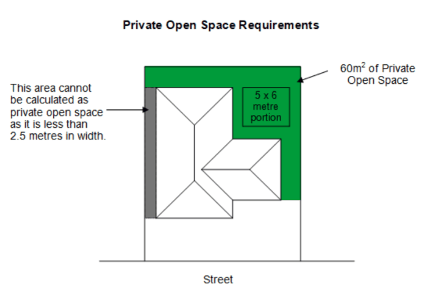
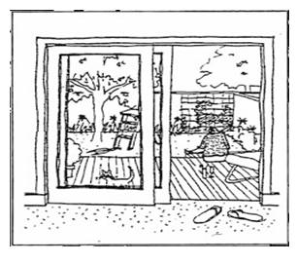

#### 5C.4 Open Space and Landscaping 5C.4.1 Open Space

Open space provides a number of amenities to the property, for example space for children to play, drying clothes and gardening. To ensure a sufficient amount of private open space is easily accessible, private open space is regulated.

#### 5C.4.1.1 Private Open Space

#### Objectives

a) Ensure the private open space is usable, functional and easily accessible for residents.

b) Ensure private open space includes landscaping and soft soil zone.

c) Ensure direct access and a relationship between indoor and outdoor living areas.

#### Controls

> [Picture on page 15: a picture, saved as a picture (images/chapter-05c-dwelling-houses-on-narrow-lots-page-15-16.gif, 150 dpi).]

a) The dwelling must have private open space.

b) A minimum area of 60sqm, with at least one 5 metre by 6 metre level ground area of soft soil zone in the rear yard. In the calculation of private open space:

## Chapter 5C – Dwelling Houses on Narrow Lots

i. must not have a gradient more than 1:50,

ii. no area is less than 2.5 metres in width will be included as part of private open

> [Picture on page 15: a picture, saved as a picture (images/chapter-05c-dwelling-houses-on-narrow-lots-page-15-23.gif, 150 dpi).]

space;

iii. outdoor clothes drying areas are included as private open space;

iv. car parking spaces are not included in open space calculations;

v. The private open space must have direct and level access from the dwelling’s living and alfresco areas, such as a lounge room, a family room, a dining room, kitchen or outdoor living.

vi. Private open space is not permitted within the front setback.

vii. Private open space must be located behind a 1.8 metre height fencing.

c) Fencing located on secondary road boundary, a maximum of 1.5 metre height applies to 50% of the length of all contiguous secondary road boundaries, a maximum of 50% of the secondary road boundary may have a 1.8 metre height fencing.

d) A garage or gate must provide access between the private open space and the driveway. This will allow items stored in backyards (eg, garbage bins, garden tools) to be moved to the street without needing to pass through the house.

#### 5C.4.2 Landscaping

For narrow lot development, applicants are encouraged to liaise with a horticulturalist at local nurseries and can prepare their own plans using the controls as a guide or alternatively engage the services of a landscape architect or other accredited professional with demonstrated experience. Council’s Landscape Assessment Officers can provide more information.

Landscaping principles, landscaping planning controls and templates are provided in Appendix F Landscape planning.

Significant trees as those trees that contribute substantially, either individually or as a member of a tree group, to the landscape character, amenity, cultural values or biodiversity of their locality. Generally trees with a girth greater than 500millimetres and a canopy spread of a 6 metre radius are trees of significance.

#### Objectives

a) To require landscape plans to respond to natural features, soften the appearance of developments, improve the living quality of the neighbourhood.

b) To encourage landscaping areas which assist in reducing the impacts of a range of environmental problems including salinity, flooding, reduction in biodiversity and climate change.

#### Controls

a) A minimum of 30% of the site is to be dedicated for soft soil zone.

b) A minimum of 50% of the front yard is to be landscaped.

c) When calculating your landscaping and soft soil area, any area less than 1.5 metres wide will not be included and count towards landscaping.

d)  A detailed landscape plan is required to be submitted with development applications. Refer to Landscaping Appendix F for principles when seeking to prepare a landscape plan.

#### 5C.4.3 Fencing

## Chapter 5C – Dwelling Houses on Narrow Lots

Fencing is an important element in creating a pleasant streetscape. To enhance the character of the City’s neighbourhoods, fencing design, height and materials are regulated.

#### Objectives

a) To provide design requirements for side, rear, and corner lot fencing that create a unified streetscape.

b) To allow for fencing that acts as a noise attenuation measure along Classified State and Regional Roads.

c) To allow for security fencing that minimises visual impact on the streetscape.

a) A front fence is not supported for narrow lot developments.

b) Fencing behind the front building line shall be a maximum height of 1.8 metres above ground level (existing).

c) Fencing located on secondary road boundary, a maximum 1.5 metre height applies to 50% of the length of all contiguous secondary road boundaries, a maximum of 50% of the secondary road boundary may have a maximum 1.8-metre-high fence.

#### Fencing design

a) Walls and fences visible from a public place or within common area property must be divided into segments no longer than 5 metres. (In the fencing design there must be some change in the façade plan or an expressed column to avoid flat featureless walls.) Details of wall and fence treatment must be submitted with the Development Application.

b) Fencing design must provide opportunities for natural surveillance into public spaces.

c) Fencing construction must meet the following criteria:

i. have adequate footings, be self-supporting and able to withstand loads, and

ii. not include barbed wire, chain wire, razor wire, broken glass, be electrified, or the like, and

iii. not stop or redirect surface waters so as to cause a nuisance and be open style fencing where the property is affected by flooding or by an overland flow.

iv. be constructed wholly within the property boundary.

Note 1: For exempt and complying fencing controls see State Environmental Planning Policy (Exempt and Complying Development Codes) 2008.
