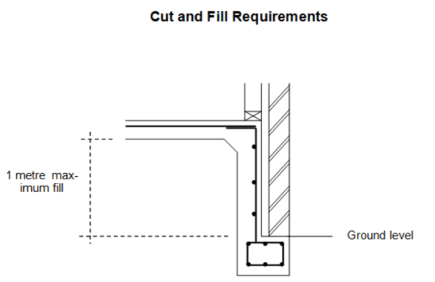

#### 5C.6  Stormwater

Proper drainage and reuse of rainwater is important to reduce flooding, stormwater damage, and overland flow. To achieve this, concept plans, rainwater tanks, overland flow, and cut and fill are regulated.

#### 5C.6.1 Stormwater Disposal

#### Objectives

a) To direct stormwater runoff to Council’s drainage system without adversely impacting on neighbouring or downstream properties.

b) To ensure the efficient and effective planning, management and maintenance of Council’s existing and future stormwater systems and reduce environmental and property damage

#### Control

a) All development applications must comply with Council’s Stormwater Management Policy 2017.

b) Relevant controls, performance criteria and where the policy applies can be found in Chapter 3 of the Stormwater Management Policy – September 2017.

#### 5C.6.2 Concept Plans

#### Objectives

a) Control flooding and prevent stormwater damage.

b) Ensure that proposed drainage of the site does not have an adverse impact on neighbouring and downstream properties.

#### Controls

a) One side setback of the development site must be a minimum of 900mm from the boundary for drainage and overland flow purposes.

b) Where the development land slopes away from the street kerb and there is no

## Chapter 5C – Dwelling Houses on Narrow Lots

alternate provision for stormwater to connect to the street to the satisfaction of Councils drainage engineer, inter allotment drainage is required to be provided. In this instance an easement to drain water shall be created over neighbouring properties to connect storm water from the development site to Council’s drainage system prior to issue of a development. This requirement will only be waived where the applicant is able to demonstrate that the proposal can drain to the street in a satisfactory manner.

c) A drainage concept plan prepared by a suitably qualified person shall be submitted with the Development Application showing all down pipes, proposed levels, pipe details etc.

#### 5C.6.3 Rainwater Tanks

#### Objectives

a) Satisfy the requirements of the Building Code of Australia.

b) Position rainwater tank to maximise rear yard space.

c) Harvest and re use stormwater.

d) Ensure that rainwater tanks are located in areas where they do not impinge on the general operation and function of the dwelling as a whole.

#### Controls

a) Above ground rainwater tanks are to be located no less than 450mm from the side and rear boundary and shall not extend above the height of the fence line.

b) Only underground water tanks are permitted in the front setback area and they are encouraged to be placed under the driveway where possible. All underground water tanks require structural certification from a qualified structural engineer.

c) Pumps and pipe system are to be provided for water recycling.

d) Pumps must comply with the noise requirements of the New South Wales Protection of the Environment Operations Act, 1997.

#### 5C.6.4 Overland Flow

#### Objectives

a) Ensure overland flow path is conveyed through the site in a satisfactory manner.

b) Minimise flooding affects within the development and on to the neighbouring properties.

#### Control

a) Any major overland flow path from neighbouring properties shall be conveyed through the site in a satisfactory and safe manner. The flow paths shall not be directed under the buildings. For details refer to Chapter 11.

b) For sites affected by overland flow, at least one carport must be provided for one of the dwellings when two or more dwellings are proposed to allow flow to travel through the site. Alternatives (including another garage) can be considered where the design addresses these drainage concerns to the satisfaction of Council. (Note: Refer to Section 5.C.12 Drainage for details of further requirements).

> [Picture on page 21: a picture, saved as a picture (images/chapter-05c-dwelling-houses-on-narrow-lots-page-21-27.gif, 150 dpi).]

## Chapter 5C – Dwelling Houses on Narrow Lots

#### 5C.6.5 Cut and Fill

#### Objectives

a) Reduce the necessity for retaining walls.

b) Reduce stormwater problems associated with changing the natural contours of the land.

c) Reduce the necessity to import fill onto the premises.

d) Reduce stormwater problems associated with changing the natural contours of the land.

e) Reduce the necessity to import fill onto the premises.

#### Controls

a) The height of the retaining wall must be shown from natural ground level.

b) A maximum fill level of 1 metre will be permitted where the filling is contained within the building envelope by a drop edge beam.

c) Any cut proposed over 400 millimetres is required to be appropriately retained immediately.

d) Filling of land outside of the building envelope is not permitted.

e) Where retaining walls require development consent, the development application must include a description of the proposed retaining walls in the development application.

f) Retaining walls are to be shown with a suggested setback of 500 millimetres from the boundary or a distance in accordance with an engineer’s design, to provide adequate subsoil drainage within the boundaries.

Note 1 - Where retaining walls are required as a result of cut for the development, details of the retaining walls or other approved methods necessary to prevent soil movement, together with associated stormwater drainage measures shall be submitted. Development consent shall be obtained for any proposed retaining wall not defined as exempt development under the State Environmental Planning Policy (Exempt and Complying Development Codes) 2008.
