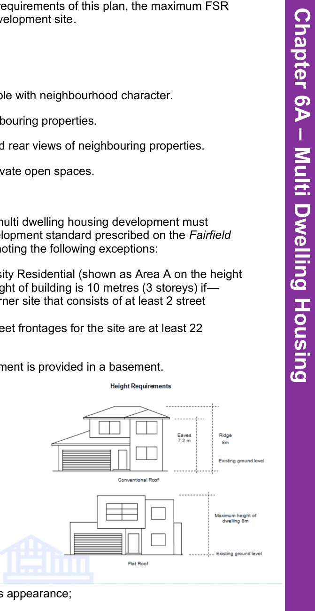

#### 6A.2  Built Form and Urban Design

#### 6A.2.1 Floor Space Ratio (FSR) Objective

a) To ensure building bulk, site coverage and open space provisions are compatible with neighbourhood character.

b) To ensure new built form is compatible with a medium density built environment.

#### Controls

a) Maximum permissible floor space ratio for any multi dwelling housing development must comply with the floor space ratio development standards prescribed on the Fairfield LEP 2013 Floor Space Ratio Map noting the following exceptions:

i. For land in Zone R3 Medium Density Residential (shown as Area B on the floor space ratio map):

## Chapter 6A – Multi Dwelling Housing

i. if the site has a street frontage of less than 22 metres— 0.5:1, or

ii. if the site has a street frontage of at least 22 metres— 0.65:1, and

ii. A floor space ratio bonus of up to 0.15:1 may be permitted if all car parking for the development is provided in a basement; and

iii. Clause 4.6 Exceptions to Development Standards of the Fairfield LEP 2013 allows Council to consider variations to development standards (e.g. floor space ratio) where justified to the satisfaction of Council.

b) Clause 4.4 Floor Space Ratio of the Fairfield Local Environment Plan 2013, identifies the objectives for maximum FSR

c) Calculation of Floor Space Ratio must comply with the Floor Space Ratio provisions defined in clause 4.5 Calculation of Floor Space Ratio and Site Area of the Fairfield LEP 2013.

d) The overall gross floor area (GFA) of the upper floors shall be a maximum of 65% of the total GFA at ground level. This only applies to R3 Medium Density Residential properties outside of the Area B precinct within the Fairfield LEP FSR Map

#### Ground Floor GFA

Upper Floor GFA 65% of Ground Floor GFA

> [Picture on page 8: a picture, saved as a picture (images/chapter-06a-multi-dwelling-housing-page-8-1.gif, 150 dpi).]

Note: Due to site constraints and other requirements of this plan, the maximum FSR will not always be achieved on every development site.

#### 6A.2.2 Building Height Objectives

a) To ensure building height is compatible with neighbourhood character.

b) To minimise overshadowing of neighbouring properties.

c) To maintain privacy and limit side and rear views of neighbouring properties.

d) To maintain sunlight in public and private open spaces.

#### Controls

a) Maximum height of building for any multi dwelling housing development must comply with height of building development standard prescribed on the Fairfield LEP 2013 Height of Building Map noting the following exceptions:

i. For land in Zone R3 Medium Density Residential (shown as Area A on the height of building map) the maximum height of building is 10 metres (3 storeys) if—

1\. the building is located on a corner site that consists of at least 2 street frontages; and

2\. the primary and secondary street frontages for the site are at least 22 metres; and

3\. all car parking for the development is provided in a basement.

## Chapter 6A – Multi Dwelling Housing

ii. Clause 4.6 Exceptions to Development Standards of the Fairfield LEP 2013 allows Council to consider variations to development standards (e.g. height of building) where justified to the satisfaction of Council; and

iii. Clause 5.6 Architectural Roof Features of Fairfield LEP 2013 allows Council to consider variations to development standards (e.g. height of building) for decorative roof elements that enhance a building’s appearance;

iv. Where solar access and privacy requirements (see Sections 6A.5.1 Solar Access and 6A.5.3 Privacy) cannot be met, some dwellings may need to be lowered in height to comply; and

v. Clause 4.3 Height of Building of the Fairfield Local Environment Plan 2013, identifies the objectives for maximum height of buildings.

b) For multi dwelling housing development with a maximum height of buildings of 9 metres (2 storeys):

i. For buildings with pitched roofs, the maximum heights of the eave line and the ridgeline from ground level (existing) shall not exceed 7.2 metres and 9 metres respectively.

ii. For buildings with parapet walls and skillion (flat) roofs, the maximum height of building shall be limited to 8 metres from ground level (existing) and walls are to be articulated.

c) All two storey and three storey multi dwelling housing applications must include a sectional diagram that indicates the height of the development from ground level (existing).

#### 6A.2.3 Setbacks

Setbacks serve to create consistent streetscapes and neighbourhood character and maintain privacy and solar access for surrounding properties. Setback controls are set for development to meet these aims, as well as for road widening where identified to improve the road network. Components of streetscape and character of the neighbourhood include building setback, landscaping, fencing, lighting, pathways and street trees.

#### Objectives

a) To maintain and enhance established streetscape and character of the neighbourhood.

b) To protect the privacy and solar access of adjacent properties.

c) To achieve a staggered and articulated built form along side elevations.

## Chapter 6A – Multi Dwelling Housing

d) To ensure vehicular and pedestrian safety by accommodating vehicles on site behind the front boundary.

#### 6A.2.3.1 Front Setback Controls

a) The minimum front setback of multi dwelling housing is 4.5 metres, measured from the front property boundary to the front of the dwellings.

b) Garages are to be set back from the street boundary by 5.5 metres.

c) The front setback area of townhouse and villa developments shall not be used for any purposes other than landscaping only.  In this regard, private courtyards, private open spaces, car parking spaces including visitor spaces, garbage bays, above ground rainwater tanks, pergola or the like are not permitted in the front setback area.

#### 6A.2.3.2 Secondary Setback Controls on Corner lots

a) The secondary building setback shall be a minimum of 3 metres, when measured from the lot boundary.

b) The secondary frontage must orient the dwellings to the street in such a manner that the dwellings have a direct relationship with the street. In this regard, private courtyards, private open spaces, car parking spaces including visitor spaces, garbage bays, above ground rainwater tanks, pergola or the like are not permitted in the secondary setback area.

#### 6A.2.3.3 Side and Rear Setback Controls Ground Floor

Side and rear walls should be at least 900 mm from the boundary.

#### 6A.2.3.4 Side and Rear Setback Controls Upper Floor

a) Beyond the first 20 metres of the site, the upper floor walls must be setback a minimum of 4 metres from side and rear boundaries and further where necessary in order to satisfy solar access and privacy requirements of Sections 6A.5.1 Solar Access and 6A.5.3 Privacy of this chapter.

b) For the first 20 metres of a site, the upper floor side walls must be setback by a minimum of 900mm from boundaries. A further distance may be necessary in order to satisfy solar access and privacy requirements of Sections 6A.5.1 Solar Access and 6A.5.3 Privacy of this chapter.

#### 6A.2.3.5 Side and Rear Setback Controls Built to Boundary

a) Side and rear walls may be built to the boundary if the following are satisfied:

## Chapter 6A – Multi Dwelling Housing

i. Located on the ground floor only;

ii. Continuous length of wall does not exceed 10 metres;

iii. Walls are not more than 50% of a boundary’s length;

iv. Walls comply with requirements of the Building Code of Australia in terms of fire separation; and

v. Walls and fences are of the same material being brick/masonry.

#### 6A.2.4 Building Separation Objectives

a) To ensure there is sufficient spatial separation between dwellings to accommodate access (i.e. both vehicular and pedestrian access) and landscaping needs.

b) To ensure there is adequate spacing of dwellings to protect resident privacy and amenity and to reduce overshadowing and overlooking within the development.

#### Controls

a) The distance between any two habitable rooms of separate dwellings on the same property shall be no less than 9 metres.

b) The distance between any window and door opening of a habitable room and non-habitable room on the same property shall be no less than 6 metres.

c) The windows of the non-habitable shall either:

i. Have a sill level above 1.8 metre above internal finished floor level, or

ii. Have a permanent privacy screen, or

iii. Have glazing that is non-operable and is of a translucent material.

#### 6A.2.5 Mix of Dwellings Objectives

a) To ensure housing supply responds to the needs of the local population.

b) To ensure a mix of dwellings is available which provides for different family sizes and people at different stages of their life cycle.

#### Control

a) The table below outlines the minimum mix of dwellings to be provided in multi dwelling housing.

b) A mix of dwelling sizes should be located on the ground floor, where accessibility is easily achieved for disabled and elderly people or families.

| Total number of dwellings proposed | Minimum required number of “dwellings -type” – i.e. 1 bedroom, 2 bedroom etc. |
|---|---|
| 3 – 6 dwellings | One - 2 bedroom dwellings |
| 7 – 10 dwellings | One - 1 bedroom dwellings or 2 bedroom dwellings |
| 11 or more dwellings | 10% - 2 bedroom dwellings, and 10% - 1 bedroom dwellings |

#### 6A.2.6 Size of Rooms and Storage

## Chapter 6A – Multi Dwelling Housing

#### Objectives

a) To maintain a high quality of amenity within each dwelling.

b) To ensure room sizes are functional, are of sufficient size and cater for intended use.

c) To ensure bulky storage provisions are provided within each dwelling to avoid storage items reducing the effective use of the garage as a vehicle storage area and sheds in the open space.

#### Controls

a) Combined living and dining rooms are to have a minimum length and width of 4 metres in any direction and a minimum area of:

i. 1 and 2 bed – 24sqm

ii. 3+ bed – 28sqm

b) Main bedroom has a minimum area of 12sqm and a minimum length and width of 3 metres in any direction, excluding space for a wardrobe.

c) Other bedrooms shall be a minimum of 10sqm and a minimum length and width of 3 metres in any direction, excluding space for a wardrobe.

d) Bathrooms are to have a minimum floor area of 5sqm.

e) A furniture plan must be shown on plans in order for alternative minimum areas to be considered.

f) In addition to storage in kitchens and bedrooms, the following storage is required:

i. a minimum dimension of 500mm is provided:

a. 1 bed 6 cubic metre

b. 2 bed 8 cubic metre

c. 3+ bed 10 cubic metre

ii. At least 50% of the required storage is located inside the dwelling.

iii. Storage not located in dwellings is secure and clearly allocated to specific dwellings if in a common area.

Note: All architectural floor plans shall show full dimensions of internal floor layout to demonstrate that the above controls have been achieved.

#### 6A.2.7 Access for all Residents

The Disability Discrimination Act 1992 (DDA) makes it unlawful to discriminate against a person, in any areas of public life, including renting or buying a house or unit, and accessing public places, because of their disability.

#### Objectives

a) To provide easy access for all, including people with prams, wheelchairs, walking difficulties, sight, hearing or intellectual impairments.

b) To ensure a single storey component is incorporated into all development sites to account for the needs of individuals with disabilities and the elderly.

## Chapter 6A – Multi Dwelling Housing

#### Controls

a) All applications must include a statement detailing how the development will comply with the provisions of the Disability Discrimination Act 1992. The following specific elements are required:

i. Townhouse/villa development must have night lighting along all driveways and footpaths throughout the site.

ii. Any signage on the site (e.g. parking) must be clear and simple to understand.

iii. Ramps should have gradients not exceeding 1 in 14, and have an even, non-slip surface.

iv. Unnecessary barriers to direct access must be avoided.

b) The table below provides the type of single storey component required based on the number of dwellings in the development.

| Total Number of Dwellings Units | Requirement |
|---|---|
| 0 – 5 dwellings | At least one bedroom on the ground floor for one dwelling. |
| 6 – 10 dwellings | One single storey accessible villa |
| 10 or more dwellings | One single storey accessible villa per 10 units or part there of |

c) The number of accessible units specified above must meet any relevant Australian Standard and Building Code of Australia requirements relating to wheelchair accessibility, with the following minimum controls incorporated within the dwellings designed to be able to accommodate wheelchairs:

i. Access to front door and private open space

ii. Internal door and passageways

iii. Ground level toilet and shower.

d) For developments with basement car parking, separate pedestrian access from the street must be provided to each dwelling.

e) For townhouse/villa developments with basement car parking one of the following must be achieved:

ii. Installation of a mechanical assistance device i.e. lift or “stair lift” that provides access to the ground level; or

iii. Disabled parking on ground level with potential concessions on parking in the front setback for accessible spaces (spaces need to be allocated to the accessible unit provided on the site in any strata plan).

#### 6A.2.8 Dwelling Position / Orientation Objectives

a) To ensure the dwellings are oriented toward the street.

b) To ensure development provides opportunities for street surveillance and connectivity.

## Chapter 6A – Multi Dwelling Housing

#### Controls

a) For dwellings along the front or side street boundary, the front door of each dwelling is directly visible from the public street.

b) Where the development site has a street frontage of more than 30 metres and more than six dwellings are proposed, the front doors of at least two dwellings located to the rear of the property are to be visible from the street.

c) Windows fronting a road from habitable rooms are to overlook the public domain.

d) On corner sites the dwellings must address both streets by incorporating appropriate architectural features, articulation to the dwelling and roof form.

#### 6A.2.9 Development Façade Objectives

a) To promote well designed buildings of high architectural quality that contribute to the local character.

b) To ensure multi dwelling housing is articulated along the primary road and secondary (side street) setbacks.

#### Controls

a) Building elevations fronting the street or internal driveways must be divided into segments or bays no longer than 5 metres.

b) A change in the façade plane, ridge line and eaves line will be required after a 5 metre distance.

c) Switchboards for gas, electricity, etc. must not be attached to the front elevations of the buildings.

d) The development may have a primary road articulation zone that extends up to 1.5m forward of the minimum required setback from the primary road. The following elements can be located in the articulation zone:

i. An entry feature or portico.

ii. A balcony, deck, pergola, terrace or verandah.

iii. A window box treatment.

iv. A bay window or similar feature.

v. An awning or other feature over a window.

vi. A sun shading feature.

vii. An eave.

#### 6A.2.10 Swimming Pools

#### Objectives

a) Ensure swimming pool safety.

b) Minimise noise levels.

## Chapter 6A – Multi Dwelling Housing

#### Controls

a) Swimming pools are to be separated from any residential building situated on the premises, by a child resistant barrier, in accordance with the Swimming Pools Act.

b) Swimming pools must be located in the rear yard.

c) Swimming pool filters are to be installed in a location that will not cause a noise nuisance to surrounding residents. The louder a swimming pool filter is the greater the required installation distance from any adjoining property boundary.

d) Swimming pools are to be built on, or in the ground and not elevated more than

1.0 metre above the ground.

e) In addition to the swimming pool controls, all private open space and landscaping requirements must be met.

Note 1: To lessen the required distance from an adjoining boundary the swimming pool filter can be located within an approved prefabricated acoustic enclosure. These enclosures will quieten the filter by approximately 15 – 20 dB(A) which will decrease the required distance from an adjoining boundary.
