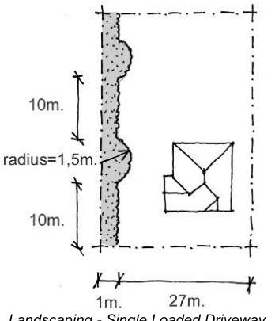
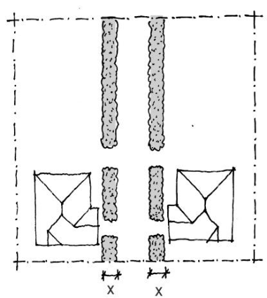
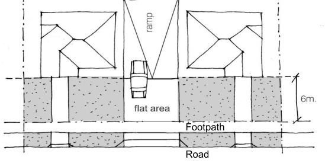

#### 6A.3  Car Parking and Access

Safe access for vehicles to enter and exit a development is essential along with maintaining onsite parking spaces. The driveway is a highly visible part of the development area thus the design and location needs to be considered to ensure the best outcome. To ensure traffic safety and streetscape, the car parking rate, driveways, driveway materials, landscaping along driveways, vehicle access design, and access location are regulated.

For general design information on car parking, refer to Chapter 12 of this DCP. In the event of inconsistency between the provisions contained within this clause and those of Chapter 12, the provisions of Chapter 12 apply to the extent of the inconsistency.

#### 6A.3.1 Car Parking Rate Objectives

a) To ensure adequate off-street car parking spaces are available on site.

b) To ensure off-street car parking is appropriately located on site, is accessible, and available at all time to residents and visitors.

#### Controls

a) Off-street parking spaces must be provided as set out below. The number of parking spaces required will be determined according to the table below. The greater of the rate will be applied.

## Chapter 6A – Multi Dwelling Housing

| Dwelling Location |  |  |
|---|---|---|
| A – Less than 400 metres from railway station or major bus station. |  |  |
| B – Greater than 400 metres from railway station or major bus station. |  |  |
| Dwelling Size or Number of Bedrooms | Car Spaces per Dwelling |  |
|  | A | B |
| 1 - 2 bedroom dwelling or less than 110sqm | 1.00 | 1.00 |
| 3 or more bedroom dwelling and/or greater than 110sqm | 1.50 | 2.00 |
| Add for Visitors per Dwelling | 0.25 | 0.25 |

Note 1: Car parking requirement must be provided by using the larger of the two calculations. For example, a 108sqm 3 bedroom dwelling located 500 metres from a railway or major bus station requires 2 car spaces. Any dwelling with an area greater than 110sqm will be regarded as a 3 bedroom unit, for parking calculation purposes.

Note 2: In cases where the calculation for required visitor spaces results in a proportion of a space being required (i.e. 0.25, 0.50, or 0.75 of a visitor space) the following calculation method will apply:

i. For developments where 1 - 8 dwellings are proposed, the number of visitor spaces will always be rounded up to the nearest whole number.

ii. For developments where more than 8 dwellings are proposed, the required number of spaces will be rounded to the nearest whole number. That is for where only “0.25” of a visitor space is required, the number of visitor spaces required can be rounded down to the nearest whole number. Conversely, where “0.50” or “0.75” of a visitor space is required, the number of visitor spaces will be rounded up to the nearest whole number.

## Chapter 6A – Multi Dwelling Housing

Note 3: Area of the dwellings is based on Gross Leasable Area. Refer DCP - Appendix A for definition.

b) For developments with basement car parking provision, any additional onsite car parking in addition to the required car parking provision is to be provided below ground.

c) All resident car parking at ground floor level must be provided within the building footprint. Visitor spaces must be accessible and made available at all times. If a proposed visitor parking space is located within an enclosed basement an intercom system allowing residents to grant visitors access to the visitor spaces in the basement must be provided.

d) Any room, or space within a room at first floor level capable of being enclosed as a room, will be regarded as a bedroom for the purposes of calculating car parking if:

i. It has an area of 9sqm or greater; or

ii. It has an area less than 9sqm, but Council Officers can demonstrate that it is capable of being used as a bedroom because the space accommodates a standard single bed, a wardrobe 1 metre by 1.5 metre in dimension and suitable circulation space. Refer to Section 6A.2.8 Size of Rooms and Storage.

#### 6A.3.2 Driveways Objectives

a) To retain the maximum number of on-street parking spaces.

b) To avoid gaps in the streetscape created by open driveways.

c) To maintain onsite parking spaces.

d) To maximise traffic and road safety on roads where access and egress is difficult.

#### Controls

a) Driveway entrances limited to one for every 15 metres of street frontage

b) The maximum width of carriageway crossings is 5.5 metres.

c) Regardless of frontage, for lots that front onto classified and regional roads, only one vehicle access driveway will be supported with a combined entry/exit separated by minimum 1.0 metre median.

d) Driveways for dwellings with street frontage must be located where the maximum number of on-street parking spaces is retained.

#### 6A.3.3 Driveway Materials Objectives

a) To provide for driveways which appear as courtyards into which vehicles intrude rather than spaces designed primarily for cars.

## Chapter 6A – Multi Dwelling Housing

b) To ensure a high standard of surface finish.

c) To minimise the visual impact of expansive driveway surfaces.

d) To provide for driveways that will, as far as possible, retain their original condition and appearance and resist the wear and marking from car movement.

#### Controls

Coloured concrete that is textured or patterned must be used and finished with a non-slip surface or coating

#### 6A.3.4 Landscaping along Driveway Objectives

a) To soften the visual impact of the dwellings, overall built form, fencing, parked cars and driveways.

b) To protect the amenity of neighbouring properties.

#### Single Loaded Driveway Controls

a) Driveways serving more than 2 dwellings are to be bordered by a densely landscaped area at least 1 metre wide along the common boundary. None of the landscape area may be turfed, but must be mulched.

b) At 10 metre intervals along the driveway, the landscape bed must be enlarged to create a node with a radius of

1.5 metres (when measured from the boundary).

c) Larger scale planting must be placed in the enlarged nodes.

d) Kerbs are required along the edge of the driveway and

> [Picture on page 18: a picture, saved as a picture (images/chapter-06a-multi-dwelling-housing-page-18-12.gif, 150 dpi).]

Landscaping - Single Loaded Driveway

> [Picture on page 18: a picture, saved as a picture (images/chapter-06a-multi-dwelling-housing-page-18-14.gif, 150 dpi).]

landscape bed.

#### Double Loaded Driveway Controls

a) A minimum 1 metre width of landscaped area on each side of the driveway must be provided as a buffer between the driveway and dwellings for the length of the driveway except for where garage and dwelling entrances are located.

b) Kerbs are not permitted along the edge of the driveway and landscape bed.

#### 6A.3.5 Vehicular Access Design

## Chapter 6A – Multi Dwelling Housing

#### Objectives

a) To ensure that vehicle access is provided in a

Landscaping - Double Loaded Driveway

location that minimises hard paved surface and maintains opportunities for roadside planting, paths or other uses.

b) To ensure that vehicles leaving sites with basement car parking have a safe stopping place to see pedestrians, cyclists, vehicles, etc before entering into the road reservation.

#### Controls

a) Long straight driveways shall be avoided and broken into bays through the use of landscape nodes in order to avoid ‘gun barrelled’ driveways.

b) For sites with basement car parking the following basement design must be achieved:-

i. The driveway gradient of the first 6 metres from the boundary in towards the car park shall not exceed 1 in 20 (5%).

ii. Residential driveways up to 20 metres long shall have a maximum grade of 1 in 4 (25%).

iii. The change of grade within the driveway shall not exceed 12.5% algebraically for summit changes and 15% algebraically for sag changes.

> [Picture on page 19: a picture, saved as a picture (images/chapter-06a-multi-dwelling-housing-page-19-12.gif, 150 dpi).]
> Words printed on the picture (title and legend, copied from the PDF):
> Footpath
> Road

iv. For more information refer to Australian Standard 2890.1:2004 : Parking facilities - Off-street car parking

c) In cases where driveways serve more than 1 dwelling the following criteria must be achieved:

i. Vehicle access must be designed so that all vehicles enter and exit the site in a forward direction.

ii. A minimum width of 6 metres for a length of 6 metres is required at the entrance of the development on Classified State and Regional Roads and Unclassified Regional Roads included at the end of this chapter. In respect to other roads this requirement will be considered on an individual basis depending on local traffic conditions (Refer to appendix G for full list of Classified and Regional Roads).

d) Dimensions for parking spaces and turning areas must be in accordance with Australian Standard 2890.1:2004 : Parking facilities - Off-street car parking Part 1 and should also achieve the following:

## Chapter 6A – Multi Dwelling Housing

i. Driveway widths should be minimised to increase landscaped areas while providing adequate space for vehicles to manoeuvre and pass at slow speeds, and

ii. The driveway should be 1 metre clear of power poles, telephone poles, stormwater pits, street trees, and metre boxes.

Note: It is recommended that the development be designed with regard to existing constraints of street trees, power poles, gully pits etc.

#### 6A.3.6 Access Location Objectives

a) To ensure that vehicle access and driveways to properties are located at the shortest, most direct access over the nature strip from the road.

b) To improve traffic and road safety by providing vehicle access to properties in a location that avoids possible traffic congestion, high speed traffic and bus-only roads.

c) To ensure that there is adequate sight distance to traffic on the frontage road and sight distance to pedestrians walking along the footpath.

#### Controls

a) Vehicle access and driveways from a physically closed road will only be permitted where there is no alternative access opportunity and with the approval of Council’s Traffic Branch.

b) Vehicle access and driveways from Classified State and Regional Roads and Unclassified Regional Roads will only be permitted via a slip lane where it is beneficial to the development and has the approval of Council’s Traffic Branch or where there is no alternative access opportunity (Refer to appendix G for full list of Classified and Regional Roads).

c) Vehicle access and driveways from the Bus Transitway corridor will not be permitted, except on the following streets where there is no alternative access opportunity: Canley Vale Road (north of the Horsley Drive), Victoria Street and eastern side of Walter Street.

d) Vehicle access and driveways to properties should be at least 30 metres or as far as possible from an intersection with a Classified State and/or Regional Road.

e) Vehicular access should be designed to avoid existing traffic calming devices, round-a-bouts, gully pits etc.

f) If a laneway separates commercial and residential zones, a pedestrian footpath must be provided, as part of the new development to encourage safe pedestrian access.
