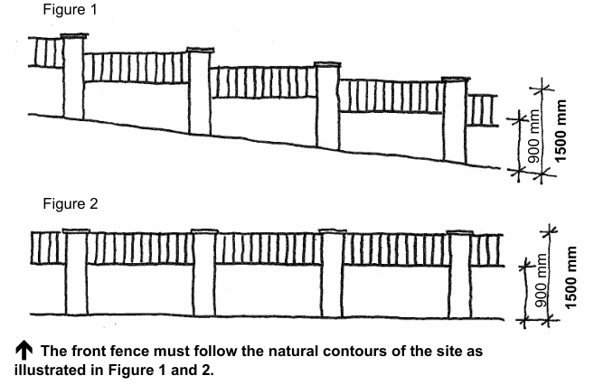

#### 6A.4  Landscaping and Open Space

#### 6A.4.1 Open Space

## Chapter 6A – Multi Dwelling Housing

Open space provides a number of amenities to the residents of the property, for example space for children to play and for drying clothes. To ensure a sufficient amount and the access to private open space is achieved the private open space and the common open space are regulated.

#### 6A.4.1.1 Private Open Space Objectives

a) To ensure the private open space is usable, functional and easily accessible for residents.

b) To ensure private open space includes landscaping and soft soil zone.

c) To ensure direct access and a relationship between indoor and outdoor living areas.

#### Controls

a) Each dwelling shall have a minimum of 35sqm of private open space at ground level with a minimum dimension of 4 metres.

b) In the calculation of private open space:

i. no area is less than 2.5 metres in width

ii. outdoor clothes drying areas are included as private open space

iii. car parking spaces are not included in open space calculations

c) The private open space must have direct and level access to the dwelling’s living areas, such as a lounge room, a family room, a dining room or a kitchen.

d) A garage or gate must provide access between the private open space and the driveway. This will allow items stored in backyards (eg, garbage bins, garden tools) to be moved to the street without needing to come through the house.

#### 6A.4.1.2 Common Open Space Objective

To ensure adequate open space is provided for large development sites, that is accessible, functional, and practical to all residents of the development.

#### Controls

a) No communal space is required for developments that have less than 12 dwellings.

b) Developments with 12 or more dwellings, a minimum of 10sqm per dwelling is required for communal open space.

c) Communal open space must have a minimum dimension of 6 metres and be co-located with deep soil zones.

d) Clothes drying areas, driveways and parking areas are not included as common

## Chapter 6A – Multi Dwelling Housing

open space.

e) Common open space must include features such as seating, shade structures, child play equipment or barbeques to satisfy the recreation needs of all residents.

f) Common open space must be accessible from all dwellings within the development. It should be possible for residents of at least 2 dwellings to visually monitor this space.

g) Common open spaces may be used for detention basins with particular attention paid to the issues listed below. The incorporation of these will reduce the basin capacity and should be recognised when preparing OSD calculations:

i. The height difference between natural ground level and the lowest level of the basin is not more than 0.5 metres;

ii. It is not located in the front yards of the development (unless it is a visual feature);

iii. It incorporates a variety of plant species (details of appropriate plants are available from Council); and

Note: It provides recreation features such as a barbeque, seat or similar.

#### 6A.4.2 Landscaping

For multi- dwelling housing, a landscape plan must be prepared by a suitable qualified landscape architect and submitted as part of the Development Application. illustrating that no more than 40% of the site area is covered with impervious material (including paving)

Significant trees are those trees that contribute substantially, either individually or as a member of a tree group, to the landscape character, amenity, cultural values or biodiversity of their locality. Generally trees with a girth greater than 500mm and a canopy spread of a 6 metre radius are trees of significance.

#### Objectives

a) To require landscape plans to respond to natural features, soften the appearance of developments and improve the living quality of the neighbourhood.

b) To encourage landscaping areas which assist in reducing the impacts of a range of environmental problems including salinity, flooding, reduction in biodiversity and climate change.

#### Controls

a) A minimum of 30% of the site is to be dedicated for soft soil zone.

b) A minimum of 20% of the site is to be dedicates for deep soil.

c) A landscape plan must be prepared for the site by a suitably qualified landscape architect or other accredited professional with demonstrated experience. Refer to Appendix F for Landscaping principles when seeking to prepare a landscape plan.

## Chapter 6A – Multi Dwelling Housing

#### 6A.4.3 Fencing

Fencing is an important element in creating a pleasant streetscape. To enhance the character of the City’s neighbourhoods, fencing design, height and materials are regulated.

#### Objectives

a) To provide design requirements for side, rear, and corner lot fencing that create a unified streetscape.

b) To allow for fencing that acts as a noise attenuation measure along Classified State and Regional Roads (Refer to appendix G for full list of Classified and Regional Roads).

c) To allow for security fencing that minimises visual impact on the streetscape.

#### Controls

#### Fencing design

a) Fencing must be designed to highlight entrances and be compatible with the materials used in the dwelling’s facade, incorporate a letterbox and garbage storage area and provide a clearly identifiable street number.

b) Walls and fences visible from a public place or within common area property must be divided into segments no longer than 5 metres. (In the fencing design there must be some change in the façade plan or an expressed column to avoid flat featureless walls.) Details of wall and fence treatment must be submitted with the Development Application.

c) Masonry walls, brushwood, lapped and capped timber and Colourbond fences will be permitted in townhouse/villa developments. Colourbond fences are not permitted to be erected along the front boundary or on any boundary that is visible from the public domain.

d) Fencing design must provide opportunities for natural surveillance into public spaces.

e) Fencing construction must meet the following criteria:

i. have adequate footings, be self-supporting and able to withstand loads;

ii. not include barbed wire, chain wire, razor wire, broken glass, be electrified, or the like;

iii. where the property is affected by flooding or by an overland flow be open style fencing so as not to stop or redirect surface waters so as to cause a nuisance; and

iv. be constructed wholly within the property boundary.

#### Front boundary fencing

## Chapter 6A – Multi Dwelling Housing

a) Fencing in front of the building line shall be a maximum height of 1.5 metres above ground level (existing) and be of masonry and decorative panel construction.  The maximum height of the masonry wall portion in front of the building line is 900mm above ground level (existing), with the exception of the masonry piers.

> [Picture on page 23: a picture, saved as a picture (images/chapter-06a-multi-dwelling-housing-page-23-30.gif, 150 dpi).]
> [Picture text on page 23 is stored in the PDF without readable letters (no character map), so it could not be copied; see the original PDF.]
> Words printed on the picture (title and legend, copied from the PDF):
> 900 mm 1500 mm
> 900 mm 1500 mm
> The front fence must follow the natural contours of the site as
> illustrated in Figure 1 and 2.

Figure 1

Figure 2

b) Infill panels and decorative inclusions must not be made out of reflective materials and must be open to permit views into the front yard and the façade of the dwelling.

c) Gates located in front of the building line should be consistent with the infill panels and not open onto a roadway or public space.

#### Side, rear and corner lot fencing

a) Fencing behind the front building line shall be a maximum height of 1.8 metres above ground level (existing).

b) For corner lots, a fence of masonry construction up to a height of 1.8 metres is required along the secondary street frontage.

#### Front boundary fencing along Classified State Roads and Regional Roads

Solid front fences with a maximum height of 1.8 metres are permitted provided that the fence incorporates corners and planting beds every 5 metres.

#### Front boundary fencing for security

a) Fencing with a maximum height of 1.8 metres are permitted where a safety risk is established.

b) Side and rear boundary fences may be a maximum height of 2.0 metres, where it can be demonstrated that significant security risk is evident.

c) Side and rear boundary fences of a maximum height of up to 2.2 metres will be considered if the site is sloping and the fence incorporates a retaining wall.

#### Internal Fencing

## Chapter 6A – Multi Dwelling Housing

a) Screen walls or fences which enclose open space areas should be at least 1.8 metres high to maximise privacy. Enclosing walls must be a timber, brushwood or masonry construction and be in segments or bays not longer than 5 metres.

b) The tops of masonry walls, timber and brushwood fencing used on the site must be decoratively treated such as lapped and capped.

c) Open style fencing is required where the property is affected by flooding or by an overland flow.

Note: For exempt and complying fencing controls see Chapter 2 Exempt and Complying Development of the Fairfield City Wide Development Control Plan and/or, State Environmental Planning Policy (Exempt and Complying Development Codes) 2008 whichever is in effect at the date of application.
