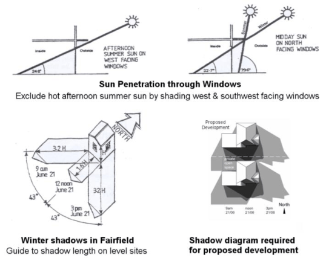
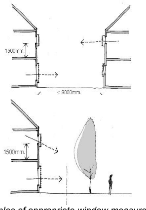

#### 6A.5 Amenity

#### 6A.5.1 Solar Access Objectives

a) To encourage the benefits of winter sun and minimise the intrusion of summer heat in design.

b) To ensure internal living spaces and private open space has adequate access to sunlight.

c) To maintain direct sunlight to adjacent dwellings.

#### Controls

a) All dwellings must be designed to ensure:

i. Living areas are orientated towards north where possible

ii. all north facing living area windows and more than two-thirds of the private open space receives at least 3 hours of direct sunlight between 9.00am and 3.00pm on 21 June.

iii. the potential for sunlight to penetrate the development through windows and atriums for dwellings on east-west orientated lots is maximised, limiting the use of skylights for  bathrooms and utility rooms only.

b) The windows to at least one living area of a dwelling on a neighbouring/adjoining dwelling/s must receive a minimum 3 hours of sunlight between 9.00am and 3.00pm at the mid–winter solstice. Where this requirement is already not achieved prior to a multi dwelling housing development, the development must not result in additional overshadowing on the affected living area of the dwelling.

## Chapter 6A – Multi Dwelling Housing

c) A development should maintain solar access to a solar hot water system, photovoltaic panel, or other solar collector on an allotment or adjoining allotment.

d) Garages, bathrooms and laundries should be located in areas with a west to southwest orientation, with windows (glazing) minimised in size and number as well

> [Picture on page 25: a picture, saved as a picture (images/chapter-06a-multi-dwelling-housing-page-25-28.gif, 150 dpi).]

as being protected with effective sun shades.

e) Council may require the preparation of shadow diagrams showing the impact of a proposal on the adjacent residential buildings and their private open space. Such diagrams shall be based on a survey of the site and adjoining development. The shadow diagrams shall include:

i. all openings and windows of adjoining buildings; and

ii. shall demonstrate likely shadow impact on the 21 June for 9 am, 12 pm, 3 pm.

Note: Habitable rooms include kitchens, living, dining rooms and the like.

#### 6A.5.2 Energy Efficiency Measures Objectives

To minimise greenhouse gas emissions in new development.

#### Controls

a) Where the solar panel will be visible from the street, the associated tank must be either within the roof or the dwelling.

b) Correct use of glazing, mass and insulation to ensure dwellings are constructed in an energy efficient manner, referring to standards contained within State Environmental Planning Policy (Building Sustainability Index: BASIX) 2004.

#### 6A.5.3 Privacy

The privacy for neighbours and for residents must be maximised in multi dwelling housing development. To ensure this, windows and balconies are regulated.

#### Objectives

a) To ensure privacy is maximised for neighbours of the development and those who will occupy the townhouse/villas.

b) To avoid overlooking of private open spaces and windows of nearby dwellings.

> [Picture on page 26: a picture, saved as a picture (images/chapter-06a-multi-dwelling-housing-page-26-18.gif, 150 dpi).]

c) To limit noise transmission to nearby dwellings.

## Chapter 6A – Multi Dwelling Housing

#### Controls

a) Townhouse/villas should be designed so that the number of windows directly overlooking adjacent dwellings is kept to a minimum.

b) Where upper floor windows result in unreasonable or unavoidable privacy issues, Council is likely to require:

i. A sill height of no less than 1.5 metres from the upper floor finished floor level,

ii. Frosted glazing,

iii. Screening, or

iv. The use of some other method to maximise privacy.

c) Facing windows closer than 9 metres will require additional appropriate privacy measures.

Examples of appropriate window measures

to ensure privacy are maximised.

d) Upper floor balconies or roof terraces are not permitted unless they are on the elevation facing the street.

e) Recreational facilities such as swimming pools, tennis courts or play equipment must be located away from bedrooms of dwellings.

f) Noise reduction between common walls and floors is to comply with the provisions of the Building Code of Australia.

#### 6A.5.4 Safety and Security Objective

To create an environment which is safe and secure from theft, personal threat and accidents.

#### Controls

a) All areas in a development should be clearly recognisable as private, common or public space. Responsibility for supervision and maintenance of these areas should be understood at the design stage and explained in the application. (Reference: Safe as Houses, Wendy Sarkissian, 1984).

b) Surveillance from dwellings is important for the safety of residents and passing pedestrians. Accordingly, a dwelling with street frontage should have a clear view of the footpath.

c) Barriers to prevent movement between roof spaces of adjoining dwelling will be required.

d) Dwellings must have a child-proof storage space for poisons or other dangerous substances.

## Chapter 6A – Multi Dwelling Housing
