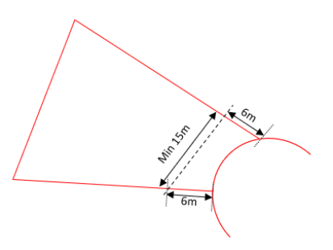
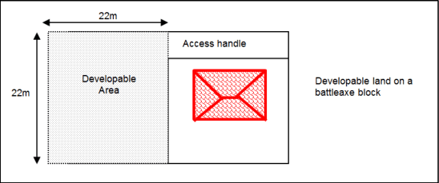

#### 6B.1  Site Requirements

The size of a lot and its width and depth affect the amenity of the lot, the amenity of the adjoining sites and the residential area as a whole. To ensure a high level of amenity the lot size and width are regulated for dual occupancy development.

## Chapter 6B – Dual Occupancy

#### 6B.1.1 Lot Requirements

#### Objectives

a) Encourage development which will address the street along publicly visible boundaries.

b) Encourage development on sites where dwellings will be able to maximise the benefits of winter sun and minimise the intrusion of summer heat.

c) Ensure privacy is maximised for neighbours of the development and those who will occupy the new dwellings.

d) Encourage development which maximise space devoted to the dwellings’ landscaping and open space.

e) Provide space for private recreation purposes and landscaping.

f) Integrate open space with internal space so that residents can maximise the use of both, while ensuring open space is sufficient for the needs of the residents.

#### Controls

#### 6B.1.1.1 Lot Size – R1 General Residential

Dual occupancy development within the R1 General Residential zone shall take into consideration the Bonnyrigg Living Communities Master Plan 2008.

#### 6B.1.1.2 Lot Size – R2 Low Density Residential

The minimum lot size for dual occupancy must be consistent with the lot sizes prescribed on the Fairfield LEP 2013 – Minimum Lot Size for Dual Occupancy Map. A

> [Picture on page 5: a picture, saved as a picture (images/chapter-06b-dual-occupancy-page-5-4.gif, 150 dpi).]

minimum lot size of either 600sqm or 900sqm is applicable.

#### 6B.1.1.3 Lot Width – R2 Low Density Residential

a) A minimum lot width of 15 metres when measured from the front building line is required for dual occupancy development in the R2 Low Density Residential zone.

b) The average lot width for measuring frontage for sites located on a cul-de-sac head is to be measured six metres from the front boundary.

#### 6B.1.1.4 Lot Size – R3 Medium Density Residential

No minimum lot size applies to development for the purposes of dual occupancy in the

R3 Medium Density Residential zone.

#### 6B.1.1.5 Lot Width – R3 Medium Density Residential

## Chapter 6B – Dual Occupancy

a) A minimum lot width of 15 metres when measured from the front building line is required for dual occupancy development in the R3 Medium Density Residential zone.

b) The average lot width for measuring frontage for sites located on a cul-de-sac head

> [Picture on page 5: a picture, saved as a picture (images/chapter-06b-dual-occupancy-page-5-24.gif, 150 dpi).]

is to be measured six metres from the front boundary.

6B.1.1.6 Dual Occupancy on

#### Battle-axe Blocks

a) In the case of a dual occupancy on a battle axe allotment, the developable area must have a minimum width and depth of 22 metres as shown in this figure.

#### 6B.1.1.7 Subdivision of Dual Occupancy – R2 Low Density Residential

a) Minimum Lot Size - For subdivision of dual occupancy requirements in the R2 Low Density Residential refer to Clause 4.1A Minimum Lot Size for Dual Occupancy Development of the Fairfield Local Environmental Plan 2013.

b) Future Lot areas created – In the design of either an attached or detached dual occupancy development, consideration must be given to future subdivision arrangements so that future lot sizes are equal or similar in size.
