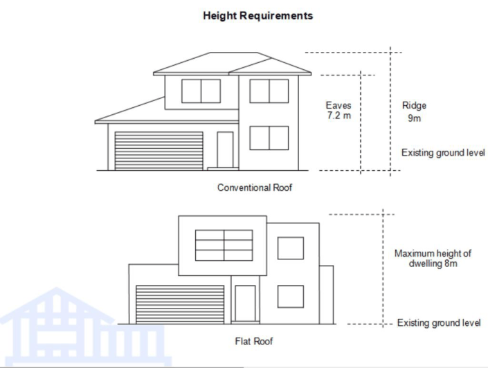
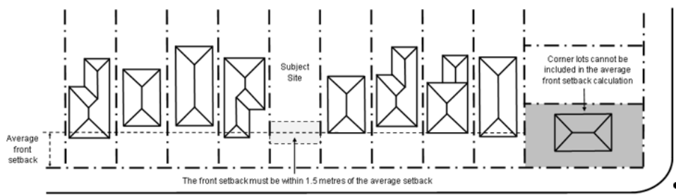
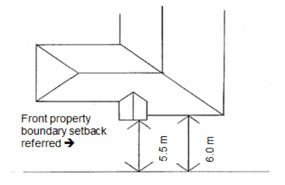
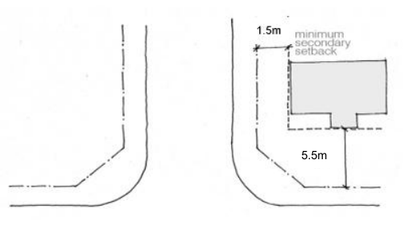
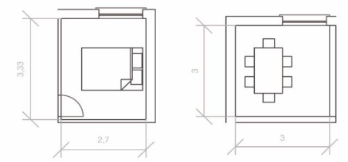

#### 6B.2 Built Form and Urban Design 6B.2.1 Floor Space Ratio (FSR)

#### Objectives

a) To ensure the Minimum Lot Size for dual occupancy development provides for desired internal and external amenity.

b) To ensure future lot areas created in dual occupancy development provide for equitable amenity for the occupants of both dwellings.

c) To ensure site widths of dual occupancy development provide for amenity and good design.

#### Controls

a) The FSR for dual occupancy must be consistent with the FSR prescribed on the Fairfield LEP 2013 – Floor Space Ratio Map.

b) Floor Space Ratio must comply with the Floor Space Ratio provisions defined in clause 4.4 Floor Space Ratio of the Fairfield LEP 2013.

c) Depending on site constraints and other requirements of this DCP, the maximum

## Chapter 6B – Dual Occupancy

FSR may not always be achieved.

d) A void space over the stairs of 8sqm can be excluded from the gross floor area calculations. Any additional void area will be included in the gross floor area calculations.

e) The Floor Space Ratio will be calculated on the future or proposed lot size.

f) Maximum permissible floor space ratio for any dual occupancy development must comply with the floor space ratio development standards prescribed on the Fairfield LEP 2013 Floor Space Ratio Map. The following exceptions for the R3 medium Density Residential zone are outlined in the Fairfield LEP 2013:

i. For land in Zone R3 Medium Density Residential (shown as Area B on the floor space ratio map):

a. if the site has a street frontage of less than 22 metres— 0.5:1, or

b. if the site has a street frontage of at least 22 metres— 0.65:1, and

ii. A floor space ratio bonus of up to 0.15:1 may be permitted if all car parking for the development is provided in a basement; and

iii. Clause 4.6 Exceptions to Development Standards of the Fairfield LEP 2013 allows Council to consider variations to development standards (e.g., floor space ratio) where justified to the satisfaction of Council.

#### 6B.2.2 Building Height

#### Objectives

a) Ensure new development is consistent and compatible with the established built form and hence results in a physically cohesive neighbourhood.

b) Ensure minimal overshadowing of neighbouring properties.

c) Ensure privacy of neighbouring properties is protected by limiting side and rear views of neighbouring properties.

## Chapter 6B – Dual Occupancy

d) Maintain sunlight in public and private open spaces.

#### Preamble

The maximum permissible building height for any development must comply with the building height standards prescribed on the Fairfield LEP Height of Building Map.

a) Ground level (existing) is defined in Fairfield LEP 2013 as the existing level of a site at any point. Note: Such ground level must be natural or lawfully approved.

b) Clause 5.6 of Fairfield LEP 2013 allows the maximum building height to be exceeded where the roof is determined to be a decorative architectural feature. Refer Clause 5.6 of Fairfield LEP 2013 for details.

c) Some dwellings may need to be lowered in height to comply with the DCP’s requirements for solar access and privacy (See 5A.5.1 Solar Access and 5A.5.3 Privacy).

d) All two storey dwelling applications must include a sectional diagram that indicates the height of the dwelling from ground level (existing).

#### Controls

## Chapter 6B – Dual Occupancy

The following controls apply in all cases where the Fairfield LEP Height of Building Map indicates a maximum building height of 9 metres is applicable. Such height typically applies in the RU5 Village, R1 Residential and R2 Low Density Residential zones.

a) A maximum of two (2) storeys above ground level (existing) plus an attic or basement is permitted.

b) The maximum heights of the eave and the ridge from the ground level (existing) must be 7.2 metres and 9 metres respectively.

> [Picture on page 8: a picture, saved as a picture (images/chapter-06b-dual-occupancy-page-8-25.gif, 150 dpi).]

c) Dwellings proposing parapet walls, flat roofs and high continuous walls shall be limited to 8 metres in height from ground level (existing) and are to provide articulation.

d) Pedestrian access to a roof terrace on flat roofs will not be supported.

e) For battleaxe blocks, the maximum ridge height is 8 metres and 6.5 metres to the underside of the eaves or 8 metres for flat roofed dwellings to allow for sloping blocks.

f) For battleaxe blocks, habitable rooms other than bedrooms or studies will not be supported on the upper floor.

#### 6B.2.3 Setbacks

The distance a dwelling is setback from the street(s) and the visual impact of a dwelling facade influences the streetscape and character of the neighbourhood. The side and rear boundaries affect the amenity of adjoining properties including visual/acoustic privacy and solar access. To ensure a high level of streetscape is preserved the front, side, and rear boundaries are regulated.

#### Objectives

a) To maintain and enhance established streetscape and character of the neighbourhood. Components of streetscape and character of the neighbourhood include building setback, landscaping, fencing, lighting, pathways, and street trees.

b) To protect the visual/acoustic privacy and solar access of adjacent properties.

c) To achieve a staggered and articulated built form.

## Chapter 6B – Dual Occupancy

d) To ensure vehicular and pedestrian safety.

e) To ensure the visual focus of the development is the dwelling, not the garage.

f) Visually recess garage so that observer’s attention is drawn to the dwelling rather than the garage.

g) To provide the opportunity for Council to acquire land for local road widening, which will improve the road network.

h) To improve traffic safety by increasing site distances for drivers at intersections.

#### Control

#### 6B.2.3.1 Front Setback

a) Any part of the dual occupancy development in the R2 Low Density Residential zone (except landscaping and retaining walls) must be located within 1.5 metres of the average existing front street setback.

> [Picture on page 9: a picture, saved as a picture (images/chapter-06b-dual-occupancy-page-9-31.gif, 150 dpi).]

b) In cases where control (a) equates to a minimum setback less than 6 metres, the dwelling, garage and carport front setback must be a minimum of 6 metres. However, porticos and verandas may encroach onto the 6 metre setback area by

> [Picture on page 10: a picture, saved as a picture (images/chapter-06b-dual-occupancy-page-10-4.gif, 150 dpi).]

500 millimetres.

c) Garages must be behind the façade of the dwelling.

d) The 6 metre front setback area of dual occupancy developments shall not be used for any purposes other than landscaping only.  In this regard, private courtyards, private open spaces, car parking spaces including visitor spaces, garbage bays, above ground rainwater tanks, pergola or the like are not permitted in the front setback area.

#### 6B.2.3.2 Side Setback Controls

a) Side and rear walls may be built to the boundary if the following are satisfied:

## Chapter 6B – Dual Occupancy

i. Located on the ground floor only;

ii. Continuous length of wall does not exceed 10 metres;

iii. Walls are not more than 50% of a boundary’s length;

iv. Walls comply with requirements of the Building Code of Australia in terms of fire separation; and

v. Walls and fences are of the same material being brick/masonry.

b) Side and rear walls not built to the boundary should be at least 0.9 metre from the boundary.

#### 6B.2.3.3 Rear Setback

First floor walls must be set back a minimum of 6 metres from the rear boundary where the lot adjoins residential properties.

#### 6B.2.3.4 Corner Lot Secondary Setback

a) Dwellings shall be appropriately articulated along the primary and secondary setbacks to ensure that the dwellings address both streets.

b) The secondary setback for a dual occupancy development must be setback the average of the existing secondary setback of the dwellings immediately adjoining.

> [Picture on page 10: a picture, saved as a picture (images/chapter-06b-dual-occupancy-page-10-35.gif, 150 dpi).]
> Words printed on the picture (title and legend, copied from the PDF):
> 5.5m

The minimum secondary setback is 1.5 metres.

c) The secondary frontage must orient the dwellings to the street in such a manner that the dwellings have a direct relationship with the street.

d) Garages forming part of a detached dual occupancy which fronts a secondary street shall be setback a minimum of 5.5 metres from the street.

e) Corner sites must have a front setback behind the Splay Corner as indicated at 6B.3.3 Splay Corner Setbacks and Road Widening.

f) The front door of the dwelling must face the primary frontage.

#### 6B.2.4 Building Appearance

#### Objectives

a) To avoid blank/plain facades along the most publicly visible part of the development;

b) To visually integrate the new development into established streetscapes.

c) To provide visual interest through the incorporation of features traditionally associated with those facades facing the street.

#### Controls

a) Dwellings which front onto a street and are immediately visible to observers must be designed to address the street.

b) The front door of those dwellings must face the street, as should any feature windows or roof treatment.

## Chapter 6B – Dual Occupancy

c) Presentation of long sidewalls to the street will not be accepted.

d) For dwellings along the front or secondary street boundary, the front door of each dwelling is directly visible from the public street.

e) A window fronting the road from habitable rooms must be provided and are to overlook the public domain.

f) On corner sites the dwellings must address both streets by incorporating appropriate architectural features, articulation to the dwelling and roof form.

#### 6B.2.5 Size of Room

#### Objective

a) To maintain a high quality of amenity within each dwelling.

b) To ensure room sizes are functional, are of sufficient size and cater for intended purpose.

c) Maintain a high quality of amenity within each dwelling.

#### Controls

a) Bedrooms shall be a minimum of 10sqm in size with a minimum 3 metre dimension.

b) Dining rooms shall be a minimum of 10sqm in size with a minimum 3 metre dimension.

c) Living rooms shall be a minimum of 18sqm in size with a minimum 4 metre dimension.

d) Where an open plan combined lounge / dining is proposed, a minimum area of 27sqm and a minimum dimension of 4 metres are acceptable.

e) In addition to storage in the kitchen and bedrooms, the following storage is required:

i. a minimum of 6sqm is required within each dwelling, including a minimum dimension of 500 millimeters.

ii. if located within the garage the storage space can be excluded from the FSR calculations.

f) A furniture plan must be shown on plans in order for alternative minimum areas to be considered.

Minimum bedroom size10sqm – 3 metre dimension

Minimum dining room size – 10sqm -3 metre dimension

> [Picture on page 12: a picture, saved as a picture (images/chapter-06b-dual-occupancy-page-12-19.gif, 150 dpi).]

Minimum stand alone living room size – 18sqm   4 metres dimension

## Chapter 6B – Dual Occupancy

Minimum size for bedrooms, dining rooms & living rooms

Note 1: All architectural floor plans shall show full dimensions of internal floor layout to demonstrate that the above controls have been achieved.

#### 6B.2.6 Dual Occupancies Proposed in Conjunction with an Existing Dwelling

Dual occupancy development where the proposal seeks to retain the existing dwelling can have adverse impacts on the amenity of residents if they are not managed appropriately. To ensure the orderly development of the site and to minimise the potential amenity issues associated with developing a new dwelling adjoining or adjacent an existing dwelling on the same lot of land, consideration shall be given to the improvement or rectification of the existing dwelling and managing the amenity impacts associated with the development.

#### Objectives

a) To ensure the development makes a positive contribution to the streetscape and neighbourhood.

b) To encourage the renewal of old housing stock as part of any dual occupancy development seeking to retain an existing dwelling.

c) To ensure the orderly development of dual occupancy sites.

#### Controls

a) Where an existing dwelling is proposed to be retained, it must be demonstrated that the existing dwelling can still address relevant development controls identified in this chapter.

b) Where development of the new dwelling affects the existing dwelling’s ability to comply with the relevant controls in the DCP or does not comply with relevant BCA requirements, Council may require the existing dwelling to be:

i. Upgraded to the meet the relevant development controls identified in this DCP and or BCA requirements or,

ii. The applicant should consider rebuilding in accordance with the controls identified in the DCP.

c) Where an existing dwelling is proposed to be retained, the external materials, finishes and architectural features shall be modified to compliment the proposed dwelling.

#### 6A.2.7 Swimming Pools

#### Objectives

a) Ensure swimming pool safety.
