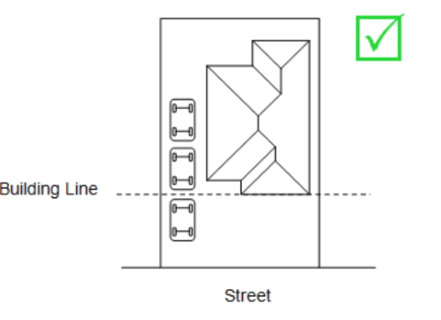

#### 6B.3 Car Parking and Access

Safe access for vehicles to enter and exit a development is essential along with maintaining onsite parking spaces. The driveway is a highly visible part of the

development area thus the design and location needs to be considered to ensure the best outcome. To ensure traffic safety and streetscape, the car parking rate, driveways, driveway materials, landscaping along driveways, vehicle access design, and access location are regulated. For general design information on car parking, refer to Chapter 12 of this DCP. In the event of inconsistency between the provisions contained within this clause and those of Chapter 12, the provisions of Chapter 12 apply to the extent of the inconsistency.

#### 6B.3.1 Car Parking

#### Objectives

a) To ensure that vehicle access is provided in a location that minimises hard paved surface and maintains opportunities for onsite landscaping, roadside planting, on street parking, paths and other uses.

b) To maintain an integrated façade so as to ensure that the dwellings are not dominated by the garages or carport.

c) To ensure the visual focus of the development is the dwellings, not the garage(s) or carport(s).

#### Controls

## Chapter 6B – Dual Occupancy

a) Two car parking spaces shall be provided per dwelling, one (1) of which must be behind the building line.

b) For dwellings located on a proposed Lot greater than 450sqm, with a width of 11 metres or greater, three (3) car parking spaces shall be provided per dwelling, two

(2) of which must be behind the building line.

c) Garages must be designed in a manner that prevents a garage dominant street environment.

d) Garages must be behind the façade of the dwelling.

e) Driveways must be designed to ensure one (1) on street carparking spot is provided in front of the proposed development. The car parking spot must be a minimum width of 5.5 metres when measured from the driveway splay.

f) Dimensions for parking spaces and turning areas should be in accordance with Australian Standard 2890.1:2004 : Parking facilities – Off-street car parking and should also achieve the following:

i. Driveway widths should be minimised to increase landscaped areas while providing adequate space for vehicles to manoeuvre; and

ii. The entry point to the driveway should be 1 metre clear of power poles, telephone poles, street trees, metre boxes, and storm water pits.

g) For corner lots, the garages or carports must be located furthest from the corner.

> [Picture on page 15: a picture, saved as a picture (images/chapter-06b-dual-occupancy-page-15-15.gif, 150 dpi).]

h) Dimensions for parking spaces and turning areas should be in accordance with Chapter 12 of this DCP.

i) If a laneway separates commercial and

## Chapter 6B – Dual Occupancy

residential zones, a pedestrian footpath must be provided, as part of the new development to encourage safe pedestrian access.

Note 1: It is recommended that the development be designed with regard to existing constraints of street trees, power poles, gully pits etc.

Note 2: The design of carports need to ensure compliance with the Building Code of Australia (BCA) and may require the provision of fire resisting walls adjoining any openings. To comply with the BCA, the location of windows near carports needs careful consideration.

#### 6B.3.2 Driveway Materials

#### Objectives

a) To provide for driveways which appear as courtyards into which vehicles intrude rather than spaces designed primarily for cars.

b) To ensure a high standard of surface finish.

c) To minimise the visual impact of expansive driveway surfaces.

d) To provide for driveways that will, as far as possible, retain their original condition and appearance and resist the wear and marking from car movement.

#### Controls

Coloured concrete that is textured or patterned must be used and finished with a non-slip surface or coating.

#### 6B.3.3 Splay Corner Setbacks and Road Widening

#### Objectives

a) To restrict building and landscaping within close proximity to road intersections.

b) To improve traffic safety by increasing site distances for drivers at intersections.

c) To provide the opportunity for Council to acquire land for local road widening, which will improve the road network.

#### Controls

a) Development on properties adjoining Boundary Lane, Cabramatta should be set back at least 9 metres from the centreline of the road. Council may seek to acquire up to 3 metres width of land for road widening on some sites where it is deemed necessary.

b) All corner lots at the intersections of public roads will be required to maintain a

## Chapter 6B – Dual Occupancy

setback to the corner of the public road to improve site distances at intersections. In this splay corner setback no buildings, fences or other structures will be permitted. Landscaping will be restricted to lawn or low growing shrubs and other plant species. Splay corner setbacks will generally be required to be 6 metres by 6 metres in the following suburbs: Wetherill Park, Bossley Park, Prairiewood, Wakeley, Greenfield Park, Edensor Park, St Johns Park, Abbotsbury and Bonnyrigg Heights. Splay corner setbacks in the others suburbs will generally be required to be 3 metres by 3 metres.
