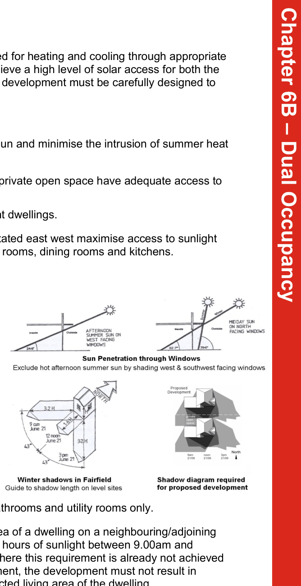
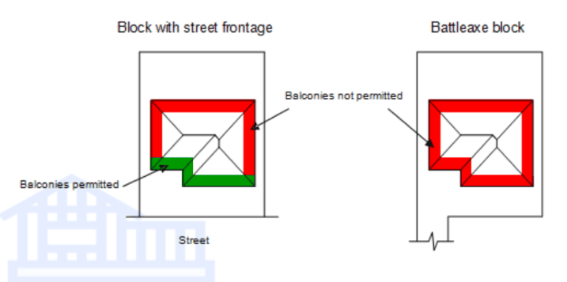

#### 6B.5 Amenity 6B.5.1 Solar Access

> [Picture on page 20: a picture, saved as a picture (images/chapter-06b-dual-occupancy-page-20-3.gif, 150 dpi).]

Dwelling design should minimise the need for heating and cooling through appropriate window size, shape and location. To achieve a high level of solar access for both the dwelling and surrounding properties, the development must be carefully designed to minimise overshadowing.

#### Objectives

a) To encourage the benefits of winter sun and minimise the intrusion of summer heat in design.

b) To ensure internal living spaces and private open space have adequate access to sunlight.

c) To maintain direct sunlight to adjacent dwellings.

d) To ensure development on lots orientated east west maximise access to sunlight for internal living areas such as living rooms, dining rooms and kitchens.

#### Controls

a) All dwellings must be designed to

## Chapter 6B – Dual Occupancy

ensure:

i. living areas are orientated towards north where possible

ii. all north facing living area windows and more than two-thirds of the private open space receives at least 3 hours of direct sunlight between 9.00am and 3.00pm on 21 June.

iii. the potential for sunlight to penetrate the development through windows and atriums for dwellings on east-west orientated lots is maximised, limiting the use of skylights for bathrooms and utility rooms only.

b) The windows to at least one living area of a dwelling on a neighbouring/adjoining dwelling/s must receive a minimum 3 hours of sunlight between 9.00am and 3.00pm at the mid–winter solstice. Where this requirement is already not achieved prior to the dual occupancy development, the development must not result in additional overshadowing on the affected living area of the dwelling.

c) A development should maintain solar access to a solar hot water system, photovoltaic panel, or other solar collector on an allotment or adjoining allotment.

d) Garages, bathrooms and laundries should be located in areas with a west to southwest orientation, with windows (glazing) minimised in size and number as well as being protected  with effective sun shades.

i. Council may require the preparation of shadow diagrams showing the impact of a proposal on  the adjacent residential buildings and their private open space. Such diagrams shall be based on a survey of the site and adjoining development. The shadow diagrams shall include:

ii. all openings and windows of adjoining buildings

iii. shall demonstrate likely shadow impact on the 21 June for 9 am, 12 pm, and 3 pm.

#### 6B.5.2 Energy Efficiency Measures

Energy efficiency measures include facilitating energy conservation and minimising energy needs to reduce greenhouse gas emissions.

#### Objectives

To maximise greenhouse gas emission reduction in new development.

#### Controls

a) Where the solar panel will be visible from the street, the associated tank must be either within the roof or the dwelling.

## Chapter 6B – Dual Occupancy

b) Correct use of glazing, mass and insulation to ensure dwellings are constructed in an energy efficient manner, referring to standards contained within State Environmental Planning Policy (Sustainable Buildings) 2022.

c) All new dwellings and renovated dwellings in NSW are required to meet minimum water and energy rating requirements specified by State Legislation – BASIX (Building Sustainability Index). Further details regarding BASIX can be viewed at the Department of Planning, Housing and Infrastructure BASIX Website.

#### 6B.5.3 Privacy

The privacy of neighbours and other residents must be maximised. To ensure this,

> [Picture on page 21: a picture, saved as a picture (images/chapter-06b-dual-occupancy-page-21-29.gif, 150 dpi).]

windows and balconies are regulated.

#### Objectives

a) To ensure privacy is maximised for neighbours of the dwelling house and those who will occupy the dwelling.

b) To avoid overlooking of private open spaces and windows of nearby dwellings.

c) To limit noise transmission to nearby dwellings.

#### Controls

a) Upper floor voids, stairways, hallways and living area windows (not including bedrooms, laundry, bathrooms or studies), which overlook neighbouring premises, must be provided with:

i. A sill height of no less than 1.5 metres from the upper floor finished floor level, or translucent glass that is fixed and not able to be opened.

ii. A stairway window that overlooks the neighboring premises is to be translucent glass that is fixed and not able to be opened.

b) Any rooftop, upper floor, rear and side balconies will not be supported, including battleaxe blocks.

c) Noise reduction between common walls and floors is to comply with the provisions of the Building Code of Australia.
