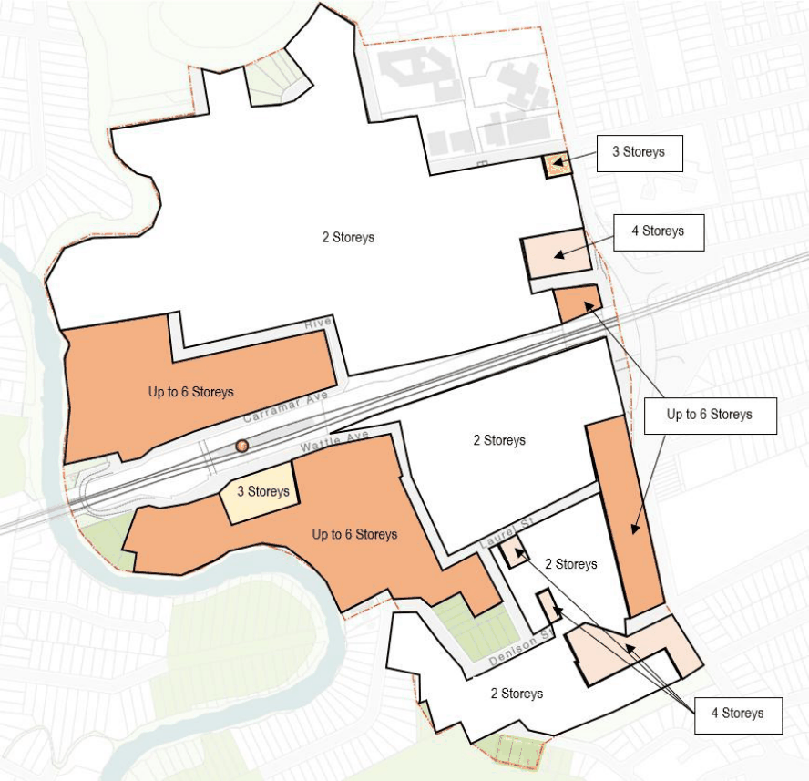

## Chapter 7 – Residential Flat Buildings

• 13 metres (4 storeys),

• 16 metres (5 storeys), and

• 20 metres (6 storeys).

Note: In cases where there is overshadowing or other impacts, the maximum height may not be achieved on a site or  parts of a site. Car parking that is located on the ground floor is regarded as a storey and is included in the height limit.

#### Carramar Town Centre Building Heights Objective

a) Encourage variations in building heights to improve levels of passive surveillance and increase flexibility of built form throughout the town centre,

b) Allow generous floor to ceiling heights to result in an improved outcome for future residents.

#### Control

a) Building heights are to align with the maximum height of building within Fairfield LEP 2013 and number of storeys outlined in figure below.

> [Picture on page 13: a picture, saved as a picture (images/chapter-07-residential-flat-buildings-page-13-4.gif, 150 dpi).]
