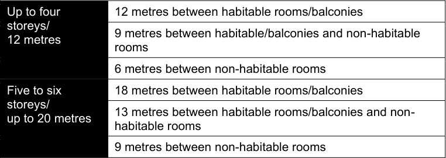

## Chapter 7 – Residential Flat Buildings

R4 High Density Residential Housing Zone – Areas zoned after making of LEP 2013

| Street setbacks | Minimum |
|---|---|
| Primary Street – shorter length | Any part of the development (except landscaping and retaining walls) must be located within 1.5 metres of the average existing front street setback. |
| Secondary street/lane – longer length | 6 metres |

c) Secondary Street Setbacks – A minor encroachment allowing a reduced setback may be considered where the:

i. Development does not result in any part of the building being closer than 3 metres to the secondary street boundary and for no more than 25% of the secondary street frontage only.

ii.  Development on a corner lot can encroach onto the primary frontage, as well as, the secondary boundary to 3 metres for 25%, however, the 3 metre setback should only be intense landscaping.

iii. Reduction in setback does not unreasonably impact the internal residential amenity of the proposed development.

iv. Development provides a feature on the corner of the development that results in a good urban design outcome and enhances the streetscape.

v. Reduction in setback does not result in the development being inconsistent with any other development control in this DCP.

d) Side and rear setbacks

> [Picture on page 15: a picture, saved as a picture (images/chapter-07-residential-flat-buildings-page-15-8.gif, 150 dpi).]
> Words printed on the picture (title and legend, copied from the PDF):
> 12 metres between habitable rooms/balconies
> Up to four
> storeys/
> 12 metres
> 9 metres between habitable/balconies and non-habitable
> rooms
> 6 metres between non-habitable rooms
> 18 metres between habitable rooms/balconies
> Five to six
> storeys/
> up to 20 metres
> 13 metres between habitable rooms/balconies and non-
> habitable rooms
> 9 metres between non-habitable rooms

Exceptions to the above are walls containing no windows or balconies. In such cases walls may be have a zero side boundary setback subject to:

i. Compliance with solar access controls contained with Section 7.4.3;

ii. Adjoining properties having similar zero boundary setback potential i.e. they have redevelopment potential in accordance with this DCP;

e) Land Required for Road Improvements
