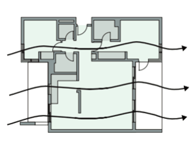

### 7.5 Amenity

Amenity is an important aspect of any development containing residential or adjacent to residential dwellings. Ventilation, visual and acoustic privacy, solar access and access to private open space all contribute to the overall liveability of dwellings within

> [Picture on page 17: a picture, saved as a picture (images/chapter-07-residential-flat-buildings-page-17-8.gif, 150 dpi).]

and adjacent to the development.

#### 7.5.1 Ventilation

#### Objectives

The intention of ventilation or cross ventilation is to keep a dwelling as cool as naturally possible in summer and reduce the reliance on electric fans and air conditioners. By positioning windows across from each other, good airflow can be maintained within the dwelling.

#### Controls

Buildings should be designed in accordance with the provisions of Part 4B –Natural Ventilation of the Apartment Design Guide.

#### 7.5.1.1 Air Conditioning Units

#### Objective
