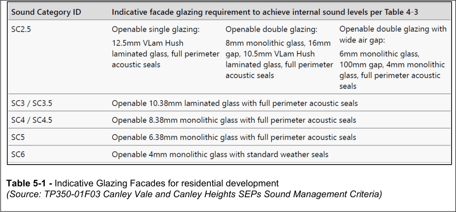

## Chapter 7 – Residential Flat Buildings

noise transmission requirements of the Building Code of Australia 2004. Noise transmission must be minimised through the design of internal layouts of apartments and the location of courtyards, terraces / balconies, and openings.

b) Noise impact assessments may be required. An assessment of the existing and expected future noise levels together with a mitigation strategy must be provided in the noise impact assessment.

c) Noise attenuation measures must be incorporated in all new developments along Classified State and Regional Roads and Unclassified Regional Roads and properties in proximity to the railway line. Developments adjacent to rail corridors, shall take into consideration the provisions within SEPP (Infrastructure) 2007 relating to impact of rail noise or vibration on non-rail development.

d) Land uses/activities noise conflicts minimised - In mixed-use developments, the design must minimise the transfer of noise between business and commercial activities and residential development by using measures that will address noise associated with:

i. Goods and service deliveries as well as waste and garbage disposal and collections, particularly if this is occurring early in the morning or late at night;

ii. Restaurants and cafes particularly those operating at night or those with outdoor seating; and

iii. Extraction fans and air conditioning units.

e) Land use conflicts between existing and new development – Noise attenuation measures must be incorporated into all new residential development proposed near an existing retail/commercial property that generates noise at times or levels not compatible with residential living. An acoustic assessment and proposed acoustic attenuation measures are to be detailed in an Acoustic Report prepared by an Acoustic Engineer or suitably qualified individual.

f) Air conditioning units proposed are to be detailed in the acoustic assessment.

g) New residential development within a Special Entertainment Precinct shall have regard to indicative measures shown in the table below. These materials are currently available for residential development to mitigate the intrusion of external sound. The table below has regard to performance-based measures currently available in the market that would comply with the National Construction Code.

> [Picture on page 19: a picture, saved as a picture (images/chapter-07-residential-flat-buildings-page-19-13.gif, 150 dpi).]
> Words printed on the picture (title and legend, copied from the PDF):
> (Source: TP350-01F03 Canley Vale and Canley Heights SEPs Sound Management Criteria)

Table 5-1 - Indicative Glazing Facades for residential development
