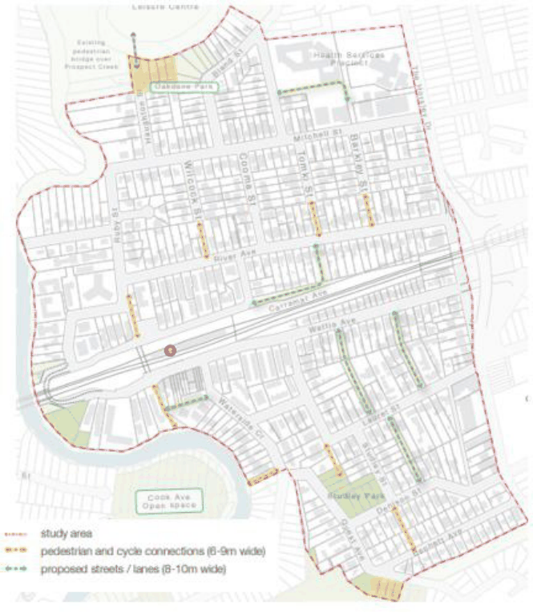

## Chapter 7 – Residential Flat Buildings

#### 7.5.7  Carramar Town Centre Through Links

> [Picture on page 22: a picture, saved as a picture (images/chapter-07-residential-flat-buildings-page-22-2.gif, 150 dpi).]

#### Objective

a) To improve permeability for pedestrians and cyclists

b) Provide assess to deep urban blocks

c) Ensure new development has public street address

d) Ensure a provision is made for stormwater flow to allow for natural drainage.

#### Control

a) Vehicular access to be provided to deep urban blocks

b) Pedestrian/cycle links, a minimum of 6 metres – 9 metres wide and constructed to Council’s standards and dedicated back to Council on completion.
