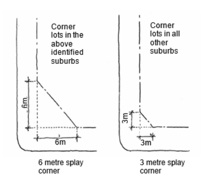

## Chapter 7 – Residential Flat Buildings

b) Driveway location and vehicle access to properties should be at least 30 metres or as far as possible from an intersection with a State or regional road.

c) Vehicle entries must be located away from main pedestrian entries and on secondary frontages and not be obstructed by power/telephone poles, meter boxes etc.

d) Driveway width is generally limited to a maximum of 6  metres and should be minimised to increase landscaped area while providing adequate space for vehicles to manoeuvre and pass at slow speeds.

e) Driveway length should be minimised where possible by being broken into bays through the use of landscape nodes.

#### 7.6.3 Splay Corner Setbacks and Road Widening

#### Objectives

a) Restrict building and landscaping within close proximity to road intersections.

b) Improve traffic safety by increasing site distances for drivers at intersections.

c) Provide the opportunity for Council to acquire land for local road widening, which will improve the road network.

#### Controls

> [Picture on page 24: a picture, saved as a picture (images/chapter-07-residential-flat-buildings-page-24-11.gif, 150 dpi).]

a) All corner lots at the intersections of public roads will be required to maintain a setback to the corner of the public road to improve site distances at intersections. In this splay corner setback no buildings, fences or other structures will be permitted. Landscaping will be restricted to lawn or low growing shrubs and other plant species. Splay corner setbacks will generally be required to be 6 metres by 6 metres in the following suburbs: Wetherill Park, Bossley Park, Prairiewood, Wakeley, Greenfield Park, Edensor Park, St Johns Park, Abbotsbury and Bonnyrigg Heights. Splay corner setbacks in the others suburbs will generally be required to be 3 metres by 3 metres.

Note 1: A number of properties in Fairfield City are affected by restrictions covering vehicular access denied (e.g. to a major road or heavy pedestrianised areas where alternative access should be provided as part of a new development), road widening, splay corner (to improve sight lines on corner blocks) and road closure provisions.
