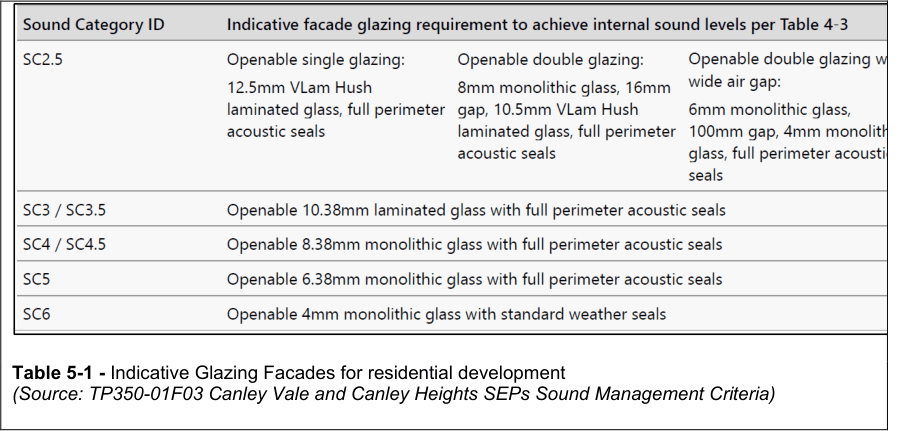

## Chapter 8 – Neighbourhood and Local Centres

When managing the impacts of a new development, the ability to maintain adequate visual and acoustic privacy is a critical contribution to the quality of life of adjoining residents.

#### Objectives

a) To minimise the direct overlooking of adjoining living areas;

b) To ensure acoustic privacy within and between bedrooms and internal living areas of adjoining neighbours; and

c) To ensure the acoustic design of new development takes into account surrounding existing developments and implements appropriate sounds attenuation measures to mitigate any conflict between the existing development and the proposed new development.

#### Controls

a) Visual Amenity (Lighting Impact) - As part of the Development Application a lighting plan shall be submitted that incorporates the following elements:

i. Use diffused lights and/or movement sensitive lights;

ii. Direct these lights towards access/egress routes to illuminate potential offenders, rather than towards buildings or resident observation points;

iii. Lighting should have a wide beam of illumination, which reaches to the beam of the next light, or the perimeter of the site or area being traversed;

iv. Avoid lighting spillage onto neighbouring properties as this can cause nuisance and reduce opportunities for natural surveillance;

v. As a guide, areas should be lit to enable users to identify a face 15 metres away;

vi. Illuminate possible places for intruders to hide; and

vii. Use energy efficient lamps/fittings/switches to save energy.

b) Acoustic Amenity

i. Noise impact assessments may be required. An assessment of the existing and expected future noise levels together with a mitigation strategy must be provided in the noise impact assessment.

ii. Noise attenuation measures must be incorporated in all new development along the Classified State and Regional Roads and Unclassified Regional Roads and properties in proximity to the railway line. Developments adjacent to rail corridors, shall take into consideration the provisions within SEPP (Transport and Infrastructure) 2021 relating to impact of rail noise or vibration on non-rail development.

iii. Air conditioning units proposed are to be detailed in the acoustic assessment.

iv. New residential development within a Special Entertainment Precinct shall have regard to indicative measures shown in the table below. These materials are currently available for residential development to mitigate the intrusion of external sound. The table below has regard to performance-based measures currently available in the market that would comply with the National Construction Code.

> [Picture on page 13: a picture, saved as a picture (images/chapter-08-neighbourhood-and-local-centres-page-13-32.gif, 150 dpi).]
> Words printed on the picture (title and legend, copied from the PDF):
> (Source: TP350-01F03 Canley Vale and Canley Heights SEPs Sound Management Criteria)

Table 5-1 - Indicative Glazing Facades for residential development
