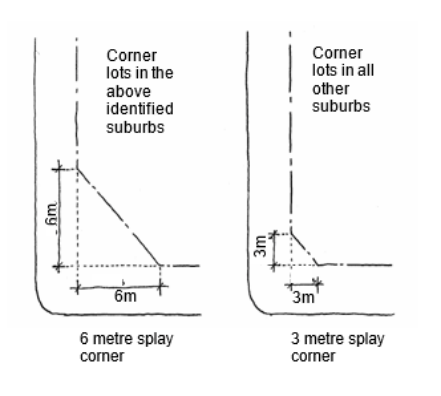

## Chapter 8 – Neighbourhood and Local Centres

c) Provide the opportunity for Council to acquire land for local road widening, which will improve the road network.

#### Controls

a) All corner lots at the intersections of public roads will be required to maintain a setback to the corner of the public road to improve site distances at intersections. In this splay corner setback no buildings, fences or other structures will be permitted. Landscaping will be restricted to lawn or low growing shrubs and other plant species.

Splay corner setbacks will generally be required to be 6 metres by 6 metres in the following suburbs: Wetherill Park, Bossley Park, Prairiewood, Wakeley, Greenfield Park, Edensor Park, St Johns Park, Abbotsbury and Bonnyrigg Heights. Splay corner setbacks in the others suburbs will generally be required to be 3 metres by 3 metres.

Note 1: A number of properties in Fairfield City are affected by restrictions covering vehicular access denied (e.g. to a major road or heavy pedestrianised areas where alternative access should be provided as part of a new development), road widening, splay corner (to

> [Picture on page 16: a picture, saved as a picture (images/chapter-08-neighbourhood-and-local-centres-page-16-15.gif, 150 dpi).]

improve sight lines on corner blocks) and road closure provisions.

Note 2: These restrictions are updated from time to time based on advice from TfNSW and investigations carried out by Council and need to be considered as part of new development.

Up-to-date information is relation to the above can be obtained from Council by requesting a section 10.7 Planning Certificate.
