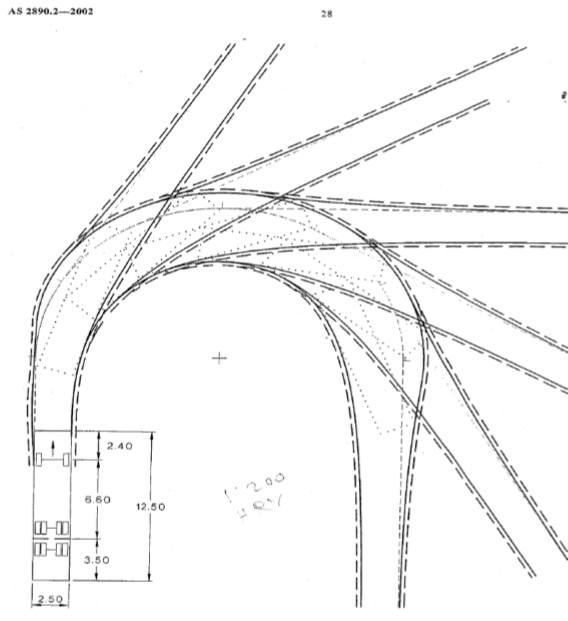

## Chapter 9  - Industrial Development

#### 9.2.4 On-Site Manoeuvring

Adequate on-site manoeuvring is to be provided to enable a large rigid truck to enter and leave the site in a forward direction. Where this is not possible because of insufficient lot width then Council will restrict future use of buildings to those uses which do not require servicing by large rigid or articulated vehicles. AS2890.2 Means the current Australian Standard 2890.2 – Commercial Vehicle Facilities

#### 9.2.5 Vehicular Access

#### Objectives

a) To manage access arrangements according to the road functions, degree of traffic, and

b) To ensure safe access arrangement

> [Picture on page 10: a picture, saved as a picture (images/chapter-09-industrial-development-page-10-19.gif, 150 dpi).]

Figure 1 - Vehicle turning movement large rigid truck or bus. Source: Australian Standards
