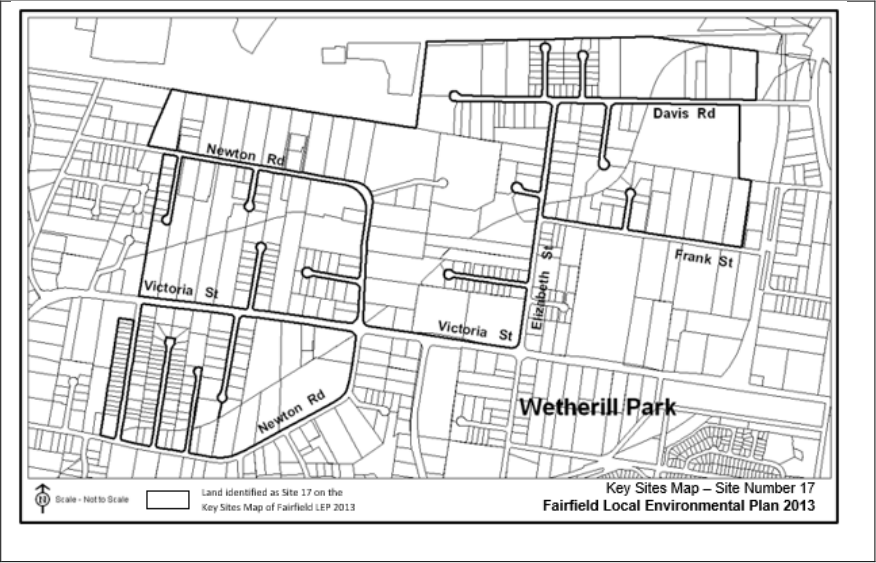

## Chapter 9  - Industrial Development

a) Ensure both customers and employees have sufficient parking.

b) Ensure there is sufficient storage for customer vehicles that are being repaired.

c) Ensure that any environmental hazards are identified, controlled and minimised.

#### Controls

a) Single worker establishments must have a minimum gross leasable area of 200 square metres.

b) A minimum gross leasable area of 100sqm is required per additional tradesman employee.

c) Vehicle storage facilities are to be provided in conjunction with all vehicle body repair workshops; and

d) All spray painting is to be carried out in a fully enclosed spray booth. The location of the spray booth and associated vehicle storage; areas are to be shown on the floor plan to be submitted with the development application.

e) The site should be designed to accommodate the intended movements of a tow truck.

f) Adequate space should be designated on site to accommodate a car washing facility.

g) All vehicle washing, wet rubbing and engine degreasing shall be conducted within a suitably restricted wash bay connected to the sewers of Sydney Water via an approved pre-treatment device; and

h) To prevent rainwater and surface water from entering the sewerage system, the vehicle wash area must be roofed and include bunding in the form of a speed hump around the wash area.

#### 9.6.4 Sex Services Premises

#### Objectives

a) Provide detailed planning controls to ensure that the location, operation and design of sex services premises do not adversely affect the amenity of the area.

b) Protect community health and welfare.

#### Controls

a) Sex services premises are permissible, with consent, only within the areas identified on the Fairfield Local Environmental Plan 2013 – Key Sites Map as Site 17.

> [Picture on page 18: a picture, saved as a picture (images/chapter-09-industrial-development-page-18-16.gif, 150 dpi).]
