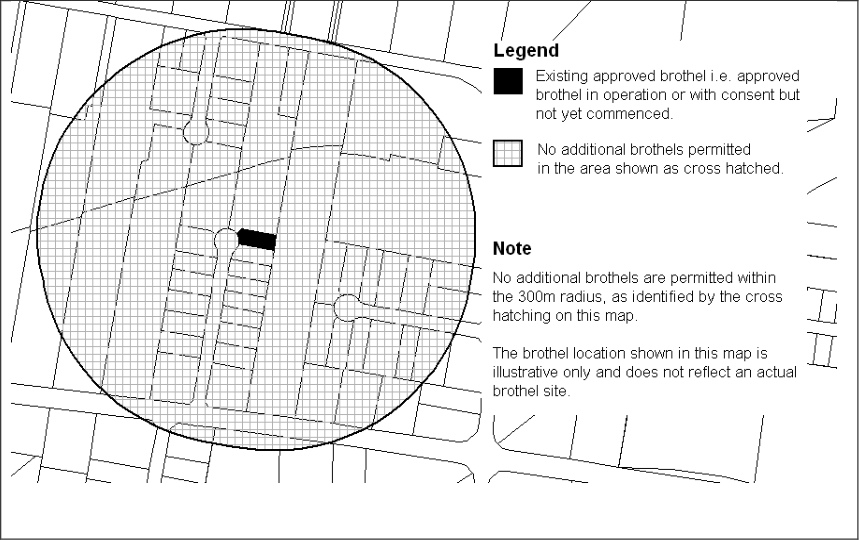

## Chapter 9  - Industrial Development

b) No sex services premises is to be located within a radius of 300 metres of any approved sex services premises site (existing or proposed) as shown by the following figure. This provision is to ensure that sex services premises do not concentrate their operations within an area to an extent where they become a noticeable element within the streetscape.

> [Picture on page 19: a picture, saved as a picture (images/chapter-09-industrial-development-page-19-1.gif, 150 dpi).]

c) A sex services premises shall not contain more than 10 rooms used or capable of being used for the purposes of prostitution.

d) All activities and displays associated with sex services premises must be contained
