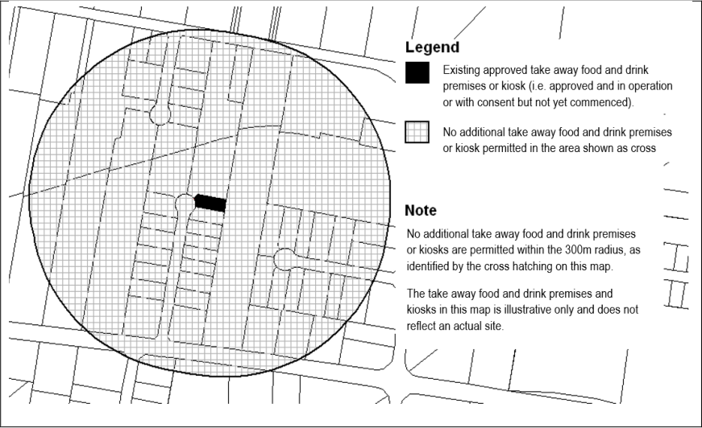

## Chapter 9  - Industrial Development

contain its own sanitary facilities in one of the following arrangements:

i. a separate en-suite bathroom containing a toilet, shower and hand basin; or

ii. a shower enclosure.

o) Where a spa bath is provided to a room, there is also to be an en-suite as described in "n" above. No variation is permitted from the above options. All required hand basins must be provided with an adequate supply of potable water, at a temperature of at least 40 degrees Celsius, delivered through an approved mixing device which can be adjusted to enable hands to be washed under hot running water. Liquid soap and single use towels must be provided at all hand basins required in the premises.

#### 9.6.5 Kiosks and Take Away Food and Drink Premises in Industrial Areas

#### Objectives

a) To ensure that the proposed developments are of a scale that will not detrimentally affect the viability of any nearby business centre.

b) To clarify that restaurants are not permitted in the industrial areas. Restaurants fall within the definition of Food and Drink Premises. They are a type of Retail Premises forming a part of the commercial premises group definition within Fairfield LEP 2013. Food and Drink Premises other than Take Away food and Drink Premises and are prohibited within the E4 General Industrial zone.

c) To provide controls to regulate take-away food and drink premises and kiosks that serve the daily needs of workers within the industrial area.

#### Controls

a) The retail floor area of a Kiosk is not to exceed 40sqm as identified within the Fairfield Local Environmental Plan 2013 – Clause 5.4 (6).

b) No individual take away food and drink premises is to exceed 100sqm in gross leasable area.

c) No more than one (1) take away food and drink premise or kiosk shall be established on an individual lot or industrial unit within an industrial factory unit complex.

A minimum distance of 300 metres shall be maintained between individual take away food and drink premises and or kiosks, as shown in the diagram below.

> [Picture on page 21: a picture, saved as a picture (images/chapter-09-industrial-development-page-21-11.gif, 150 dpi).]
