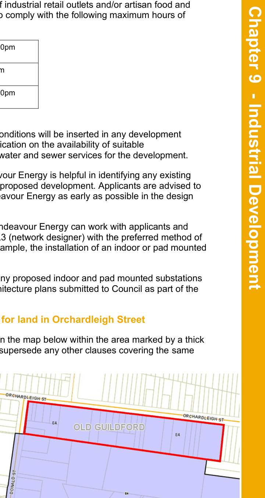

## Chapter 9  - Industrial Development

#### 9.6.6.1 Car Parking and Operating Hour Requirements for Industrial Retail Outlets and Artisan Food and Drink Industry Objectives

a) To ensure an appropriate amount of car parking is provided on-site to service industrial retail outlets and artisan food and drink industries.

b) Minimise the impact of ancillary retailing on adjoining industrial developments or residential areas.

c) Provide operating hour controls for industrial retail outlets and artisan food and drink premises.

#### Controls

a) Car parking requirements for industrial retail outlets are 1 space per 50sqm gross leasable area plus the requirement for any associated use such as Take Away Food and Drink Premises. Refer to Chapter 12 -   Car parking, Vehicle and Access Management of this DCP, for full details of car parking requirements applicable to industrial uses.

b) Car parking requirements for artisan food and drink premises are contained within Chapter 12 of this DCP.

> [Picture on page 23: a picture, saved as a picture (images/chapter-09-industrial-development-page-23-1.gif, 150 dpi).]

c) Development for the purposes of industrial retail outlets and/or artisan food and drink premises will be required to comply with the following maximum hours of operation:

| Monday to Friday | 7:00am – 9:00pm |
|---|---|
| Saturday | 8:00am – 6pm |
| Sunday | 9:00am – 5:00pm |

#### 9.6.6.2 Site Servicing

a) Utility availability - Appropriate conditions will be inserted in any development consents granted requiring certification on the availability of suitable telecommunications, electricity, water and sewer services for the development.

b) Pre DA consultation with Endeavour Energy is helpful in identifying any existing network assets impacted by the proposed development. Applicants are advised to submit load applications to Endeavour Energy as early as possible in the design phase.

Upon receiving load applications, Endeavour Energy can work with applicants and their Accredited Services Provider L3 (network designer) with the preferred method of supply to their developments: for example, the installation of an indoor or pad mounted substation.
